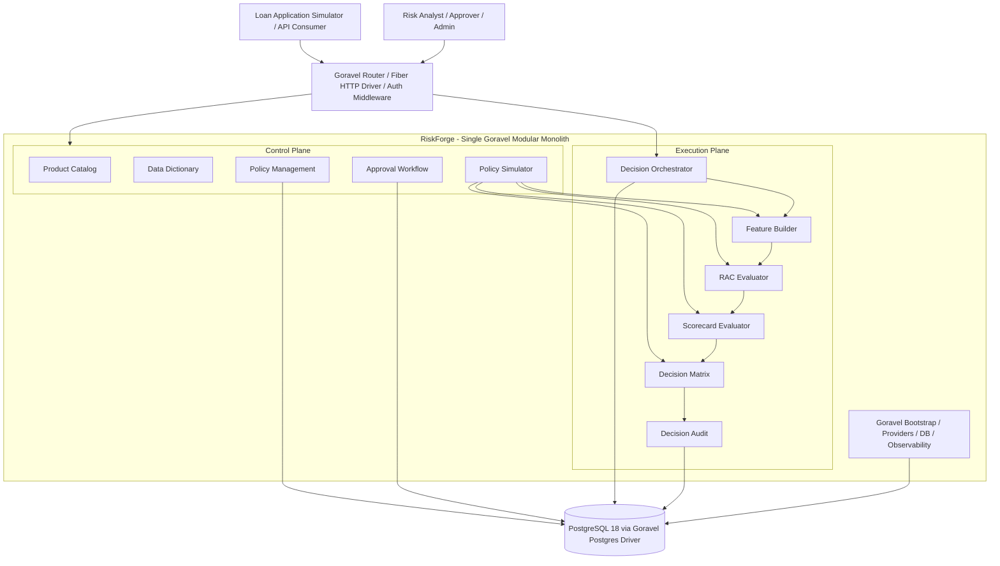
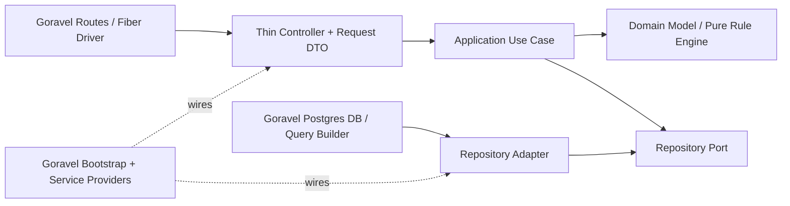
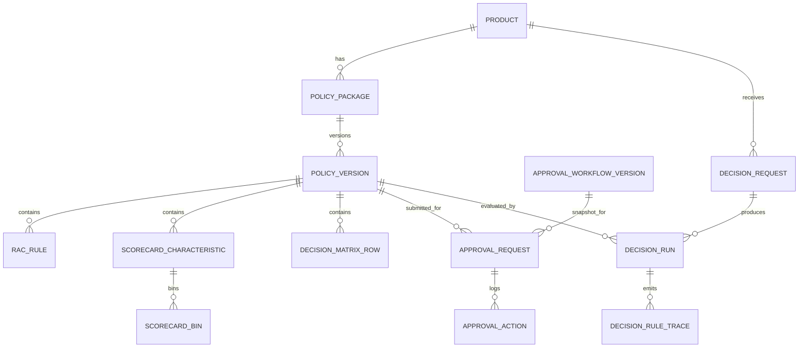
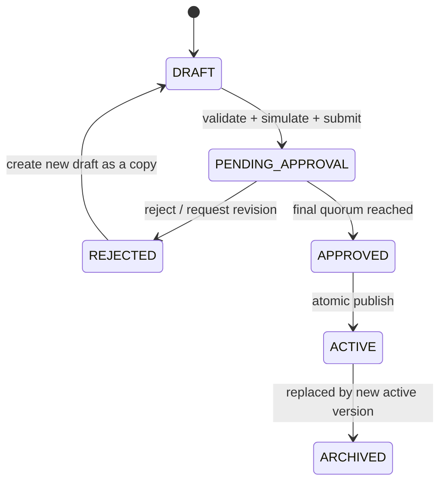
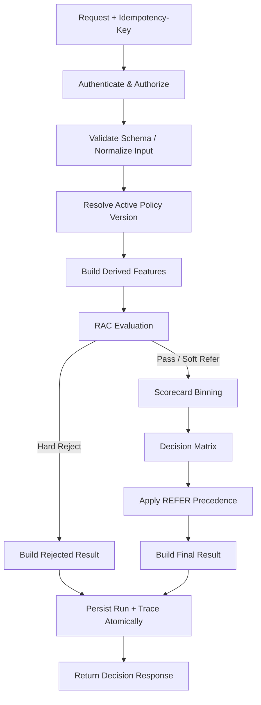
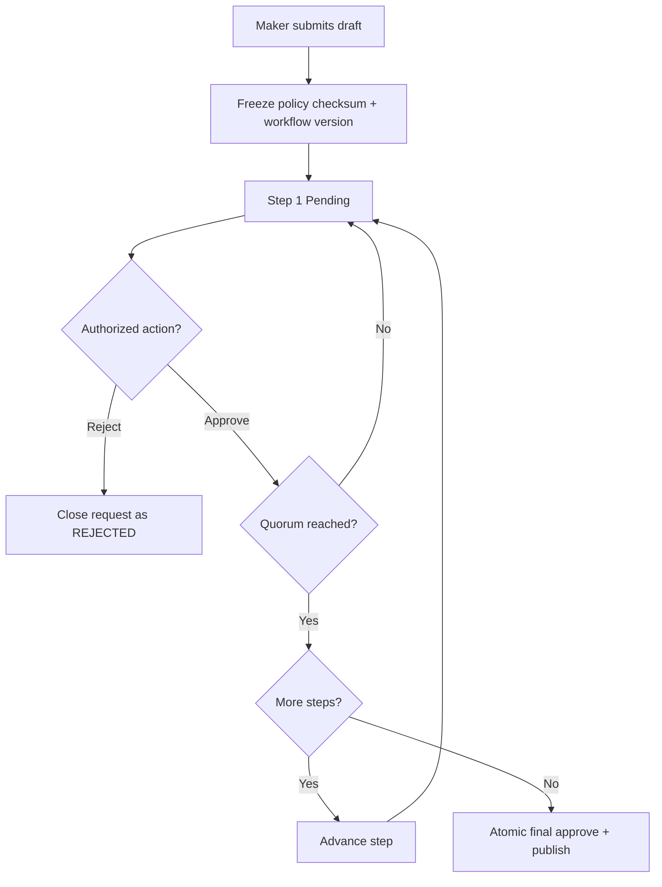
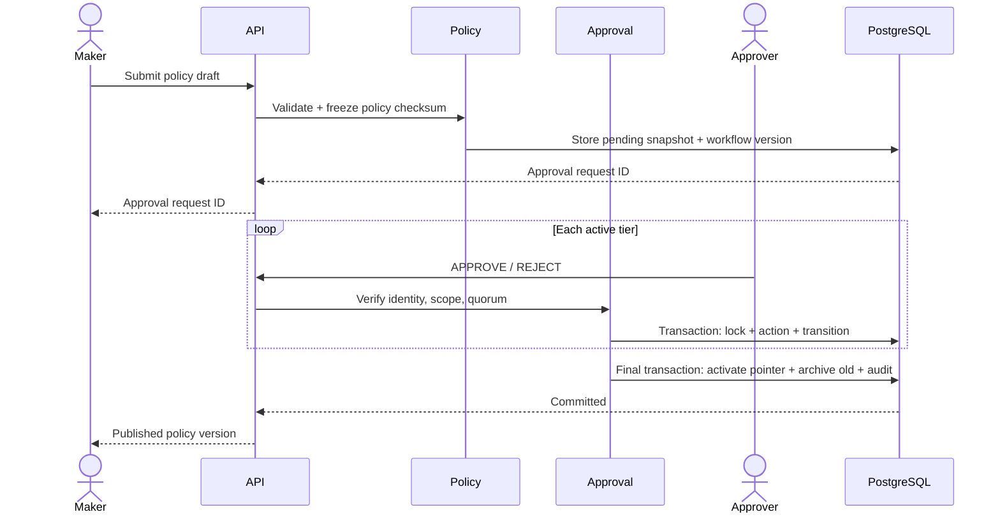
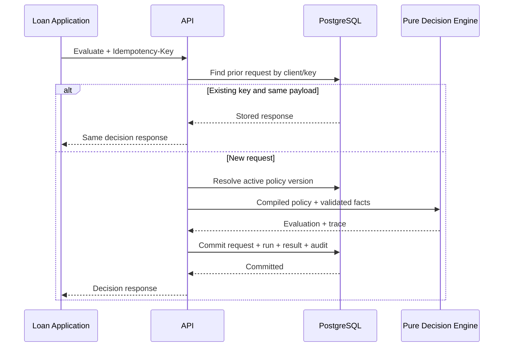

# RiskForge — System Design & Vibe Coding Blueprint

> **Project type:** Personal portfolio / Backend Engineering  
> **Document status:** Design baseline v1.3 — Milestone 1 merged, Swagger UI + versioned Postman Collection workflow  
> **Updated:** 17 November 2026  
> **Primary language:** Bahasa Indonesia  
> **Core stack:** Go 1.25.x · Goravel v1.18 (Fiber HTTP driver) · PostgreSQL 18.x · Modular Monolith · REST API · OpenAPI 3.1 · Swagger UI · Postman Collection · Docker Compose  
> **Implementation principle:** Selesaikan satu vertical slice yang berjalan dan teruji sebelum menambah fitur baru.
> **Verified repository snapshot:** `lathief/RiskForge` branch `main`, commit `07e9ebea` (17 November 2026): RF-001..RF-004 merged melalui PR #1..#4; `api/openapi/openapi.yaml` sudah ada dan mendokumentasikan 8 HTTP operations. Runtime test dicatat pada README repo, bukan dijalankan ulang ketika dokumen ini diperbarui.

---

## 0. Cara Menggunakan Dokumen Ini untuk Vibe Coding

Dokumen ini adalah **single source of truth untuk scope, desain, dan perilaku RiskForge MVP**, termasuk keputusan framework **Goravel + Fiber**. Ini *bukan* kumpulan source code dan bukan blueprint internal milik IDX Partners. RiskForge adalah proyek independen yang terinspirasi oleh pola umum credit decision engine dan diskusi awal mengenai platform iDecision.

**Workflow yang disarankan ketika bekerja dengan AI coding assistant:**

1. Berikan dokumen ini sebagai konteks proyek; minta AI membaca **scope, invariants, dan milestone** terlebih dahulu.
2. Pastikan environment terisolasi tersedia sesuai [Bagian 5.5 — Docker Compose untuk agent](#55-docker-compose-untuk-isolasi-agent); agent menjalankan Go, migrations, dan tests **dalam container**, bukan host.
3. Jika tiket membuat, mengubah, atau menghapus HTTP endpoint, lakukan **API-first change**: perbarui `api/openapi/openapi.yaml`, cek Swagger UI, **generate ulang Postman Collection**, dan commit hasilnya **dalam PR yang sama**, mengikuti [Bagian 5.6](#56-swagger-ui-openapi-dan-postman-collection).
4. Pilih **satu tiket** di [Implementation Backlog](#18-implementation-backlog-untuk-vibe-coding), jangan meminta AI membuat seluruh aplikasi sekaligus.
5. Sebelum AI menulis kode, minta ringkasan perubahan file, desain singkat, dependencies, risiko, dan test cases.
6. Implementasikan perubahan sekecil mungkin hingga satu acceptance criteria selesai.
7. Jalankan formatting, linting, unit/integration tests, dan review migration sebelum merge.
8. Perbarui checklist backlog dan Architecture Decision Records (ADR) apabila keputusan desain berubah.

**Batas framework:** bila AI menulis contoh aplikasi Fiber murni, menjadikan ORM model sebagai domain entity, atau membypass controller/service/repository boundary, perubahan itu harus ditolak dalam review.

**Prioritas saat ada konflik:** (1) keamanan/integritas data, (2) invariant domain, (3) acceptance criteria tiket, (4) kesederhanaan desain, (5) preferensi library.

### 0.1 Peta dokumentasi (DOC-001)

| Dokumen | Peran | Mengikuti |
|---|---|---|
| `SYSTEM_DESIGN.md` (dokumen ini) | **Design specification**: scope, invariant, desain target, backlog. | Keputusan desain (diubah lewat ADR). |
| `docs/*.md` | **Panduan praktis**: getting started, arsitektur, domain, contoh API, testing, decision engine. Bagian yang belum terimplementasi ditandai *Planned* beserta tiketnya. | Implementasi aktual dan test-nya. |
| `docs/adr/` | Alasan dan konsekuensi setiap keputusan teknis. | Keputusan yang sudah diambil. |
| `AGENT_RUNBOOK.md` | Perintah dan konvensi persis untuk developer dan AI agent. | Tooling aktual. |
| `api/openapi/openapi.yaml` | Kontrak HTTP (sumber tunggal Swagger UI dan Postman). | Endpoint yang live. |

Aturan agar tidak muncul dua sumber yang saling bertentangan: `docs/` tidak mengulang spesifikasi, tetapi merangkum dan merujuk bagian dokumen ini. Jika `docs/` dan kode berbeda, kode beserta test-nya yang benar dan `docs/` diperbaiki dalam PR yang sama. Setiap tiket yang mengubah perilaku yang dijelaskan sebuah guide wajib memperbarui guide tersebut, `README.md`, dan bagian terkait di dokumen ini. Indeks guide dan penjelasan isi setiap folder repository ada di `docs/README.md`.

### Hal yang tidak boleh dilakukan AI tanpa diminta

- Mengubah arsitektur menjadi microservices atau mengganti framework Goravel/Fiber tanpa ADR dan persetujuan.
- Menginstal Go/PostgreSQL pada host sebagai jalan pintas, menguji against database `rf-dev`, menggunakan project name Compose yang sama untuk parallel agents, atau menjalankan `docker compose down -v` tanpa memastikan scope project-nya.
- Memasang Docker socket, `privileged`, `host network`, atau membuat volume/network Docker `external` untuk development MVP.
- Memperkenalkan Redis, Kafka, Kubernetes, Elasticsearch, MongoDB, atau layanan cloud untuk menyelesaikan masalah yang bisa ditangani PostgreSQL dan Go.
- Membuat standalone `fiber.App`/Fiber bootstrap paralel dengan Goravel; Fiber harus melalui HTTP driver resmi Goravel.
- Mengimpor Goravel/Fiber facades atau HTTP context ke dalam domain `ruleengine` dan business entities.
- Meng-hardcode persyaratan kredit ke source code.
- Melakukan bypass approval untuk mengaktifkan policy.
- Menghapus audit history, mengedit versi policy yang sudah dikunci, atau menampilkan data sensitif di log.
- Menambahkan fitur di luar tiket tanpa persetujuan eksplisit.
- Mengarang integrasi API asli SLIK/OJK, credit bureau, ataupun data debitur sungguhan.
- Menambah, mengubah, atau menghapus endpoint HTTP tanpa memperbarui OpenAPI 3.1, menguji akses Swagger UI (ketika tooling-nya tersedia), membuat ulang Postman Collection, dan memverifikasi cakupan operationId dalam PR yang sama. Jangan mengedit hasil generate Postman secara manual.

---

## 1. Executive Summary

**RiskForge** adalah platform backend **berbasis Goravel (Go) dengan Fiber HTTP driver** untuk membuat, mengelola, menguji, menyetujui, dan mengeksekusi kebijakan keputusan kredit secara dinamis. Aplikasi eksternal seperti Loan Application mengirim data pengajuan; RiskForge mengevaluasi **Risk Acceptance Criteria (RAC)**, menghitung **Scorecard**, memetakan skor dengan **Decision Matrix**, lalu mengembalikan keputusan dan jejak audit.

Perubahan aturan dilakukan melalui **policy draft → simulation → parameterized multi-level approval → publish**. Tim risk dapat memperbarui policy tanpa mengubah source code aplikasi, sementara keputusan historis tetap dapat ditelusuri ke versi kebijakan yang digunakan.

### Tujuan portofolio

Menunjukkan kemampuan seorang Backend Engineer melalui:

- Modular monolith design dengan batas domain jelas.
- Domain modeling dan relational data design.
- Dynamic rule evaluation yang deterministik.
- Transactions, locking, concurrency, dan idempotency.
- State machine & parameterized approval workflow.
- Security, observability, automated tests, dan documentation.

### Sukses MVP

Seorang **Risk Analyst** dapat membuat policy untuk produk kredit sintetis, menguji contoh pengajuan, mengirimnya ke approval, dan menerbitkan policy setelah semua approver setuju. **Loan Application Simulator** dapat memanggil API keputusan dan memperoleh respons `APPROVE`, `REFER`, atau `REJECT` yang dapat ditelusuri ke policy version dan decision trace.

---

## 2. Product Scope

### 2.1 In scope — MVP (P0)

| ID | Feature | Hasil yang diharapkan |
|---|---|---|
| F01 | Authentication & RBAC | Admin, Risk Analyst, Approver, Auditor, API Consumer punya hak akses berbeda. |
| F02 | Product Catalog | Membuat dan mengelola produk kredit, tanpa hardcode product code. |
| F03 | Data Dictionary & Feature Builder | Definisi variabel, validasi tipe data, dan variabel turunan dasar seperti DSR. |
| F04 | Policy/Rule Management | Draft, clone, RAC, scorecard bins, decision matrix, validasi konfigurasi. |
| F05 | RAC Engine | Evaluasi hard reject dan refer beserta reason code. |
| F06 | Scorecard Engine | Menghasilkan total score dan breakdown karakteristik. |
| F07 | Decision Matrix | Menghasilkan grade dan keputusan berdasarkan rentang skor. |
| F08 | Parameterized Multi-Level Approval | Maker-checker, tier dinamis, role checks, quorum, locking, publishing. |
| F09 | Policy Simulator | Mengevaluasi draft tanpa mengubah policy aktif maupun transaksi produksi. |
| F10 | Decision History & Audit | Persistensi keputusan, trace, versi kebijakan, dan histori perubahan. |

### 2.2 Technical capabilities wajib MVP

- REST API menggunakan Goravel router + Fiber HTTP driver, **OpenAPI 3.1 sebagai single source of truth**, Swagger UI interaktif, dan **Postman Collection yang diregenerasi pada setiap perubahan endpoint**.
- Goravel/Artisan database migrations pada PostgreSQL; constraints dan indexes yang masuk akal.
- Idempotent decision evaluation.
- Explicit error taxonomy (business decision tidak sama dengan technical failure).
- Unit tests, integration tests dengan PostgreSQL, race tests, dan CI.
- Structured logging, request/correlation ID, health check, metrics dasar.
- Docker Compose untuk menjalankan API dan PostgreSQL secara lokal **dengan project namespace terisolasi per agent/test session, volumes terpisah, database tanpa host port**, serta perintah test/migration hanya dalam container.
- Synthetic seed data dan demo scenario lengkap.

### 2.3 Out of scope — v1.0

- UI drag-and-drop, orchestration DAG, dan visual policy builder.
- ML scoring, real credit bureau/SLIK/Dukcapil integration, KYC/AML.
- Multi-tenant SaaS, multi-region deployment, microservices.
- Advanced champion-challenger, production batch backtesting, real-time streaming.
- Sistem Loan Application lengkap (online origination), loan servicing, collection, atau core banking.
- Perhitungan pricing/limit kompleks; boleh menambahkan **output konfigurasi statis** di matrix sebagai demonstrasi, bukan engine pricing penuh.

**Prinsip scope:** implementasikan satu produk demonstrasi `KTA_DEMO` dahulu. Desainnya mendukung penambahan produk lain melalui konfigurasi, tanpa harus langsung membuat KPR, leasing, atau semua jenis kredit.

---

## 3. Asumsi & Keputusan Awal

| Area | Keputusan MVP | Alasan |
|---|---|---|
| Organization | Single-institution demo | Isolasi multi-tenant membutuhkan kompleksitas tambahan. |
| Deployment | Satu deployable Goravel API (single process) | Selaras dengan modular monolith. |
| Agent runtime | Docker Compose v2: Go `api` + PostgreSQL `db` | Isolasi network, volume, proses, dependency dari host; uji dalam project name terpisah. |
| Go framework | Goravel v1.18, full framework scaffold | Memanfaatkan struktur, service container, routing, middleware, migrations, dan testing Goravel. |
| HTTP driver | Fiber melalui `github.com/goravel/fiber` | Gunakan driver resmi Goravel, bukan aplikasi Fiber terpisah. |
| DB | Satu PostgreSQL 18.x | Transaksi kuat, constraints, relational data, JSONB untuk snapshot. |
| DB access | `github.com/goravel/postgres` + Goravel DB/Query Builder; ORM selektif | Integrasi native Goravel untuk CRUD dan transaksi; SQL eksplisit untuk operasi kompleks tanpa mengunci domain ke ORM. |
| Schema migrations | Goravel Artisan migrations di `database/migrations/` | Tetap mengikuti lifecycle dan struktur standar framework. |
| Rule DSL | `expr-lang/expr` | Cocok untuk expression Go; kompilasi dilakukan sebelum policy aktif. |
| API | Goravel routing + Fiber driver + REST/JSON + OpenAPI 3.1 | `api/openapi/openapi.yaml` adalah kontrak utama; HTTP handlers memakai kontrak Goravel, tidak mengekspos Fiber ke domain. |
| API developer experience | Swagger UI + Postman Collection v2.1 (generated) | Dokumentasi interaktif dan koleksi request harus selalu sejalan dengan kontrak/route, tanpa server baru. |
| Cache | Compiled policy cache di memori aplikasi | Tidak perlu Redis; key berdasarkan immutable policy version. |
| Authentication | Modul identity di atas Goravel Auth/Hash atau kontrak auth custom teruji | Manfaatkan kemampuan framework seperlunya; role + scope tetap dipastikan server-side. |
| Async events | Tidak dibutuhkan untuk alur kritis MVP | Konsistensi utama dilakukan secara sinkron dalam transaksi PostgreSQL. |
| Admin UI | Tidak dibangun dulu | Swagger UI adalah halaman dokumentasi API developer, **bukan** admin policy builder. |
| Financial precision | PostgreSQL `NUMERIC` dan decimal representation di domain Go | Menghindari kesalahan pembulatan floating point. |

> **Pin versions:** Saat membuat repository, kunci versi framework Goravel, package `goravel/fiber`, `goravel/postgres`, Go, dan PostgreSQL yang kompatibel dalam `go.mod`, image Docker, dan CI. Target awal mengikuti dokumentasi Goravel v1.18 dan Go 1.25.x (lihat docs/adr/0001-go-version.md; target awal 1.27.x) / PostgreSQL 18.x; validasi kompatibilitas aktual lewat `go mod tidy`, build, dan integration tests. Jangan mengasumsikan package `@latest` selalu saling kompatibel.

**Keputusan yang sengaja ditunda:** format UI, dukungan multi-tenant, real external integrations, policy linting lanjutan, output pricing/limit kompleks, dan target SLA produksi final. Tidak perlu mengunci desain fitur-fitur tersebut sebelum MVP tervalidasi.

### 3.1 Keputusan integrasi Goravel + Fiber (wajib)

- **Gunakan Goravel sebagai application framework** untuk bootstrap, dependency wiring, route registration, middleware, validation, database migrations, dan fasilitas testing yang relevan.
- **Fiber adalah HTTP driver resmi Goravel**, bukan framework kedua yang diinisialisasi manual. Gunakan `github.com/goravel/fiber`, pilih/set driver `fiber` di `config/http.go`, dan pertahankan konfigurasi bawaan Goravel sesuai versi terpasang.
- **PostgreSQL memakai driver Goravel** `github.com/goravel/postgres`; panggil melalui DB/query builder/ORM adapter pada infrastructure layer. Untuk transaksi yang membutuhkan locking/SQL spesifik, gunakan transaction handle yang sama dalam satu boundary; jangan menjalankan sebagian operasi di koneksi terpisah.
- **Goravel facade dan `http.Context` hanya di transport/infrastructure/composition boundary**. Domain entity, rule compiler, rule evaluator, dan approval state machine harus framework-agnostic.
- **Folder standar Goravel dipertahankan.** Jangan mengganti bootstrap utama dengan `cmd/riskforge-api` atau memindahkan migrations ke `db/migrations` hanya karena mengikuti template Go generik.
- **Default untuk MVP:** pilih full Goravel scaffold, bukan Goravel Lite, agar tidak perlu merakit modul framework satu per satu; fitur framework yang tidak dipakai tidak perlu diaktifkan.
- **Dokumentasi implementasi:** ketika ada perbedaan API antarrilis Goravel, ikuti dokumentasi dan package source dari versi yang benar-benar dipin di repository; jangan menebak signature fungsi.

**Bootstrap yang direncanakan (panduan, bukan perintah yang sudah dieksekusi):**

1. Buat project melalui installer resmi Goravel; pilih HTTP driver Fiber apabila ditawarkan.
2. Jika scaffold memakai Gin secara default, instal `github.com/goravel/fiber` dengan mekanisme package installer Goravel dan ubah default driver di `config/http.go` menjadi `fiber`.
3. Pasang `github.com/goravel/postgres` dan konfigurasi koneksi PostgreSQL di `config/database.go`.
4. Verifikasi server boot, route API, middleware request ID, koneksi database, dan Artisan migrate dengan versi package yang sudah dipin.

**Referensi teknis:** [Goravel Installation](https://www.goravel.dev/getting-started/installation), [Goravel Routing](https://www.goravel.dev/the-basics/routing.html), [goravel/fiber](https://github.com/goravel/fiber), [goravel/postgres](https://github.com/goravel/postgres).

---

## 4. Users, Roles & Use Cases

| Role | Aksi utama | Larangan penting |
|---|---|---|
| `ADMIN` | Kelola user/role, product metadata, approval workflow configuration | Tidak otomatis boleh melewati approval policy. |
| `RISK_ANALYST` | Buat/clone/edit draft, simulasi, submit approval | Tidak boleh approve submission sendiri. |
| `RISK_APPROVER` | Review diff, approve/reject sesuai tier & scope | Tidak boleh mengedit draft yang sedang diperiksa. |
| `AUDITOR` | Read-only decision trace, policy history, approval history | Tidak dapat membuat/mengubah policy. |
| `API_CONSUMER` | Memanggil decision evaluation untuk produk yang diotorisasi | Tidak dapat memodifikasi policy atau approval. |

**Use cases:**

1. Analyst membuat draft policy baru berdasarkan policy aktif.
2. Analyst mengedit RAC, scorecard bins, dan decision matrix.
3. Sistem menolak expression salah tipe, bin overlap, matrix gap, atau rule tanpa reason code.
4. Analyst menjalankan simulasi tanpa berpengaruh pada traffic produksi.
5. Analyst mengirim draft untuk persetujuan berjenjang.
6. Approver melihat perubahan policy dibandingkan versi aktif dan memutuskan approve/reject.
7. Approval terakhir memicu publikasi atomik versi baru.
8. Loan Application mengirim pengajuan dengan `Idempotency-Key` dan mendapatkan hasil keputusan.
9. Auditor mencari hasil evaluasi beserta input sintetis, applied policy version, dan rule trace.

---

## 5. High-Level Architecture



### 5.1 Modular Monolith principles

1. **One process, one deployment** untuk Goravel API dengan HTTP driver Fiber; boleh menggunakan *background goroutines* dalam proses hanya untuk tugas non-kritis yang sudah terkontrol.
2. Setiap module punya model, use case, repository interfaces, dan kepemilikan data sendiri.
3. Cross-module interactions menggunakan exported application interfaces, bukan import ke internal repository module lain.
4. Tidak boleh ada circular dependencies.
5. `ruleengine` merupakan **pure/domain component**: menerima typed facts + compiled policy, menghasilkan result tanpa akses Goravel/Fiber/HTTP/SQL.
6. `decision` menangani orchestration dan transaction boundary; `policy` mengelola lifecycle; `approval` mengelola hak keputusan perubahan.
7. Shared infrastructure hanya untuk cross-cutting concerns; jangan membuat `common` package berisi business logic acak.
8. Goravel controller/request/middleware hanya memetakan transport ke application use case; jangan menaruh scoring/approval business logic di controller.
9. Service provider/composition root bertanggung jawab melakukan wiring repository dan use case; constructor injection lebih jelas daripada memanggil facades dari semua module.

### 5.2 Modul dan dependencies

| Module | Owns | Depends on |
|---|---|---|
| `identity` | user, credential, roles, API clients | auth/hash adapters dari Goravel; domain bebas framework |
| `catalog` | products & product status | identity (authorization contract) |
| `dictionary` | variable definitions, feature formulas | catalog |
| `policy` | packages, versions, RAC, scorecard, matrix | catalog, dictionary |
| `ruleengine` | compile, validate, evaluate | **no database dependencies** |
| `simulation` | draft evaluations, sample expected results | policy, dictionary, ruleengine |
| `approval` | workflow templates/versions, requests, actions | identity, policy via application contracts |
| `decision` | request, resolved version, evaluation, result, idempotency | catalog, dictionary, policy, ruleengine |
| `audit` | append-only domain events & decision trace access | decision/policy/approval events |

**Mapping Goravel:** `routes/` dan `app/http/controllers` = transport; `app/modules/*/application` = use case; `app/modules/*/domain` = pure business logic; `app/modules/*/infrastructure` = Goravel/Postgres adapters; `bootstrap/` dan `app/providers` = dependency composition.

### 5.3 Suggested repository layout — mengikuti Goravel

```text
riskforge/
├── main.go                        # entrypoint standar Goravel
├── artisan                        # Goravel Artisan CLI
├── bootstrap/                     # framework bootstrap, route/provider registration
│   ├── app.go
│   └── providers.go               # sesuai scaffold versi terpasang
├── config/
│   ├── http.go                    # default HTTP driver = fiber
│   └── database.go                # PostgreSQL connection
├── routes/
│   └── api.go                     # route mapping saja; register via bootstrap
├── app/
│   ├── http/
│   │   ├── controllers/           # thin HTTP adapters -> use cases
│   │   ├── middleware/            # auth/RBAC, request ID, security
│   │   └── requests/              # transport input validation/DTOs
│   ├── modules/                   # domain modules: isolated logical boundaries
│   │   ├── identity/              # domain, application, infrastructure
│   │   ├── catalog/
│   │   ├── dictionary/
│   │   ├── policy/
│   │   ├── ruleengine/            # pure evaluator, no framework coupling
│   │   ├── simulation/
│   │   ├── approval/
│   │   ├── decision/
│   │   └── audit/
│   ├── providers/                 # app-level service wiring (as needed)
│   └── models/                    # optional persistence-only Goravel ORM models
├── database/
│   ├── migrations/                # Goravel Artisan versioned migrations
│   └── seeders/                   # synthetic seed fixtures
├── api/
│   ├── openapi/
│   │   └── openapi.yaml           # Existing: OpenAPI 3.1 single source of truth
│   └── postman/                   # DX-001 (implemented): generated, do not edit by hand
│       ├── RiskForge.postman_collection.json    # Generated from OpenAPI; commit
│       └── RiskForge.local.postman_environment.json # Template non-secret; optional
├── tests/                          # framework/integration/E2E tests
├── docs/                         # DOC-001: practical guides that follow the code (see 0.1)
│   ├── README.md                   # index + repository layout explanation
│   ├── GETTING_STARTED.md, ARCHITECTURE.md, DOMAIN_GUIDE.md, API_EXAMPLES.md
│   ├── TESTING.md, DECISION_ENGINE.md
│   ├── adr/                        # Architecture Decision Records
│   └── (planned) SECURITY, DATABASE, DEMO_SCENARIOS, OBSERVABILITY, TRADEOFFS
├── compose.yaml                    # Dev & agent runtime: api + db, per-project isolation
├── scripts/
│   ├── init-agent-env.sh           # Generate untracked local secrets
│   ├── generate-postman.sh         # DX-001: deterministic one-shot generator (--check)
│   ├── postman/normalize.js        # DX-001: normalization step used by the generator
│   └── update-swagger-ui.sh        # DX-001: vendors pinned swagger-ui-dist into public/swagger
├── .env.agent.example              # Template non-secret; .env.agent generated/ignored
├── AGENT_RUNBOOK.md                # Commands for dev/test agent sessions
├── deployments/local/             # Future deployment artefacts (optional)
├── .github/workflows/
├── .env.example
├── go.mod
└── README.md
```

**Penting:** Ini struktur target **berdasarkan direktori scaffold Goravel v1.18**. Jangan menghapus/mengganti file bootstrap dan provider bawaan hanya agar tree terlihat sama dengan contoh. Nama/path yang dibuat oleh installer aktual menjadi acuan final. Buat modul secara bertahap, bukan semua folder kosong sekaligus. File di bawah `api/postman/` dan script generator adalah **target implementasi DX-001**, belum diklaim tersedia di `main`. Swagger UI boleh menggunakan asset lokal yang dipin di `public/` atau embed bila cocok dengan Goravel versi terpasang.

### 5.4 Framework boundary & dependency direction



- Controller menerima `Goravel contracts/http.Context`, memvalidasi transport input, dan membentuk response; **jangan meneruskan Fiber context atau framework request object** ke domain/application.
- Application use cases mengandalkan interface kecil (`PolicyRepository`, `DecisionRepository`, `TransactionManager`, dll.); infrastructure adapters mengimplementasikannya memakai Goravel database access.
- Gunakan framework middleware untuk authentication, authorization, correlation ID, dan request size/rate limit; verifikasi cakupan middleware terhadap Fiber driver melalui HTTP integration tests.
- Hindari penggunaan facade Goravel di pure domain code. Simulasi dan live evaluation harus memanggil engine yang sama.
- Unit testing pure domain berjalan tanpa bootstrap Goravel. HTTP integration testing menjalankan stack Goravel + Fiber sungguhan.

### 5.5 Docker Compose untuk isolasi agent

**Tujuan:** supaya AI coding agent dapat menjalankan Goravel + Fiber, migrasi PostgreSQL, dan test suite dalam lingkungan yang **reproducible dan terpisah** dari Go/PostgreSQL host. Ini adalah baseline development/test, **bukan file deployment production**. Bagian ini ditambahkan pada v1.2 sebagai perubahan kebutuhan baru; fitur bisnis tetap sama.

**Komponen aktif hanya dua:** `api` (container Go yang menjalankan satu backend Goravel/Fiber) dan `db` (PostgreSQL 18). Tidak ada microservice tambahan. Docker Compose membuat network serta volume terisolasi berdasarkan `-p <project-name>`. Sumber aplikasi di-bind mount agar coding agent dapat mengubah dan langsung menguji kode. PostgreSQL tidak diekspos ke port host; API hanya di-bind ke loopback `127.0.0.1`. Keberadaan file Compose **tidak otomatis membuat aplikasi berjalan sebelum Goravel scaffold dan driver disiapkan**. <https://docs.docker.com/compose/how-tos/project-name/>

**File yang wajib tersedia di root repository setelah bootstrap:** `compose.yaml`, `.env.agent.example`, `scripts/init-agent-env.sh`, `AGENT_RUNBOOK.md`; serta `.env` milik scaffold Goravel. Agent perlu membaca instruksi di runbook sebelum menggunakan Docker. `.env` dan `.env.agent` **wajib masuk `.gitignore`**, jangan di-commit.

#### 5.5.1 File `compose.yaml` (baseline agent/dev)

```yaml
# RiskForge developer/agent environment (not a production deployment).
# Start each worktree/session with a UNIQUE Compose project name (-p).
# Keep the original Goravel scaffold and app entrypoint; do not create a second Fiber server.
services:
  api:
    image: ${GO_IMAGE:-golang:1.25-bookworm}
    working_dir: /workspace
    init: true
    command: ["go", "run", "."]
    environment:
      APP_NAME: RiskForge
      APP_ENV: local
      APP_DEBUG: "true"
      APP_HOST: "0.0.0.0"
      APP_PORT: "3000"
      APP_KEY: ${APP_KEY:?Run ./scripts/init-agent-env.sh first}
      DB_CONNECTION: postgres
      DB_HOST: db
      DB_PORT: "5432"
      DB_DATABASE: ${DB_DATABASE:-riskforge}
      DB_USERNAME: ${DB_USERNAME:-riskforge}
      DB_PASSWORD: ${DB_PASSWORD:?Run ./scripts/init-agent-env.sh first}
    volumes:
      - ./:/workspace
      - go_modules:/go/pkg/mod
      - go_build:/root/.cache/go-build
    ports:
      - "127.0.0.1:${RISKFORGE_HOST_PORT:-3000}:3000"
    depends_on:
      db:
        condition: service_healthy
    networks:
      - backend
    security_opt:
      - no-new-privileges:true
    cap_drop:
      - ALL

  db:
    image: ${POSTGRES_IMAGE:-postgres:18}
    environment:
      POSTGRES_DB: ${DB_DATABASE:-riskforge}
      POSTGRES_USER: ${DB_USERNAME:-riskforge}
      POSTGRES_PASSWORD: ${DB_PASSWORD:?Run ./scripts/init-agent-env.sh first}
    volumes:
      # PostgreSQL 18+ uses /var/lib/postgresql, not /var/lib/postgresql/data.
      - postgres_data:/var/lib/postgresql
    healthcheck:
      test: ["CMD-SHELL", "pg_isready -U \"$${POSTGRES_USER}\" -d \"$${POSTGRES_DB}\""]
      interval: 5s
      timeout: 3s
      retries: 20
      start_period: 10s
    networks:
      - backend
    # Intentionally no `ports:`: PostgreSQL is reachable only inside this Compose network.
    security_opt:
      - no-new-privileges:true

networks:
  backend:
    driver: bridge

volumes:
  postgres_data:
  go_modules:
  go_build:
```

**Pilihan desain dan batasannya:**

- API image memakai Go toolchain agar **agent tidak perlu memasang Go di host**; perintah `go run .`, `go test ./...`, dan `./artisan migrate` dijalankan dari container. Driver Fiber tetap dikonfigurasi melalui Goravel, **bukan `fiber.App` kedua**.
- Image PostgreSQL 18 me-mount data pada `/var/lib/postgresql` (bukan `/var/lib/postgresql/data` untuk versi 18+). <https://hub.docker.com/_/postgres>
- `depends_on: condition: service_healthy` menunggu DB sehat sebelum `api` startup. Tidak menggantikan validasi koneksi aktual maupun retry aplikasi. <https://docs.docker.com/compose/how-tos/startup-order/>
- `postgres_data`, `go_modules`, dan `go_build` otomatis mendapat prefix Compose project; project name harus **unik per agent/task**, jangan memakai `container_name` atau external volume.
- Bind mount source (`./:/workspace`) bersifat writeable karena tujuan agent adalah mengubah codebase. Jadi Compose mengisolasi **runtime, dependency, dan data test**, bukan memberikan perlindungan dari agent yang tidak dipercaya.
- Docker socket tidak dipasang dalam container. Docker Engine tetap harus berjalan di host; untuk sandbox keamanan agent yang tidak tepercaya gunakan VM/remote disposable workspace.
- `APP_KEY` dan `DB_PASSWORD` harus acak di file `.env.agent` yang diabaikan Git; nilai contoh di `.env.agent.example` **bukan** credential sungguhan. Jangan jalankan untuk data sensitif nyata.
- Pin image tags/digests setelah environment berhasil diboot dan diverifikasi; pastikan versi yang dipakai kompatibel dengan scaffold aktual.

#### 5.5.2 Alur kerja agent (sebelum satu tiket dimulai)

Setelah **full Goravel scaffold** terpasang, salin file kit lalu jalankan dari root repository:

```sh
./scripts/init-agent-env.sh
# Project name stabil untuk development pribadi
docker compose -p rf-dev --env-file .env.agent config --quiet
docker compose -p rf-dev --env-file .env.agent up -d
# Setelah migration tersedia
docker compose -p rf-dev --env-file .env.agent exec -T api ./artisan migrate
# Setelah RF-001 membuat health endpoint
curl -fsS http://127.0.0.1:3000/health/live
```

Untuk **test isolasi** tanpa menyentuh database development, gunakan project name unik dan tidak perlu menjalankan container API permanen:

```sh
docker compose -p rf-test-rf012 --env-file .env.agent up -d db
docker compose -p rf-test-rf012 --env-file .env.agent run --rm --no-deps api ./artisan migrate
docker compose -p rf-test-rf012 --env-file .env.agent run --rm --no-deps api go test ./...
# Menghapus HANYA database, network, cache milik rf-test-rf012
docker compose -p rf-test-rf012 --env-file .env.agent down -v --remove-orphans
```

**Wajib:** `rf-dev` dan `rf-test-rf012` adalah environment berbeda; gunakan nama lain untuk agent/test lain. Perintah `down -v` destruktif dan tidak boleh dijalankan tanpa project scope eksplisit. Jika beberapa API dinyalakan bersamaan, set `RISKFORGE_HOST_PORT` berbeda di tiap session atau jalankan hanya test one-off tanpa publish port.

#### 5.5.3 Acceptance criteria isolasi

- [ ] Compose valid dengan `docker compose -p rf-dev --env-file .env.agent config --quiet`.
- [ ] API Goravel/Fiber sukses boot dan endpoint `/health/live` dapat diakses pada `127.0.0.1`.
- [ ] PostgreSQL healthcheck lulus; tidak ada port PostgreSQL yang dipublish di host.
- [ ] `./artisan migrate` serta `go test ./...` berjalan dari container Go, tidak mengandalkan Go atau PostgreSQL host.
- [ ] Dua project berbeda menghasilkan network dan DB volume terpisah.
- [ ] Cleanup `rf-test-*` tidak memengaruhi data `rf-dev`.
- [ ] Agent tidak memasang Docker socket, privileged mode, ataupun bypass boundary domain.

**Status terbaru (17 November 2026):** RF-001 dan RF-002 telah merged di `main`; README repository mencatat verifikasi container, migration, dan test terisolasi. Catatan ini **bukan** klaim pengujian ulang secara independen. Baseline `api + db` tetap dipertahankan ketika menambahkan Swagger/Postman; tooling generator berjalan sebagai *one-off container*, bukan service ketiga.


### 5.6 Swagger UI, OpenAPI, dan Postman Collection

> **Status implementasi DX-001 (17 November 2026, branch `fix/M1-hardening`):** selesai. `GET /swagger`, `GET /swagger/assets/{file}`, `GET /openapi.yaml` aktif bila `DOCS_ENABLED=true` (startup menolak nilai ini di luar `local`/`testing`); Swagger UI `swagger-ui-dist` **5.35.0** di-vendor ke `public/swagger/vendor`; generator `scripts/generate-postman.sh` memakai `openapi-to-postmanv2` **6.3.3** + `js-yaml` 4.1.0 dan menghasilkan koleksi v2.1 dengan **8 request** yang byte-identik antar-run (`--check`); parity `(METHOD, path)` antara route terdaftar, spec, dan koleksi diuji di `tests/feature/api_contract_test.go`. Keputusan dan batas: `docs/adr/0005-swagger-ui-and-generated-postman.md`. Penyimpangan kecil dari rencana di bawah: `/swagger` dilayani langsung (tanpa redirect ke `/swagger/`, karena router Fiber non-strict menganggap keduanya sama), dan aset berada di `/swagger/assets/{file}` dengan whitelist tiga file.

**Keputusan wajib mulai setelah Milestone 1:** dokumentasi HTTP API harus selalu sinkron dengan implementasi. **Single source of truth** ialah OpenAPI **3.1** pada `api/openapi/openapi.yaml` (file **sudah tersedia** di branch `main` sejak RF-004). Swagger UI membaca file tersebut; Postman Collection **dihasilkan dari file yang sama**, bukan ditulis ulang secara manual. Perubahan ini merupakan *developer experience requirement*, tidak mengubah jumlah layanan aktif: **tetap `api` + `db`**.

**Snapshot M1 yang telah dikonfirmasi di repository** (`main` commit `07e9ebea`): 8 HTTP operations: `GET /health/live`, `GET /health/ready`, `POST /api/v1/auth/login`, `GET /api/v1/auth/me`, `GET /api/v1/products`, `POST /api/v1/products`, `GET /api/v1/products/{code}`, dan `PATCH /api/v1/products/{code}`. Daftar pada Bagian 13 yang belum terimplementasi adalah **rencana**, tidak boleh dianggap sebagai endpoint yang sudah live atau otomatis dimasukkan ke spec. Route tooling `/swagger`, `/openapi.yaml`, dan asset Swagger bukan domain API dan sengaja **dikecualikan** dari baseline delapan request Postman; pengecualian ini harus dicatat pada parity checker.

#### 5.6.1 Swagger UI (target awal: DX-001 sebelum RF-005 HTTP API)

- **Halaman dokumentasi:** `GET /swagger` (boleh redirect ke `/swagger/` untuk asset relatif), merender Swagger UI interaktif. **Kontrak mentah:** `GET /openapi.yaml` menyajikan isi persis `api/openapi/openapi.yaml` dengan Content-Type YAML yang sesuai. Dua route dokumentasi ini berada di **Goravel + Fiber app yang sama**, bukan proses web/container terpisah.
- Gunakan distribusi **Swagger UI 5.x** yang mendukung OpenAPI 3.1, **pin** versi asset/dependency setelah diverifikasi; utamakan asset lokal/bundled untuk akses offline di Docker. Jangan membangun aplikasi Fiber mandiri atau menebak API route handler Goravel. Jika menggunakan `public/`/embed, pastikan file Swagger dan `openapi.yaml` masuk image release hanya ketika docs diaktifkan.
- **Security:** dokumentasi dan spec aktif di `local`/`testing` secara eksplisit (misalnya `DOCS_ENABLED=true`); nonaktif secara default di production, atau proteksi dengan autentikasi yang layak jika perlu diaktifkan. Halaman Swagger boleh menyediakan tombol *Authorize* untuk JWT sintetis. Jangan menyisipkan token demo, password, JWT secret, atau credential ke spec, HTML, dan asset statis.
- Uji via HTTP integration test: `GET /swagger` menghasilkan halaman yang memuat Swagger UI; `GET /openapi.yaml` mengembalikan dokumen OpenAPI 3.1 valid; halaman membaca endpoint yang ada; route bisnis tetap ditegakkan oleh middleware auth/permission (`401`/`403` tidak boleh di-bypass oleh Swagger).

#### 5.6.2 Postman Collection — wajib setiap perubahan endpoint

- **Output versioned:** `api/postman/RiskForge.postman_collection.json` (format Postman Collection **v2.1**, importable). Buat satu *request item* untuk setiap kombinasi **HTTP method + path** di OpenAPI, termasuk health, auth, product, dan semua endpoint M2–M5 yang kelak ditambahkan. Folder berdasarkan OpenAPI `tags`, nama request dari `operationId`/summary yang stabil.
- **Template environment:** `api/postman/RiskForge.local.postman_environment.json` (atau template dokumentasi ekuivalen) dapat memuat `baseUrl=http://127.0.0.1:3000`, `accessToken` kosong, `productCode=KTA_DEMO`, dan variabel non-secret lain. **Jangan commit access token, password demo asli, atau secret**. Normalisasikan server URL hasil konversi menjadi `{{baseUrl}}` secara otomatis jika generator tidak melakukannya; jangan mengedit JSON hasil generate secara manual.
- **Generator tunggal:** `scripts/generate-postman.sh` harus berjalan dari Docker one-off / tool container, menggunakan konverter resmi `openapi-to-postmanv2` **versi dipin**; jalankan setelah perubahan spec. Implementasi boleh memakai CLI di bawah ini sebagai baseline, kemudian lakukan normalisasi variabel serta pengurutan/format yang deterministik di dalam script. Tidak perlu memasang Node.js di host dan tidak menambah service permanen Compose.

  ```sh
  # Dari root repo (Linux/macOS; Windows sesuaikan host volume mapping Docker).
  mkdir -p api/postman
  docker run --rm -v "$PWD:/workspace" -w /workspace node:22-alpine sh -lc \
    'npx --yes --package=openapi-to-postmanv2@6.3.3 openapi2postmanv2 \
      -s api/openapi/openapi.yaml \
      -o api/postman/RiskForge.postman_collection.json -p'
  # DX-001 akan membungkus command di atas + normalisasi baseUrl di scripts/generate-postman.sh.
  ```

- CLI tersebut mendukung OpenAPI **3.1** serta opsi `-s` / `-o` / `-p`. **Perhatikan:** kode contoh di atas adalah *rencana perintah*, bukan klaim sudah dijalankan. Script final wajib menghasilkan JSON valid, importable, dan stabil antara dua run terhadap input spec yang sama. Bila versi konverter berubah, pin lewat ADR/skrip dan verifikasi output/diff.
- **Cakupan:** setiap request HTTP yang diimplementasikan memiliki `operationId` unik, metode, path, parameters, auth requirement, request body jika perlu, success + error responses, contoh payload yang aman. Collection yang di-commit **tidak boleh kehilangan** operasi setelah spec diperbarui. Perubahan yang menghapus/rename endpoint juga harus menghapus/rename operasi dari collection melalui regenerasi.
- **Verification gate:** parse OpenAPI dan Collection; bandingkan set `(METHOD, normalized path)` satu-per-satu antara keduanya, bukan hanya jumlah; periksa duplicate operationId, serta keberadaan bearer auth pada request terlindungi. Jalankan import/smoke test koleksi untuk endpoint yang berubah menggunakan dataset sintetis. Jika memakai testing scripts Postman tambahan, jangan simpan test bisnis custom langsung pada file generated tanpa strategi sync yang deterministik.

#### 5.6.3 Workflow wajib untuk **setiap** tiket yang menyentuh HTTP API

1. Sebelum implementasi, buka `api/openapi/openapi.yaml`. Buat atau revisi operasi yang relevan: method/path, tag, `operationId`, parameter/path/query, request/response schema, status code, header (`X-Request-ID`, `Idempotency-Key` bila relevan), contoh sukses dan gagal, `bearerAuth` serta `x-required-permission` bila terproteksi.
2. Implementasikan route, controller dan middleware dalam Goravel/Fiber, kemudian unit/integration test. **Kontrak harus cocok dengan perilaku aktual**; jika terdapat perubahan desain yang disetujui, perbarui spec pada PR yang sama.
3. Validasi spec memakai Redocly CLI (repo M1 sudah menggunakan `redocly/cli:2.79.0`):

   ```sh
   docker run --rm -v "$PWD/api/openapi:/spec:ro" redocly/cli:2.79.0 lint /spec/openapi.yaml
   ```

4. Jalankan `./scripts/generate-postman.sh` (setelah DX-001 tersedia), lalu commit hasil `api/postman/RiskForge.postman_collection.json` dan file template environment jika berubah. Bandingkan cakupan operasi dan tes request baru melalui Postman/local API.
5. Uji `/swagger` dan `/openapi.yaml` di Compose dev/test. *Swagger UI* harus mencerminkan spec yang sama; UI/API consumer tidak boleh mendapatkan akses istimewa hanya karena dokumentasi tersedia.
6. **PR tidak selesai** jika endpoint baru/berubah sudah bisa diakses tetapi OpenAPI, Swagger, atau Postman Collection belum mengikuti. Setelah CI RF-025 tersedia, CI wajib lint spec, generate koleksi dari scratch, cek hasil byte/diff (setelah generator deterministik), dan verifikasi parity `(method,path)`; sebelum RF-025, agent menjalankan gate tersebut secara lokal/container dan menempelkan hasil di deskripsi PR.

**Acceptance criteria DX-001 (cross-cutting; tidak mengubah RF-001..RF-026):** `/swagger` dan `/openapi.yaml` berfungsi di Goravel/Fiber dengan mode local/test, `api/openapi/openapi.yaml` lama tetap authoritative, baseline Postman berisi **tepat 8 HTTP operations** yang sudah live pada M1, `scripts/generate-postman.sh` dapat dijalankan dua kali dengan output stabil, dan test negative route docs/security lulus. **Tidak ada Redis, service Swagger tambahan, atau perubahan schema database.**

**Referensi:** [Swagger UI](https://github.com/swagger-api/swagger-ui), [OpenAPI-to-Postman](https://github.com/postmanlabs/openapi-to-postman), [Postman API conversion](https://learning.postman.com/docs/developer/collection-conversion), [Redocly CLI](https://redocly.com/docs/cli/installation).

---

## 6. Domain Model & Core Concepts

### 6.1 Definisi istilah

- **Product:** identitas produk kredit, misalnya `KTA_DEMO`.
- **Policy Package:** kumpulan lengkap definisi rules/scorecard/matrix yang berfungsi sebagai satu unit release.
- **Policy Version:** snapshot immutable dari package ketika di-submit/published, termasuk schema input, formula features, dan metadata evaluator.
- **RAC:** evaluasi eligibility/knock-out; kegagalan menghasilkan `REJECT` atau `REFER` berdasarkan action rule.
- **Scorecard:** karakteristik, bins, points, serta base score.
- **Decision Matrix:** memetakan total score ke risk grade dan keputusan.
- **Approval Workflow Version:** definisi tetap dari tier, role, dan quorum yang digunakan sebuah pengajuan.
- **Decision Run:** satu eksekusi terhadap satu policy version dengan input dan hasil yang dicatat.
- **Reason Code:** kode stabil yang menjelaskan hasil; jangan hanya menyimpan human-readable message.

### 6.2 Entity relationship (konseptual)



### 6.3 Keputusan immutability

- Draft bisa diedit hanya selama `DRAFT`.
- Saat submit, policy dibekukan melalui version snapshot; seluruh approval mereferensikan isi yang sama.
- Published policy tidak boleh diedit in-place.
- Riwayat approval, perubahan policy, dan hasil keputusan tidak boleh dihapus dari jalur aplikasi biasa.
- Rollback berarti **mempublikasikan versi baru yang isinya disalin dari versi yang pernah baik**, tetap melalui governance; bukan mengedit ulang versi historis.

---

## 7. Database Design — PostgreSQL

Gunakan **satu database PostgreSQL** dengan schema logis melalui driver resmi `goravel/postgres`. Tabel dan kolom berikut adalah desain konseptual; finalisasi **Goravel Artisan migrations** di `database/migrations` **pada milestone yang terkait**, bukan sekaligus.

| Schema | Core tables | Notes |
|---|---|---|
| `identity` | `users`, `roles`, `user_roles`, `api_clients` | Credential/token metadata tidak diekspos ke consumer. |
| `catalog` | `products` | Unique product code dan active state. |
| `dictionary` | `variables`, `variable_versions`, `feature_definitions` | Type, nullability, scale, unit, valid range. |
| `policy` | `policy_packages`, `policy_versions`, `rac_rules`, `scorecard_characteristics`, `scorecard_bins`, `decision_matrix_rows`, `active_policy_bindings` | Relational constraints & version references. |
| `approval` | `workflow_definitions`, `workflow_versions`, `workflow_steps`, `requests`, `actions` | Role, quorum, frozen workflow snapshot. |
| `decision` | `requests`, `runs`, `rule_traces` | Idempotency, policy ref, result, score breakdown, execution status. |
| `audit` | `events` | Append-only event metadata and actor. |

### 7.0 Database access strategy (Goravel)

- **Primary access:** Goravel DB/query builder melalui adapter repository per modul. Goravel ORM boleh dipakai selektif untuk CRUD sederhana (contoh Product Catalog), tetapi tidak menjadi domain model.
- **Complex consistency:** untuk approval quorum, atomic publish, idempotency, dan decision persistence, gunakan transaksi database dengan explicit locking/constraints; implementasi boleh memakai SQL parameterized dalam transaksi Goravel jika query builder tidak mengekspresikan operasi secara aman.
- **One transaction boundary:** seluruh update kritis dari satu business operation harus lewat **transaksi/koneksi yang sama**. Dilarang sebagian repository menggunakan transaksi Goravel sementara repository lainnya diam-diam menulis lewat koneksi default di luar transaksi.
- **Migrations:** pakai Goravel Artisan + schema migration yang tersedia. Untuk fitur PostgreSQL spesifik (partial unique index, advanced constraints), boleh gunakan SQL migration terkontrol dan diuji.
- **Tidak wajib `pgx + sqlc`:** rancangan sebelumnya memakai keduanya, tetapi dengan Goravel database facade sebagai akses utama, tidak perlu memperkenalkan data-access stack paralel di MVP. Jika suatu hari perlu `pgx/sqlc`, tetapkan lewat ADR dan adapter terisolasi.

### 7.1 Data type guidelines

- Primary keys: UUID/UUIDv7 atau `BIGINT`, pilih satu konvensi konsisten. **Rekomendasi:** UUID untuk public IDs, internal IDs sesuai kebutuhan.
- Monetary/financial amounts: `NUMERIC(p, s)`, dengan presisi dan satuan eksplisit.
- Score/points: `NUMERIC` atau integer points bila seluruh scorecard didesain integer; **MVP pilih `NUMERIC(12,2)`**.
- Dates: `TIMESTAMPTZ` untuk event time dan `DATE` untuk tanggal kalender.
- JSONB hanya untuk **frozen snapshots, variable facts, test input, rule traces, change diff**, bukan pengganti seluruh relational model.
- Gunakan foreign keys, unique constraints, dan check constraints; jangan hanya mempercayai validasi di layer service.

### 7.2 Mandatory constraints

- Unique `(product_id, policy_version_number)` dalam scope package terkait.
- Tepat satu **active pointer** per product+scope untuk MVP (`active_policy_bindings` memiliki unique key). Pointer tidak pernah menunjuk draft.
- Unique `(policy_version_id, rule_code)`.
- Unique `(policy_version_id, characteristic_code, bin_order)`.
- Validasi overlap/gap score bins di application layer dengan pengujian eksplisit; gunakan DB constraints jika representasi range mendukung.
- Unique `(approval_request_id, step_id, actor_id)` untuk mencegah double-vote; actor yang sama tetap tidak boleh dihitung dua kali pada tier yang sama.
- Unique `(api_client_id, idempotency_key)`.
- `decision.runs` harus mereferensikan `policy_version_id`, `policy_checksum`, dan normalized input snapshot.

### 7.3 Indexing awal

- Product code, package/product foreign keys, active policy bindings.
- Approval request: `status`, `current_step`, `created_at`.
- Decision history: `(application_id, created_at DESC)`, `(policy_version_id, created_at DESC)`.
- Audit events: `(aggregate_type, aggregate_id, occurred_at)`.

**Jangan membuat index untuk setiap JSONB field tanpa query nyata.** Setelah volume tumbuh, pertimbangkan partitioning time-based pada decision audit/runs berdasarkan hasil pengukuran.

### 7.4 Audit & PII

Untuk demo, gunakan **data sintetis**. Jika suatu hari digunakan untuk data pribadi sungguhan: data minimization, masking, encryption at rest/in transit, authorization, retention policy, dan secure erasure harus didesain khusus. Jangan memasukkan NIK, alamat lengkap, atau credential dalam application logs. Audit event harus menyimpan *siapa, kapan, aksi, entitas, versi, dan hasil*; detail payload hanya yang diperlukan.

---

## 8. Data Dictionary & Feature Builder

**Input dictionary** adalah kontrak antara Loan Application dan engine. Definisi input di-version bersama policy atau direferensikan secara immutable agar keputusan dapat direplay.

| Variable | Type | Required | Example | Definition |
|---|---|---|---|---|
| `age_years` | integer | Yes | `29` | Usia pada tanggal aplikasi (per aturan contoh). |
| `monthly_income` | decimal IDR | Yes | `12000000` | Pendapatan bulanan terverifikasi/sintetis. |
| `existing_installment` | decimal IDR | Yes | `2500000` | Cicilan bulanan existing. |
| `employment_tenure_months` | integer | Yes | `36` | Lama bekerja dalam bulan. |
| `slik_max_kol` | integer | Yes (demo) | `1` | Angka simulasi kolektibilitas; tanpa koneksi SLIK. |
| `is_blacklisted` | boolean | Yes | `false` | Flag input sintetis. |
| `dsr_ratio` | decimal | Derived | `0.2083...` | `existing_installment / monthly_income` untuk demo. |
| `net_disposable_income` | decimal IDR | Derived | `9500000` | `monthly_income - existing_installment`. |

**Kontrak validasi:**

1. Required field hilang/null/wrong type → `INPUT_VALIDATION_ERROR`, **bukan** `REJECT`.
2. `monthly_income <= 0` → validation error, tidak boleh division by zero.
3. `age_years`, `employment_tenure_months`, dan amount tidak boleh negatif; rentang yang realistis didefinisikan oleh dictionary.
4. Formula dasar dieksekusi oleh feature builder yang dapat diuji; expression DSL tidak boleh bebas melakukan I/O, mengakses database, atau memanggil jaringan.
5. Nilai derived disimpan dalam trace dengan definisi formula/version untuk replay.
6. Pembulatan dan unit harus eksplisit. Contoh `dsr_ratio` menggunakan rasio 0–1 (bukan 0–100) dan pembulatan dilakukan hanya pada output display, bukan di tengah perhitungan.

> **Catatan domain:** Rumus DSR di sini **contoh sintetis sederhana**. Pada produk finansial sesungguhnya, definisi DSR/DBR bisa berbeda (termasuk cicilan usulan, income eligibility, dll.). Jangan menyatakan formula ini sebagai standar perbankan universal.

---

## 9. Policy Model & Lifecycle

### 9.1 Policy package

Satu package publishable mencakup:

- Product and scope identifiers.
- Data dictionary version + feature formula definitions.
- RAC rules + reason codes + ordering.
- Scorecard base score, characteristics, bins, points.
- Decision matrix rows + output fields.
- Evaluator/DSL version, canonical snapshot, checksum.
- Regression test cases dengan expected results.

### 9.2 State machine



**MVP simplification:** final approval dan publication dilakukan dalam **satu business operation** menggunakan transaksi DB. `APPROVED` boleh menjadi state transisional yang sangat singkat; tidak boleh ada approved but untracked partial publish. Jika ingin activation terjadwal di masa depan, pisahkan operation-nya secara eksplisit dan buat retry/recovery semantics.

### 9.3 Invariants

- Draft bisa diubah; pending/approved/active/archived tidak dapat diubah.
- Policy hanya bisa submit ketika semua expression valid, rules punya reason code, scorecard bins dan matrix tidak ambigu, dan test cases wajib lulus.
- Policy approval hanya sah terhadap checksum policy & workflow version yang sama dengan saat submission.
- Tidak boleh ada dua active versions untuk product+scope yang sama pada MVP.
- Active version resolution harus konsisten di awal satu decision run.

### 9.4 Policy publication transaction

Saat approver terakhir memberikan approval:

1. Lock approval request dan active policy binding.
2. Verifikasi actor, role, quorum, status, dan submitted snapshot checksum.
3. Simpan approval action terakhir.
4. Ubah request menjadi approved dan set binding ke versi baru.
5. Tandai versi sebelumnya sebagai archived, versi baru sebagai active.
6. Simpan domain audit event.
7. **Commit seluruhnya atau rollback seluruhnya**.

Compile rules saat validasi sebelum publish; jangan mengaktifkan policy yang gagal compile. Setelah commit, engine dapat memuat compiled version baru berdasarkan ID immutable.

---

## 10. Decision Engine Design

### 10.1 Pipeline



### 10.2 RAC rules

- Rule has `rule_code`, stable `reason_code`, expression, action on fail (`REJECT` / `REFER`), and order.
- Expressions are compiled and type-checked **before** activation; at runtime only precompiled expressions are executed.
- A hard reject ends scoring **after** recording all traces already evaluated; response is `REJECT` with reason code.
- A soft failure sets `refer_flag=true`; scorecard continues.
- If matrix returns `APPROVE` while `refer_flag=true`, final decision is `REFER`.
- If matrix returns `REJECT`, final remains `REJECT`.
- Expression runtime error → **technical evaluation failure**, not silent rejection.

### 10.3 Scorecard

- Each characteristic contributes **exactly one** bin result unless the policy explicitly defines a missing-data outcome.
- Bin boundaries must be non-overlapping; selected interval semantics are consistent (recommend `[min, max)` with final upper boundary documented).
- `total_score = base_score + Σ selected_bin_points`.
- If no valid bin or more than one bin matches, return `POLICY_CONFIGURATION_ERROR`; such cases should be prevented by pre-publish validation.
- Points are decimal, with deterministic rounding and documented scale.

### 10.4 Decision Matrix

- Maps total score to grade + decision + optional demonstrative output fields.
- Matrix ranges must be complete for the supported score domain, non-overlapping, and use explicit interval semantics.
- No matching row → configuration error (never default APPROVE).
- Decision precedence: hard RAC REJECT > matrix REJECT > soft RAC REFER > matrix APPROVE/REFER.

### 10.5 Decision statuses vs system errors

| Category | Values | Meaning |
|---|---|---|
| Business result | `APPROVE`, `REFER`, `REJECT` | Evaluasi policy berhasil. |
| Processing state | `RECEIVED`, `COMPLETED`, `FAILED` | Lifecycle request/run internal. |
| System errors | `INPUT_VALIDATION_ERROR`, `POLICY_NOT_ACTIVE`, `POLICY_CONFIGURATION_ERROR`, `EVALUATION_ERROR`, `IDEMPOTENCY_CONFLICT`, `FORBIDDEN` | Evaluasi tidak menghasilkan keputusan bisnis sah. |

**Tidak boleh** mengubah failure dari PostgreSQL, parser, timeout, atau bug menjadi `REJECT` karena hal itu menyamarkan incident teknis menjadi penilaian risiko nasabah.

### 10.6 Compiled policy cache

- Cache per `policy_version_id` + checksum (immutable key).
- **MVP:** baca active version pointer dari PostgreSQL untuk tiap keputusan (query kecil terindeks), kemudian gunakan compiled policy dari in-memory cache.
- Tidak perlu Redis dan tidak perlu cache invalidation kompleks pada satu-instance MVP.
- Jika compiled object tidak ada, load & compile dari DB dan masukkan cache secara concurrency-safe.
- Publish tidak membatalkan in-flight evaluation; setiap run tetap memakai version yang di-resolve pada awal run.
- Untuk multi-instance di masa depan, utamakan correctness versi sebelum mengoptimalkan active binding cache.

---

## 11. Parameterized Multi-Level Approval

### 11.1 Konfigurasi contoh

| Step | Name | Required role | Min distinct approvers |
|---|---|---|---|
| 1 | Risk Lead Review | `RISK_APPROVER` (`RISK_LEAD` scope) | 1 |
| 2 | Head of Risk Review | `RISK_APPROVER` (`HEAD_OF_RISK` scope) | 1 |

Engine tidak meng-hardcode jumlah tier. Master workflow bisa mempunyai 1..N steps. Implementasi MVP memakai **sequential tiers**; conditional tier skip ditunda.

### 11.2 Lifecycle pengajuan



### 11.3 Approval invariants

- `submitted_by != actor_id` di semua steps.
- Role+scope harus benar **berdasarkan identity server-side**, bukan nilai `actor_role` yang dikirim client.
- Satu actor hanya boleh satu valid approval pada satu step; approver unik dihitung untuk quorum.
- Hanya step aktif yang menerima action.
- Approval request menggunakan workflow version snapshot; perubahan workflow master tidak memengaruhi request yang sedang berjalan.
- Jika dua approver menekan tombol bersamaan: transaksi locking + unique constraints menghasilkan quorum dan transition **tepat sekali**.
- Maker tidak dapat mengedit draft selama pending; rejected request tetap tercatat, revisi membuat draft/submission baru.
- Approval workflow configuration sendiri membutuhkan restricted admin permission dan audit; approval berlapis terhadap workflow configuration dapat menjadi enhancement jika dibutuhkan.

### 11.4 Perubahan yang bisa direview approver

Sistem menyediakan `change_summary` dan perbedaan terhadap active policy:

- Added/modified/removed RAC rules.
- Perubahan scorecard characteristic/bin/points.
- Perubahan matrix boundaries/grade/decision.
- Perubahan input dictionary/derived formula.
- Hasil regression tests (pass/fail) dan ringkasan dampak simulasi.

---

## 12. Policy Simulator & Regression Testing

Simulator menggunakan **evaluation core yang sama** dengan production evaluation, tetapi:

- Menggunakan draft policy/version tertentu.
- Tidak mengganti active policy binding.
- Tidak membuat decision transaksi produksi atau memengaruhi approval metric.
- Mengembalikan detail rules, score breakdown, grade, final decision, dan reason codes.
- Menyediakan test cases yang tersimpan dengan input serta expected result, untuk pemeriksaan sebelum submit.

**Minimum golden cases untuk `KTA_DEMO`:**

1. Happy path dengan hasil `APPROVE`.
2. `age_years` di bawah ambang RAC → hard reject.
3. `is_blacklisted=true` → hard reject.
4. Kondisi soft RAC fail → `REFER` meski scorecard cukup tinggi.
5. Total score persis pada setiap boundary matrix.
6. Nilai `null` / input hilang / wrong type → validation error.
7. `monthly_income=0` → validation error, tidak ada division by zero.
8. Score bin overlap / matrix gap → policy gagal validasi.
9. Simulasi draft tidak memengaruhi keputusan production active version.
10. Re-evaluation terhadap input & policy snapshot sama menghasilkan output yang sama.

---

## 13. API Contracts (Conceptual v1)

Base path bisnis: `/api/v1` (health dan docs berada di luar prefix). Semua endpoint admin membutuhkan authentication dan RBAC; decision API menggunakan authenticated API consumer. **Routes didaftarkan melalui Goravel Router dengan HTTP driver Fiber**; handler menggunakan Goravel HTTP contracts, bukan `fiber.Ctx` langsung. **Source of truth yang berjalan:** `api/openapi/openapi.yaml` (OpenAPI 3.1) ditampilkan oleh Swagger UI dan menjadi sumber generasi Postman; contoh kebijakan dan endpoint masa depan di bawah tetap **kontrak rancangan**, bukan implementasi. Lihat [Bagian 5.6](#56-swagger-ui-openapi-dan-postman-collection).

### 13.1 Endpoint inventory

**Telah terimplementasi (Milestone 1, `main` commit `07e9ebea`):** delapan operations berikut sudah tercatat di `routes/api.go` dan OpenAPI 3.1; semua bisa di-*try out* lewat Swagger UI setelah DX-001 selesai, dan wajib menjadi baseline Postman Collection.

| Method | Absolute path | Auth / Permission |
|---|---|---|
| `GET` | `/health/live` | Public / health probe |
| `GET` | `/health/ready` | Public / DB readiness |
| `POST` | `/api/v1/auth/login` | Public / memperoleh JWT |
| `GET` | `/api/v1/auth/me` | Bearer / current user |
| `GET` | `/api/v1/products` | Bearer + `product:read` |
| `POST` | `/api/v1/products` | Bearer + `product:write` |
| `GET` | `/api/v1/products/{code}` | Bearer + `product:read` |
| `PATCH` | `/api/v1/products/{code}` | Bearer + `product:write` |

**Target berikutnya (planned, bukan otomatis sudah live):** tabel di bawah memakai path relatif `/api/v1` kecuali health. Operasi planned ditambahkan ke `openapi.yaml` **hanya pada tiket implementasi terkait**.

| Method | Path | Auth | Purpose |
|---|---|---|---|
| `GET` / `POST` | `/dictionary/variables` | Admin / Analyst | Browse/create variable definitions. |
| `GET` / `POST` | `/policies` | Analyst | Browse/create policy packages/drafts. |
| `POST` | `/policies/{id}/clone` | Analyst | Clone active/draft menjadi draft baru. |
| `GET` / `PUT` | `/policy-versions/{id}/rac-rules` | Analyst | Browse/replace RAC draft configuration. |
| `GET` / `PUT` | `/policy-versions/{id}/scorecard` | Analyst | Browse/replace scorecard configuration. |
| `GET` / `PUT` | `/policy-versions/{id}/decision-matrix` | Analyst | Browse/replace matrix configuration. |
| `POST` | `/policy-versions/{id}/validate` | Analyst | Validate entire package. |
| `POST` | `/policy-versions/{id}/simulate` | Analyst | Simulate draft/selected version. |
| `POST` | `/policy-versions/{id}/submit` | Analyst | Freeze draft and request approval. |
| `GET` | `/approval-requests/{id}` | Approver / Auditor | Review request and diff. |
| `POST` | `/approval-requests/{id}/actions` | Approver | Approve/reject active tier. |
| `POST` | `/decisions/evaluate` | API Consumer | Run credit decision. |
| `GET` | `/decisions/{decision_id}` | Authorized consumer / Auditor | Decision result and authorized trace. |

Untuk setiap operasi, wajib memperbarui **OpenAPI 3.1 → Swagger UI → Postman Collection** dalam PR yang sama. Dokumen OpenAPI mencakup pagination, security per permission, standard error shape, `X-Request-ID`, `Idempotency-Key` bila berlaku, serta validation messages; Postman dibuat dengan generator di Bagian 5.6. Jangan mencampur endpoint rencana dengan endpoint yang sudah live.

### 13.2 Example decision request

```http
POST /api/v1/decisions/evaluate
Authorization: Bearer <API_CONSUMER_TOKEN>
Idempotency-Key: loan-application-demo-001-v1
Content-Type: application/json
```

```json
{
  "application_id": "LOAN-APP-DEMO-0001",
  "product_code": "KTA_DEMO",
  "applicant": {
    "age_years": 29,
    "monthly_income": "12000000.00",
    "existing_installment": "2500000.00",
    "employment_tenure_months": 36,
    "slik_max_kol": 1,
    "is_blacklisted": false
  }
}
```

> Monetary amounts dikirim sebagai decimal strings agar tidak kehilangan presisi akibat JSON floating-point. OpenAPI harus mendokumentasikan format ini; jangan diam-diam menerima tipe berbeda tanpa normalisasi.

### 13.3 Example success response

```json
{
  "decision_id": "dec_demo_0001",
  "application_id": "LOAN-APP-DEMO-0001",
  "product_code": "KTA_DEMO",
  "policy_version": "1.0",
  "status": "COMPLETED",
  "final_decision": "APPROVE",
  "risk_grade": "A",
  "total_score": "685.00",
  "reason_codes": [],
  "rac_results": [
    {"rule_code": "RAC_MIN_AGE", "passed": true},
    {"rule_code": "RAC_BLACKLIST", "passed": true}
  ],
  "score_breakdown": [
    {"characteristic": "age_group", "bin": "25_to_45", "points": "85.00"},
    {"characteristic": "dsr_ratio", "bin": "up_to_30_pct", "points": "150.00"},
    {"characteristic": "employment_tenure", "bin": "24_months_or_more", "points": "100.00"}
  ],
  "execution_ms": 8
}
```

This example assumes `base_score = 350.00` and synthetic bins: 350 + 85 + 150 + 100 = 685. Score values/thresholds are demo-only. `execution_ms` is a sample response field, **bukan benchmark terukur**.

### 13.4 Example error response

```json
{
  "error": {
    "code": "INPUT_VALIDATION_ERROR",
    "message": "monthly_income must be greater than zero",
    "details": [{"field": "applicant.monthly_income", "issue": "invalid_range"}]
  },
  "request_id": "req_demo_0001"
}
```

**Suggested HTTP mapping:**

- 400/422 — invalid input / semantic validation (pilih konsisten dalam OpenAPI).
- 401 — unauthenticated.
- 403 — unauthorized role/scope.
- 404 — resource not found.
- 409 — illegal state transition, no active policy, idempotency hash mismatch.
- 500/503 — unexpected failure atau dependency unavailable; tidak menciptakan hasil credit decision.

### 13.5 Idempotency rules

- Key scoped by `(api_client_id, idempotency_key)`; simpan request payload hash.
- Key sama + payload sama → response decision yang sama, tanpa evaluasi berulang.
- Key sama + payload berbeda → `409 IDEMPOTENCY_CONFLICT`.
- Jika duplicate request datang saat first request masih in progress, gunakan bounded waiting atau explicit retriable conflict; jangan menghasilkan dua decision runs.
- Response sukses dikirim **setelah** decision run, result, dan trace berhasil committed. Jika DB gagal commit, jangan kirim business decision sukses.

---

## 14. Detailed Operational Flows

### 14.1 Publish policy



### 14.2 Run decision



---

## 15. Security, Reliability & Observability

### 15.1 Security baseline

- TLS at ingress untuk environment publik.
- Secrets via environment/secret manager; tidak commit token/password/db credentials.
- Access tokens berumur terbatas; credential disimpan menggunakan hashing yang layak untuk password, token API disimpan hashed bila memungkinkan.
- RBAC verified server-side for every endpoint; tests untuk privilege escalation dan maker-checker bypass.
- SQL parameterization melalui Goravel DB/Query Builder/ORM adapters, tidak membentuk SQL dari rule expressions; raw SQL untuk operasi kritis harus menggunakan parameter binding.
- Expression evaluator hanya boleh mengakses allowlisted variable/function; tidak ada arbitrary code execution.
- Rate limits dan payload-size limits untuk public decision endpoint.
- Sanitize logs, audit access, backup/restore drill.

### 15.2 Reliability rules

- PostgreSQL menjadi source of truth untuk active version, approvals, dan decisions.
- Gunakan transaksi untuk state transitions dengan concurrency guards (`SELECT ... FOR UPDATE` atau optimistic versioning sesuai case).
- Docker isolation untuk agent/testing harus menggunakan Compose project name unik; tidak ada database/credential sharing dengan host secara default.
- HTTP timeout dan request cancellation harus ditangani secara eksplisit pada Goravel + Fiber driver; jangan berasumsi perilaku `net/http` sama dengan Fiber/fasthttp. Propagasi cancellation/deadline ke operasi DB dengan cara yang didukung versi framework/driver, lalu verifikasi lewat integration tests.
- Graceful shutdown: hentikan request baru, beri waktu in-flight request menyelesaikan atau gagal bersih.
- In-memory cache boleh hilang saat restart; aplikasi bisa memuat ulang policy dari DB.
- Tidak ada best-effort audit untuk successful decisions; persistensi audit yang wajib harus satu durability boundary dengan result.

### 15.3 Observability MVP

| Signal | Example |
|---|---|
| Logs | `request_id`, `decision_id`, `product_code`, `policy_version`, `error_code` (tanpa PII). |
| Metrics | `decision_requests_total{outcome}`, `decision_duration_seconds`, `approval_actions_total`, `policy_publish_total`. |
| Health | `/health/live`, `/health/ready` dan DB connectivity. |
| Trace | correlation ID dari API hingga DB operations; OpenTelemetry opsional bila sederhana. |

**Performance:** jangan mengklaim "latency 1ms" tanpa benchmark. Ukur secara terpisah **engine-only latency** dan **end-to-end HTTP+DB latency** dengan dataset dan spesifikasi hardware yang dicantumkan. Target awal adalah correctness; performance SLO difinalisasi setelah baseline benchmark.

### 15.4 Structured logs per tipe dan per modul (LOG-001, sudah diimplementasikan)

Empat file JSON-lines di `storage/logs` (juga ke stdout bila `LOG_PRINT=true`), ditulis oleh `app/platform/logging`. Keputusan lengkap: `docs/adr/0004-structured-logging.md`.

| File | Isi | Field kunci |
|---|---|---|
| `activity.log` | Satu entri per request HTTP, termasuk yang ditolak (401/403/404/422) dan panic (500). | Format gateway: `app_name`, `host`, `clientip`, `clientapp` (`X-App`), `path`, `path_alias` (`X-Path-Gateway`), `requestID`, `requestFrom`, `requestUser`, `deviceID`, `requestTags`, `requestBody`, `responseBody`, `responseTime` (ms), `httpCode`, `memoryUsage`, `requestAt`; ditambah `module`, `method`, `userID` (terverifikasi), `requestHeaders`, `responseHeaders`. |
| `error.log` | Panic (dengan stack trace) dan error/warning yang ditangani. | `module`, `requestID`, `message`, `error`, `panic`, `stack`. |
| `lifetime.log` | Siklus proses dari start sampai stop. | `event` (`starting`, `signal_received`, `stopped`, `startup_failed`, `crashed`), `pid`, `hostname`, `uptimeSeconds`. |
| `query.log` | Setiap statement SQL dan hasil transaksi. | `module` (repository pemilik), `requestID`, `kind`, `sql`, `args` (jumlah saja), `rows`, `durationMs`, `slow`, `inTransaction`. |

**Invariant keamanan:** body dan header disensor sebelum ditulis (password, token, secret, Authorization, cookie, dan sejenisnya menjadi `[REDACTED]`); body yang tidak bisa disensor (bukan JSON valid, atau terlalu besar) hanya dicatat ukurannya; nilai argumen SQL tidak pernah dicatat. Bila kelak memproses data pribadi nyata, set `LOG_HTTP_BODIES=false`.

---

## 16. Testing Strategy & Definition of Done

### 16.1 Test pyramid

- **Unit:** formula builder, DSL compile/validation, RAC precedence, bin selection, matrix boundary, approval state machine.
- **Integration:** Goravel migrations, constraints, CRUD, DB transactions, locking, idempotency, audit persistence dengan PostgreSQL nyata **di project Compose test yang terpisah dari rf-dev**.
- **HTTP/E2E (Goravel + Fiber):** middleware auth/RBAC, request validation, route binding, error response, lalu draft → simulate → submit → tier approvals → active policy → evaluate → audit lookup.
- **API documentation parity:** lint OpenAPI 3.1; `/openapi.yaml` dan halaman `/swagger` tersedia hanya sesuai konfigurasi docs; test otomatis memastikan setiap `(method,path)` implementasi yang sengaja diekspos ada di spec dan setiap operasi spec ada di Postman JSON; verifikasi regenerasi deterministik tanpa secret.
- **Concurrency:** 2+ approvers menekan approve bersamaan; duplicate evaluate requests; concurrent publish attempts.
- **Security:** anonymous access, role mismatch, maker approving self, secret/PII logging.
- **Load/benchmark:** stable test dataset, baseline throughput and p50/p95/p99, resource consumption, results in `docs/`.

### 16.2 Global Definition of Done

Setiap tiket hanya selesai jika:

- [ ] Kebutuhan dan acceptance criteria implementasinya jelas.
- [ ] Business rule tidak di-hardcode bila merupakan policy configuration.
- [ ] API contract dan data migration diperbarui jika interface/storage berubah.
- [ ] **Jika HTTP endpoint dibuat/diubah/dihapus:** OpenAPI 3.1 diperbarui + lint lulus; Swagger UI menampilkan perubahan; Postman Collection v2.1 diregenerasi serta di-commit; parity operasi (`METHOD + path`) dan contoh request diuji pada PR yang sama. **Tidak boleh defer ke RF-025.**
- [ ] Unit tests dan integration tests yang relevan lulus.
- [ ] Error scenarios dipetakan dan tidak menyamar menjadi `REJECT`.
- [ ] Authorization, data sensitivity, dan audit dipertimbangkan.
- [ ] Formatting, static analysis, race tests (jika concurrency), dan CI lulus.
- [ ] Bila kode membutuhkan database, test dijalankan dalam Compose project `rf-test-*` terpisah; tidak pernah menggunakan DB development.
- [ ] README/docs/demo steps diperbarui.
- [ ] Tidak ada komponen di luar scope tanpa ADR/review.

---

## 17. Milestones & Release Gates

| Milestone | Scope | Release gate |
|---|---|---|
| M1 — Foundation | Goravel + Fiber driver bootstrap, Compose agent sandbox, Postgres driver, config, migrations, auth/RBAC, product catalog | **Done pada `main` (PR #1..#4, commit `07e9ebea`);** bukti runtime tersedia di README. |
| M2 — Policy Configuration | DX-001 Swagger UI + Postman baseline, lalu data dictionary, versioned draft, RAC/scorecard/matrix CRUD + validation | Valid & invalid policy examples pass contract tests; setiap endpoint M2 tersedia di OpenAPI, Swagger UI, dan Postman. |
| M3 — Decision Engine | Derived features, RAC, scorecard, matrix, decision API, idempotency | Golden dataset passes; decision run stored durably. |
| M4 — Governance | Simulator, workflow config, tier approval, publish/rollback semantics | Self-approval blocked; concurrency tests pass; version is immutable. |
| M5 — Portfolio Hardening | Audit search, observability, CI untuk validasi OpenAPI + Postman parity, tests, demo | Complete E2E demo reproducible dari Compose project baru + fresh DB; docs/collection drift gagal di CI. |

**Urutan:** M1 (done) → **DX-001 (Swagger UI + Postman baseline)** → M2/RF-005 → M3 → M4 → M5. Agar ada demo cepat, boleh menerapkan policy seed **khusus development/test** sebelum workflow approval selesai, tetapi production evaluation endpoint tidak boleh memiliki bypass policy publishing di versi final.

### Portfolio demo script (5–10 menit)

1. Jalankan `docker compose -p rf-demo --env-file .env.agent up -d` dan tunjukkan Goravel/Fiber + PostgreSQL dari project Compose independen.
2. Authenticate sebagai Risk Analyst, tunjukkan product `KTA_DEMO`.
3. Clone active policy sebagai draft; ubah satu RAC threshold.
4. Simulasikan dua pengajuan sintetis dan tunjukkan perbedaan decision trace.
5. Submit draft, coba self-approve (harus ditolak), lalu approve melalui dua role sesuai workflow.
6. Evaluasi pengajuan sebagai API Consumer dan tunjukkan policy version baru.
7. Kirim ulang request dengan idempotency key sama; tunjukkan decision ID tidak berubah.
8. Tampilkan audit trail lengkap; tunjukkan perubahan sebelumnya tetap terlacak.
9. Buka `/swagger`, tunjukkan kontrak live; impor collection `api/postman/RiskForge.postman_collection.json` ke Postman dan demonstrasikan request yang sama (environment lokal dengan token sementara, bukan token yang di-commit).

### 17.1 M1 hardening (hasil review M1, branch `fix/M1-hardening`)

Review independen atas RF-001..RF-004 tidak menemukan cacat severity high pada authN/authZ maupun SQL, tetapi menemukan celah hardening berikut. Semuanya diperbaiki sebelum DX-001/M2 dan diuji di `tests/feature/hardening_test.go` serta unit test terkait.

| # | Temuan | Perbaikan |
|---|---|---|
| 1 | Handler panic bawaan Goravel melog header (token Bearer) dan body (password login). | `middleware.Recover` menggantikan handler bawaan; hanya melog request ID, method, path, dan nilai panic, lalu mengembalikan `500 INTERNAL_ERROR`. |
| 2 | `JWT_TTL=0` diterima dan guard mengubahnya menjadi token 100 tahun. | Validasi startup: `JWT_TTL` 1–1440 menit. |
| 3 | `body_limit: 4096` ternyata KiB (4 MiB) pada endpoint login publik. | `body_limit: 64` (KiB), unit dicatat di `config/http.go`. |
| 4 | Byte NUL di username/nama produk menghasilkan 500 dari PostgreSQL. | Username di luar format tersimpan langsung `401` tanpa query; nama/deskripsi produk dengan karakter kontrol menjadi `422 invalid_characters`. |
| 5 | Login bcrypt cost 12 tanpa batas dapat menghabiskan CPU. | Semaphore pada password hasher (`HASH_MAX_CONCURRENT`, `HASH_QUEUE_TIMEOUT_MS`); saat penuh `503 SERVICE_BUSY` + `Retry-After`, tidak pernah `401`. Lihat ADR 0003. Rate limit per client/IP tetap di RF-023. |
| L | `page` tanpa batas dapat overflow offset; cost bcrypt tanpa batas atas; log image release tidak terbaca; 404 berupa plain text; OpenAPI belum memuat 500/408/413; klaim runbook tentang `Down()` keliru. | `page` ≤ 10000; bcrypt cost 10–14; direktori log ditulis user `app` + `LOG_PRINT=true` di image; fallback 404 JSON `ROUTE_NOT_FOUND`; OpenAPI 0.4.1 lint bersih; runbook dikoreksi. |

**Batas yang diterima:** `408` (timeout) dan `413` (body terlalu besar) dihasilkan driver Fiber sebelum kode aplikasi berjalan dan `goravel/fiber` v1.18.1 tidak menyediakan hook error handler, sehingga body keduanya tetap plain text dan didokumentasikan demikian di OpenAPI. Method yang tidak terdaftar pada path yang ada menghasilkan `404 ROUTE_NOT_FOUND`, bukan `405`.

**Aturan baru untuk tiket berikutnya:** route khusus test didaftarkan sekali di `tests/routes.go` (driver memasang fallback 404 sebagai catch-all pada request pertama, sehingga route yang didaftarkan sesudahnya tertutup).

**Belum dapat diverifikasi:** pemindaian kerentanan dependency (`govulncheck`) gagal dijalankan dari lingkungan pengembangan karena `vuln.go.dev` tidak dapat diakses; jalankan di CI (RF-025).

---

## 18. Implementation Backlog untuk Vibe Coding

**Aturan tiket:** satu tiket = satu perubahan terukur dengan acceptance criteria dan test. ID `RF-001..RF-026` tetap dipertahankan. Mulai M2, **semua tiket yang menambah/mengubah/menghapus endpoint HTTP wajib memperbarui OpenAPI, memverifikasi Swagger UI, dan meregenerasi Postman Collection pada PR yang sama** (Bagian 5.6, DoD Bagian 16.2). Sebuah tiket **DX-001** tambahan mendirikan tooling ini; tidak perlu membuka ulang RF-001..RF-004 yang sudah merged.

### M1 — Foundation

- [x] **RF-001 Bootstrap Goravel modular monolith + Fiber + agent container.** Scaffold full Goravel; pasang/aktifkan official Fiber HTTP driver; tambahkan `compose.yaml`, env bootstrap script, isolated project naming dan runbook; route `/health/live` dan `/health/ready`; config validation; request ID middleware; verifikasi via Compose HTTP test; pure domain folder bukan framework-specific.
- [x] **RF-002 Goravel PostgreSQL foundation.** Pasang official `goravel/postgres` driver, konfigurasi `config/database.go`, Artisan migrations, repository adapters + transaction boundary, local reset/setup docs; uji rollback & atomicity dengan PostgreSQL **di Compose test project terpisah** dan tanpa host DB port.
- [x] **RF-003 Goravel Identity + RBAC.** Demo users/roles, authentication integration, Goravel middleware guards, permission matrix, dan negative authorization tests lewat Fiber HTTP driver.
- [x] **RF-004 Product catalog.** CRUD product code/name/status via thin Goravel controller + application service + repository adapter; unique constraints; OpenAPI examples. **Merged PR #4**; OpenAPI 3.1 telah memuat 8 HTTP operations M1.

### M2 — Policy Configuration

- [x] **DX-001 Swagger UI + generated Postman Collection (cross-cutting prerequisite).** Gunakan `api/openapi/openapi.yaml` yang **sudah ada**; sajikan `/swagger` dan `/openapi.yaml` di Goravel/Fiber dengan docs hanya pada local/test; buat `scripts/generate-postman.sh`, baseline collection v2.1 untuk tepat 8 operations M1, template environment tanpa secret, verifikasi parity/determinism, dan dokumentasi di `AGENT_RUNBOOK.md`. Tidak membuat container/service ketiga; tidak mengubah schema database.
- [ ] **RF-005 Data dictionary.** Typed variables, required/null handling, unit, range; schema version.
- [ ] **RF-006 Policy package/version model.** Create draft, clone, immutable snapshot on submit; cannot edit frozen versions.
- [ ] **RF-007 RAC management & validation.** Expressions, deterministic order, action, reason code, type/syntax check.
- [ ] **RF-008 Scorecard management.** Characteristics/bins/points, single-match checks, decimal score rules.
- [ ] **RF-009 Decision matrix management.** Boundary validation, no gaps/overlap for supported score domain.
- [ ] **RF-010 Full policy validation.** Compile all expressions, verify references, run required golden tests.

### M3 — Decision Engine

- [ ] **RF-011 Feature builder.** DSR + disposable income, invalid input handling, deterministic decimal math.
- [ ] **RF-012 Pure RAC evaluator.** Hard reject, refer, reason codes, rule traces, unit tests.
- [ ] **RF-013 Scorecard + matrix evaluator.** Bin matching, score aggregation, matrix lookup, precedence rules.
- [ ] **RF-014 Goravel/Fiber Decision API.** Route/controller Goravel + official Fiber driver, auth API consumer, active version resolution, evaluate, error mapping, **OpenAPI 3.1 + Swagger UI + generated Postman request**; domain bebas framework.
- [ ] **RF-015 Decision persistence + idempotency.** Request hash, unique key, durable result/trace; duplicate concurrency tests.
- [ ] **RF-016 Compiled policy cache.** Version-keyed, concurrency-safe, correct after publish, no Redis.

### M4 — Governance

- [ ] **RF-017 Policy simulator.** Evaluate draft, show rule trace, do not write production decision.
- [ ] **RF-018 Approval workflow config.** Versioned tiers, role/scope, quorum, default demo workflow.
- [ ] **RF-019 Approval state machine.** Submission lock, action validation, self-approval prevention, unique votes.
- [ ] **RF-020 Atomic publishing.** Gunakan satu Goravel DB transaction untuk switch active binding, archive old, dan audit; eksplisit locking + concurrency tests.
- [ ] **RF-021 Policy diff & approval review.** Compare against active version; readable change summary and test results.

### M5 — Portfolio Hardening

- [ ] **RF-022 Audit endpoints.** Permissioned searches, result/approval histories, sanitized fields.
- [ ] **RF-023 Observability and security.** Structured log, metrics, timeouts, rate limits, security checks.
- [ ] **RF-024 Tests and benchmark.** Golden cases, DB integration, E2E, race test, documented performance baseline; test dijalankan di disposable `rf-test-*` Compose projects dan `down -v` hanya untuk project tersebut.
- [ ] **RF-025 CI/CD and local run.** GitHub Actions, Goravel/Fiber build + HTTP tests, Docker image build untuk release (jika relevan), Compose agent test/runbook, Artisan migration check, **Redocly OpenAPI 3.1 lint + regenerate Postman + byte/diff parity + operationId coverage checks**; CI menggunakan project namespace unik serta disposable test DB. Tooling Swagger/Postman pertama dibuat di DX-001, **bukan** menunggu RF-025.
- [ ] **RF-026 Developer experience & demo.** README, architecture diagrams, ADRs, synthetic fixtures, demo walkthrough and screenshots/API sample output.

**Milestone completion rule:** jangan lanjut jika release gate sebelumnya belum lulus, kecuali ada alasan tercatat di ADR/issue. **M1 selesai dan merged** menurut status repository 17 November 2026 (PR #1..#4). Lanjutkan DX-001, kemudian RF-005; jangan membuat ulang M1. Setiap HTTP API ticket setelah itu wajib memenuhi documentation parity pada Bagian 5.6.

---

## 19. Prompt Templates untuk AI Coding Assistant

### 19.1 System/context prompt proyek

```text
Kamu adalah Senior Backend Engineer yang membantu membangun RiskForge,
sebuah Credit Decision & Policy Management Engine untuk portofolio.

Baca SYSTEM_DESIGN.md sebagai source of truth.
Arsitektur HARUS modular monolith berbasis Goravel (Go) dengan official
Fiber HTTP driver (github.com/goravel/fiber), PostgreSQL melalui official
Goravel Postgres driver (github.com/goravel/postgres), REST API, OpenAPI 3.1 pada api/openapi/openapi.yaml, Swagger UI, serta
Postman Collection generated, dan domain modules yang terisolasi secara logika.
Gunakan scaffold dan Artisan bawaan Goravel, bukan standalone Fiber app
ataupun bootstrap custom Go.

Prioritas: correctness, invariant, security, auditability, testing,
dan maintainability. Jangan membuat microservices, Redis, Kafka,
Kubernetes, UI kompleks, atau ML di MVP.

Untuk menjalankan kode/test/migrations, gunakan Docker Compose menurut Bagian 5.5:
script init-agent-env.sh, --env-file .env.agent, dan -p project name eksplisit.
Unit dan integration test di rf-test-<ticket>-<agent>, BUKAN rf-dev.
Jangan install Go/PostgreSQL di host dan jangan mount Docker socket.
Jangan menyatakan test sukses bila container belum benar-benar dijalankan.
Jika menambah/mengubah/menghapus endpoint HTTP: wajib update OpenAPI 3.1,
uji halaman /swagger dan /openapi.yaml, generate Postman Collection via
scripts/generate-postman.sh, commit JSON generated, dan cek kesetaraan
method+path dengan implementasi. Jika DX-001 belum tersedia, selesaikan
DX-001 terlebih dahulu sebelum tiket HTTP berikutnya.

Goravel facades/HTTP context hanya di HTTP atau infrastructure adapter;
pure ruleengine/domain tidak boleh bergantung pada Goravel/Fiber/SQL.
Gunakan Goravel DB/query builder dengan satu transaction boundary untuk
operasi approval, publish, decision persistence. Tidak otomatis memakai
pgx+sqlc atau ORM untuk seluruh operasi.

Jangan mulai coding sebelum menjelaskan:
1) scope tiket dan acceptance criteria,
2) modul/file yang akan terpengaruh,
3) desain ringkas, transaksi, dan edge cases,
4) test yang akan dibuat,
5) risiko dan pertanyaan blocker yang benar-benar material.

Implementasikan satu tiket saja. Jangan membuat feature tambahan.
Jangan meng-hardcode kebijakan kredit ke source code.
Semua data demo bersifat sintetis.
```

### 19.2 Prompt untuk satu tiket

```text
Implementasikan RF-XXX: [judul tiket] berdasarkan
SYSTEM_DESIGN.md. Pertahankan stack Goravel v1.18 + official
Fiber HTTP driver + Goravel PostgreSQL driver; jangan mengganti framework.

Konteks repository saat ini: [ringkas kondisi codebase atau lampirkan tree].

Tolong:
1. Review acceptance criteria tiket dan dependensinya.
2. Berikan rencana perubahan singkat sebelum mengubah file.
3. Implementasikan minimal diff mengikuti batas domain module.
   Jalankan perubahan dengan Docker Compose; untuk test gunakan project name
   rf-test-<ticket>-<agent> agar database terisolasi dari development.
4. Tambahkan unit/integration tests termasuk negative cases.
5. Jika tiket menyentuh HTTP API: update OpenAPI 3.1, smoke Swagger UI,
   generate ulang Postman Collection v2.1, cek operationId/method/path parity
   dan commit spec + koleksi bersamaan. Update migration/docs jika relevan.
6. Jalankan test yang tersedia dan laporkan hasil sebenarnya.
7. Jelaskan cara verifikasi manual dan apa yang belum selesai.

Jangan mengerjakan tiket lain dan jangan menambah infra baru.
```

### 19.3 Prompt untuk review hasil AI

```text
Review implementasi RF-XXX terhadap SYSTEM_DESIGN.md.
Cari khusus: ketidaksesuaian Goravel/Fiber API, direct Fiber dependency
di domain, transaksi di luar boundary, pelanggaran module boundary, race condition,
transaction consistency, IDOR/RBAC bypass, SQL injection,
policy immutability, scorecard/matrix boundary bugs,
wrong decimal arithmetic, idempotency bug, audit omission,
dan technical errors yang salah dikonversi menjadi REJECT.
Untuk setiap HTTP endpoint, review juga apakah Swagger UI memuat spec yang
valid, dan apakah Postman Collection generated mempunyai operasi yang sama
(method+path), auth yang tepat, contoh aman, serta tidak menyimpan secret.

Beri temuan berdasarkan severity, sertakan file/line jika tersedia,
perbaikan minimal, dan test yang membuktikan bug tersebut.
Jangan melakukan refactor besar tanpa alasan konkret.
```

### 19.4 Prompt penutup setiap milestone

```text
Audit milestone M-X RiskForge.
Berdasarkan checklist dan release gate dalam system design,
sebutkan yang COMPLETE, PARTIAL, dan MISSING beserta buktinya.
Jalankan test/CI yang tersedia dan jangan mengklaim sukses
untuk proses yang belum benar-benar dijalankan.
Beri daftar blocker sebelum lanjut ke milestone berikutnya.
```

---

## 20. Demo Policy Dataset (Synthetic)

Gunakan contoh policy yang **sekadar ilustrasi**, bukan aturan lembaga keuangan nyata.

### 20.1 RAC

| Code | Condition to pass | On fail | Reason |
|---|---|---|---|
| `RAC_MIN_AGE` | `age_years >= 21` | `REJECT` | `AGE_BELOW_MINIMUM` |
| `RAC_BLACKLIST` | `is_blacklisted == false` | `REJECT` | `BLACKLISTED` |
| `RAC_SLIK` | `slik_max_kol <= 2` | `REFER` | `SLIK_REVIEW_REQUIRED` |

### 20.2 Illustrative scorecard

- `base_score = 350.00`
- `age_group`: 25–45 years → `+85.00`; other valid age groups must also have non-overlapping bins.
- `dsr_ratio`: up to 0.30 → `+150.00`; other valid DSR intervals must also be explicitly covered.
- `employment_tenure`: 24 months or more → `+100.00`; lower tenure has its own bin.

### 20.3 Illustrative matrix

For a demo-supported score domain of **0 to 900** (inclusive), choose interval boundaries that do not overlap. For example:

| Total score | Grade | Decision |
|---|---|---|
| `[0, 500)` | D | `REJECT` |
| `[500, 650)` | B | `REFER` |
| `[650, 901)` | A | `APPROVE` |

`901` adalah exclusive upper bound agar score 900 tetap termasuk. Jika score domain kelak berubah, matrix harus divalidasi ulang. Angka-angka ini **bukan calibrated credit risk model**.

### 20.4 Example run

- Input: usia 29, pendapatan Rp12 juta, cicilan Rp2,5 juta, tenure 36 bulan, `slik_max_kol=1`, blacklist=false.
- Derived DSR: 2.500.000 / 12.000.000 = 0,20833... (rasio).
- RAC: seluruh rule lulus.
- Score: 350 + 85 + 150 + 100 = 685.
- Matrix: grade A, `APPROVE`.
- Expected trace: all evaluated rules, selected bin for each characteristic, policy version, and score breakdown.

---

## 21. Future Roadmap

| Phase | Feature | Dependency |
|---|---|---|
| v1.1 | Policy comparison + historical/synthetic backtesting | Versioning, decision dataset, simulator stabil. |
| v1.2 | Champion–challenger / staged rollout | Metrics, safe assignment, immutable policy lifecycle. |
| v1.3 | Mock/real external data adapters | Secure integration design, timeout/retry, consent and compliance. |
| v2.0 | Visual decision workflow editor | Mature workflow domain model and versioned execution. |
| v3.0 | ML scoring with model registry & monitoring | Model governance, validation data, explainability and monitoring. |

Ekspansi harus berbasis kebutuhan dan bukti bottleneck, bukan sekadar menambah tools agar stack terlihat ramai.

---

## 22. Architectural Decision Records (ADR) to Maintain

Mulai dari dokumen singkat di `docs/adr/`:

- **ADR-001:** Modular monolith over microservices.
- **ADR-002:** PostgreSQL as the sole primary database for MVP, via Goravel Postgres driver.
- **ADR-003:** Expr DSL with pre-publish validation and compiled runtime.
- **ADR-004:** Immutable policy versions and atomic publication.
- **ADR-005:** Version-keyed in-memory compiled policy cache.
- **ADR-006:** Decimal financial math and deterministic rounding.
- **ADR-007:** API idempotency and durable decision persistence.
- **ADR-008:** Single-institution scope and synthetic dataset only.
- **ADR-009:** Goravel full framework with official Fiber HTTP driver (no standalone Fiber bootstrap).
- **ADR-010:** Goravel DB/query builder & Artisan migrations over parallel pgx/sqlc baseline; transaction consistency requirements.
- **ADR-011:** Docker Compose agent isolation: two services, per-agent project namespace, no DB host port, ephemeral test DB, source bind mount, and explicit non-sandbox trust boundary.

Setiap ADR mencatat **context, decision, alternatives, consequences, date**.

---

## 23. Open Questions (Tidak Menghalangi Foundation)

1. Apakah `policy scope` cukup per product, atau perlu segment/channel (MVP: per product saja)?
2. Apakah approval akhir otomatis publish atau boleh schedule activation (MVP: otomatis atomik)?
3. Apakah rate/limit ditampilkan di demo (MVP: optional static output field)?
4. Apakah login memakai local auth demo atau OIDC provider (MVP: local auth yang diuji; hindari membuat identity platform penuh)?
5. Apakah audit data perlu retention yang berbeda jika deployment di luar demo (belum ditentukan)?
6. Berapa target load/performance final (diukur sesudah engine stabil)?

**Default:** ikuti keputusan MVP yang tertulis sampai ada ADR baru. Jangan memblokir RF-001 dengan pertanyaan future scope.

---

## 24. References & Provenance

**Basis kebutuhan yang berasal dari diskusi sebelumnya:**

- Dokumen pengguna **“Mengenal Platform iDecision IDX Partners”** (31 halaman): RAC → Scorecard → Matrix, rule management, versioning, simulator, audit, parameterized approval, dan MVP roadmap.
- Percakapan lanjutan: memilih nama **RiskForge**, target **portofolio Backend Engineer**, arsitektur **Go modular monolith**, **PostgreSQL**, dan prioritas feature MVP serta future roadmap.
- Permintaan revisi: gunakan **Goravel dengan Fiber HTTP driver resmi**, sambil menjaga modular monolith dan desain domain MVP.
- Permintaan tambahan: **Docker Compose untuk membuat lingkungan kerja agent/test independen** sehingga aplikasi dan database tidak harus berjalan di host.

**Penyempurnaan desain yang ditambahkan dalam dokumen ini** (bukan klaim fitur atau struktur internal IDX Partners): explicit module boundaries, active policy pointer, immutable publish snapshots, typed dictionary, decimal correctness, error taxonomy, idempotency, transaction design, concurrency tests, backlog/issues, dan AI coding prompts.

**Official references (checked 16 November 2026):**

- Go releases: https://go.dev/dl/
- PostgreSQL versions: https://www.postgresql.org/support/versioning/
- PostgreSQL 18.7 release: https://www.postgresql.org/about/news/postgresql-187-1712-1616-1520-1425-and-19-rc-2-released-3442/
- Expr docs: https://expr-lang.org/docs/getting-started
- Goravel installation v1.18: https://www.goravel.dev/getting-started/installation
- Goravel project structure: https://www.goravel.dev/getting-started/directory-structure.html
- Goravel routing / Fiber driver: https://www.goravel.dev/the-basics/routing.html
- Goravel Fiber package: https://github.com/goravel/fiber
- Goravel PostgreSQL package: https://github.com/goravel/postgres
- Goravel database transactions: https://www.goravel.dev/database/getting-started.html
- Goravel migrations: https://www.goravel.dev/database/migrations.html
- Goravel app startup and key generation: https://www.goravel.dev/getting-started/installation
- Docker Compose project isolation: https://docs.docker.com/compose/how-tos/project-name/
- Docker Compose service health: https://docs.docker.com/compose/how-tos/startup-order/
- PostgreSQL Docker image v18 volume convention: https://hub.docker.com/_/postgres
- Swagger UI (OpenAPI 3.1 support): https://github.com/swagger-api/swagger-ui
- Postman OpenAPI converter (3.1, CLI): https://github.com/postmanlabs/openapi-to-postman
- Postman documentation for collection conversion: https://learning.postman.com/docs/developer/collection-conversion
- Redocly CLI lint & Docker: https://redocly.com/docs/cli/installation

---

## Final Checklist: Portfolio Is Ready When…

- [ ] Satu demo product dan policy aktif tersedia dari synthetic seed.
- [ ] Draft policy bisa di-clone, divalidasi, disimulasikan, dan disubmit.
- [ ] Maker-checker dan multi-level approval teruji termasuk quorum dan concurrency.
- [ ] Publish mengganti active version secara atomik dan policy lama masih terarsip.
- [ ] Decision API benar-benar menjalankan RAC → Scorecard → Matrix melalui konfigurasi.
- [ ] Semua hasil decision berhasil direferensikan ke policy version dan audit trace.
- [ ] Invalid input dan technical error tidak dikembalikan sebagai business REJECT.
- [ ] Idempotent request tidak menggandakan decision result.
- [ ] `go test`, DB integration, E2E, race tests, migrations, dan CI lulus.
- [ ] OpenAPI 3.1, **Swagger UI `/swagger`**, Postman Collection v2.1 yang generated dan lengkap untuk semua endpoint, Docker Compose, agent runbook, README, demo script, dan architectural diagrams tersedia; Goravel + Fiber driver terbukti melalui containerized HTTP tests dan `artisan` migration flow.
- [ ] Ketika endpoint HTTP berubah, `api/openapi/openapi.yaml` + Postman JSON diperbarui pada PR yang sama; lint, docs UI smoke, dan parity `(METHOD,path)` lulus; CI RF-025 nantinya menolak drift.
- [ ] Agent dapat menjalankan stack dari Compose `api + db`, menguji dengan `rf-test-*` terisolasi, dan membersihkan test project tanpa menghapus volume development.
- [ ] Tidak ada data pribadi sesungguhnya, keys, atau credentials di repo.

**Status kini: M1/RF-001..RF-004 selesai di `main`. M1 hardening (17.1), LOG-001 structured logs (15.4), dan DX-001 Swagger UI + generated Postman Collection (5.6) selesai di branch `fix/M1-hardening`, menunggu review dan merge ke `main`. Langkah berikutnya: `RF-005 Data Dictionary`.** Lanjutkan satu tiket pada satu waktu, verifikasi output nyata, dan pertahankan `SYSTEM_DESIGN.md` sebagai source of truth.
