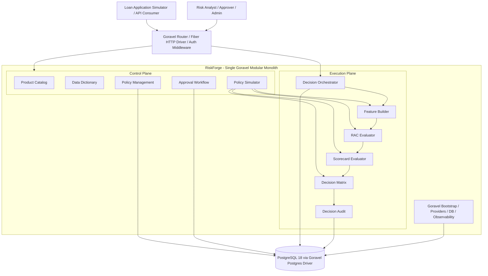
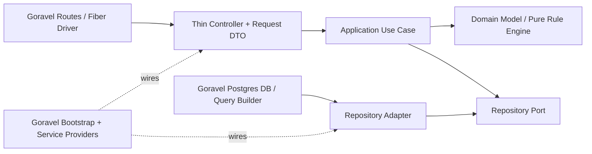
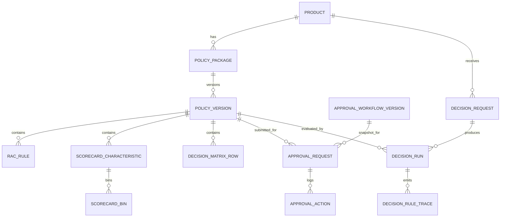
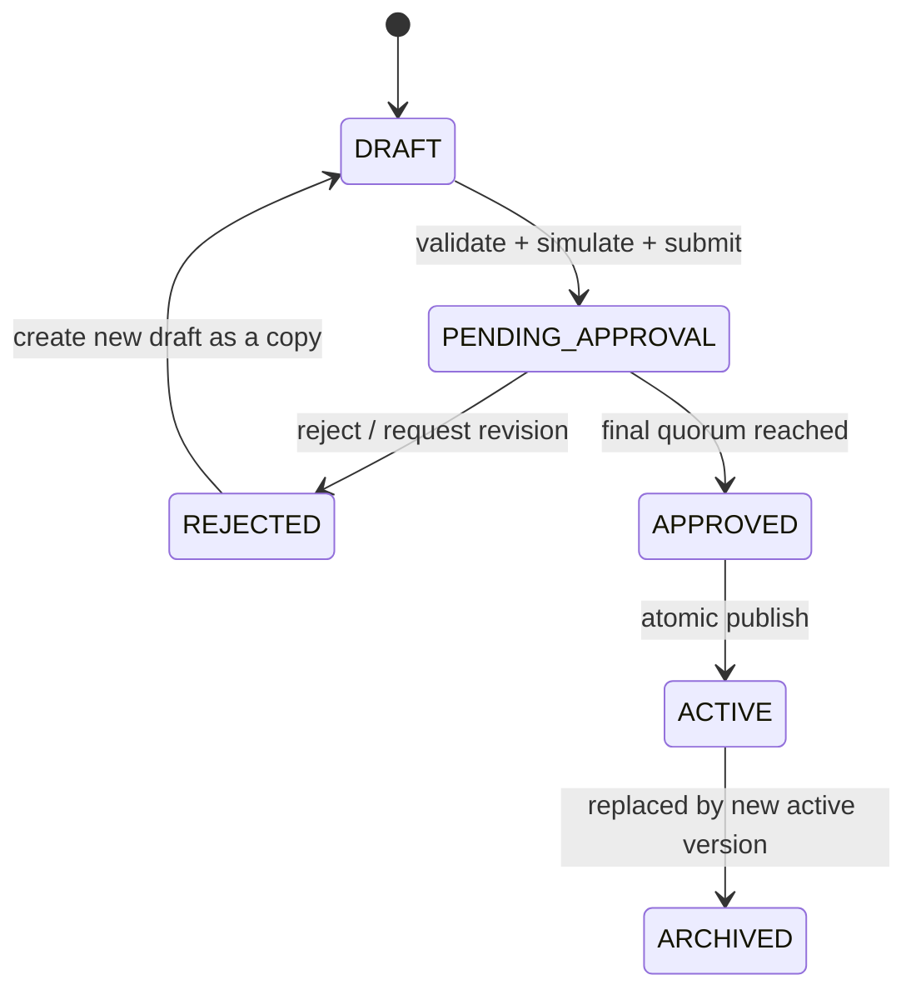
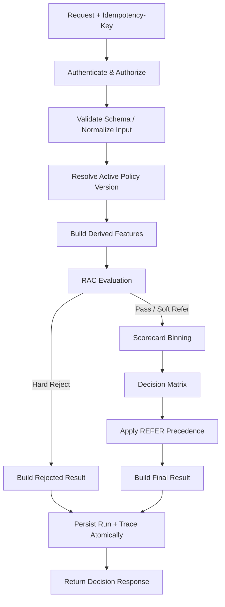
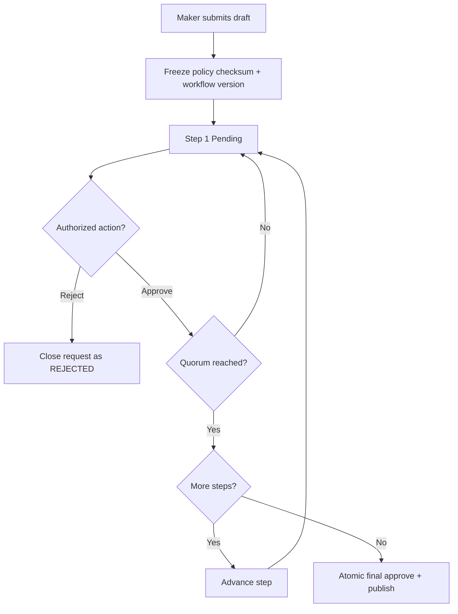
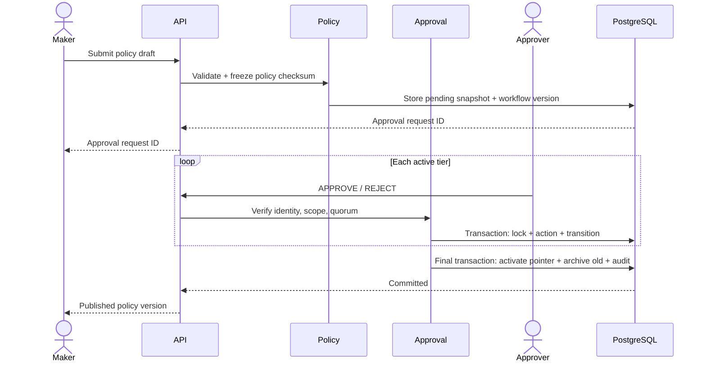
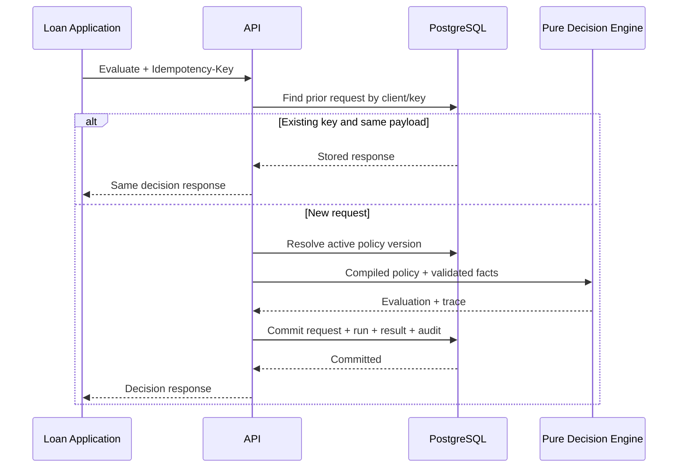

# RiskForge — System Design & Vibe Coding Blueprint

> **Project type:** Personal portfolio / Backend Engineering  
> **Document status:** Design baseline v1.3 — Milestone 1 merged, Swagger UI + versioned Postman Collection workflow  
> **Updated:** 17 November 2026  
> **Primary language:** Bahasa Indonesia  
> **Core stack:** Go 1.25.x · Goravel v1.18 (Fiber HTTP driver) · PostgreSQL 18.x · Modular Monolith · REST API · OpenAPI 3.1 · Swagger UI · Postman Collection · Docker Compose  
> **Implementation principle:** Selesaikan satu vertical slice yang berjalan dan teruji sebelum menambah fitur baru.
> **Verified repository snapshot:** `lathief/RiskForge` branch `main`, commit `07e9ebea` (17 November 2026): RF-001..RF-004 merged melalui PR #1..#4; `api/openapi/openapi.yaml` sudah ada dan mendokumentasikan 8 HTTP operations. Bukti runtime dicatat di `docs/VERIFICATION.md`. Bagian 5.6, 15.4, 17.1, dan 17.2 menggambarkan branch `fix/M1-hardening`, yang menunggu merge ke `main`. **Pembaruan 20 November 2026:** RF-005 (data dictionary) selesai pada branch `feature/RF-005-data-dictionary` (belum di-merge); OpenAPI 3.1 pada branch itu mendokumentasikan 12 HTTP operations (8 M1 + 4 dictionary). **Pembaruan berikutnya:** RF-006 (policy package/version model) selesai pada branch `feature/RF-006-policy-package-version-model`, dibuat di atas branch RF-005 (belum di-merge); OpenAPI pada branch itu mendokumentasikan 19 HTTP operations.

---

## 0. Cara Menggunakan Dokumen Ini untuk Vibe Coding

Dokumen ini adalah **single source of truth untuk scope, desain, dan perilaku RiskForge MVP**, termasuk keputusan framework **Goravel + Fiber**. Ini *bukan* kumpulan source code dan bukan blueprint internal milik IDX Partners. RiskForge adalah proyek independen yang terinspirasi oleh pola umum credit decision engine dan diskusi awal mengenai platform keputusan kredit.

**Workflow yang disarankan ketika bekerja dengan AI coding assistant:**

1. Berikan dokumen ini sebagai konteks proyek; minta AI membaca **scope, invariants, dan milestone** terlebih dahulu.
2. Pastikan environment terisolasi tersedia sesuai [Bagian 5.5 — Docker Compose untuk agent](#55-docker-compose-untuk-isolasi-agent); agent menjalankan Go, migrations, dan tests **dalam container**, bukan host.
3. Jika tiket membuat, mengubah, atau menghapus HTTP endpoint, lakukan **API-first change**: perbarui `api/openapi/openapi.yaml`, cek Swagger UI, **generate ulang Postman Collection**, dan commit hasilnya **dalam PR yang sama**, mengikuti [Bagian 5.6](#56-swagger-ui-openapi-dan-postman-collection).
4. Pilih **satu tiket** di [Implementation Backlog](#18-implementation-backlog-untuk-vibe-coding), jangan meminta AI membuat seluruh aplikasi sekaligus.
5. Sebelum AI menulis kode, minta ringkasan perubahan file, desain singkat, dependencies, risiko, dan test cases.
6. Implementasikan perubahan sekecil mungkin hingga satu acceptance criteria selesai.
7. Jalankan formatting, linting, unit/integration tests, dan review migration sebelum merge.
8. Perbarui checklist backlog dan Architecture Decision Records (ADR) apabila keputusan desain berubah.

**Batas framework:** bila AI menulis contoh aplikasi Fiber murni, menjadikan ORM model sebagai domain entity, atau membypass controller/service/repository boundary, perubahan itu harus ditolak dalam review.

**Prioritas saat ada konflik:** (1) keamanan/integritas data, (2) invariant domain, (3) acceptance criteria tiket, (4) kesederhanaan desain, (5) preferensi library.

### 0.1 Peta dokumentasi (DOC-001)

| Dokumen | Peran | Mengikuti |
|---|---|---|
| `SYSTEM_DESIGN.md` (dokumen ini) | **Design specification**: scope, invariant, desain target, backlog. | Keputusan desain (diubah lewat ADR). |
| `docs/*.md` | **Panduan praktis**: getting started, arsitektur, domain, contoh API, testing, decision engine. Bagian yang belum terimplementasi ditandai *Planned* beserta tiketnya. | Implementasi aktual dan test-nya. |
| `docs/adr/` | Alasan dan konsekuensi setiap keputusan teknis. | Keputusan yang sudah diambil. |
| `docs/POST_M5_BACKLOG.md` | Temuan review (keamanan, keandalan, desain, tooling) yang belum diperbaiki dan dikerjakan setelah M5. | Hasil review per milestone. |
| `AGENT_RUNBOOK.md` | Perintah dan konvensi persis untuk developer dan AI agent. | Tooling aktual. |
| `api/openapi/openapi.yaml` | Kontrak HTTP (sumber tunggal Swagger UI dan Postman). | Endpoint yang live. |

Aturan agar tidak muncul dua sumber yang saling bertentangan: `docs/` tidak mengulang spesifikasi, tetapi merangkum dan merujuk bagian dokumen ini. Jika `docs/` dan kode berbeda, kode beserta test-nya yang benar dan `docs/` diperbaiki dalam PR yang sama. Setiap tiket yang mengubah perilaku yang dijelaskan sebuah guide wajib memperbarui guide tersebut, `README.md`, dan bagian terkait di dokumen ini. Indeks guide dan penjelasan isi setiap folder repository ada di `docs/README.md`.

### Hal yang tidak boleh dilakukan AI tanpa diminta

- Mengubah arsitektur menjadi microservices atau mengganti framework Goravel/Fiber tanpa ADR dan persetujuan.
- Menginstal Go/PostgreSQL pada host sebagai jalan pintas, menguji against database `rf-dev`, menggunakan project name Compose yang sama untuk parallel agents, atau menjalankan `docker compose down -v` tanpa memastikan scope project-nya.
- Memasang Docker socket, `privileged`, `host network`, atau membuat volume/network Docker `external` untuk development MVP.
- Memperkenalkan Redis, Kafka, Kubernetes, Elasticsearch, MongoDB, atau layanan cloud untuk menyelesaikan masalah yang bisa ditangani PostgreSQL dan Go.
- Membuat standalone `fiber.App`/Fiber bootstrap paralel dengan Goravel; Fiber harus melalui HTTP driver resmi Goravel.
- Mengimpor Goravel/Fiber facades atau HTTP context ke dalam domain `ruleengine` dan business entities.
- Meng-hardcode persyaratan kredit ke source code.
- Melakukan bypass approval untuk mengaktifkan policy.
- Menghapus audit history, mengedit versi policy yang sudah dikunci, atau menampilkan data sensitif di log.
- Menambahkan fitur di luar tiket tanpa persetujuan eksplisit.
- Mengarang integrasi API asli SLIK/OJK, credit bureau, ataupun data debitur sungguhan.
- Menambah, mengubah, atau menghapus endpoint HTTP tanpa memperbarui OpenAPI 3.1, menguji akses Swagger UI (ketika tooling-nya tersedia), membuat ulang Postman Collection, dan memverifikasi cakupan operationId dalam PR yang sama. Jangan mengedit hasil generate Postman secara manual.

---

## 1. Executive Summary

**RiskForge** adalah platform backend **berbasis Goravel (Go) dengan Fiber HTTP driver** untuk membuat, mengelola, menguji, menyetujui, dan mengeksekusi kebijakan keputusan kredit secara dinamis. Aplikasi eksternal seperti Loan Application mengirim data pengajuan; RiskForge mengevaluasi **Risk Acceptance Criteria (RAC)**, menghitung **Scorecard**, memetakan skor dengan **Decision Matrix**, lalu mengembalikan keputusan dan jejak audit.

Perubahan aturan dilakukan melalui **policy draft → simulation → parameterized multi-level approval → publish**. Tim risk dapat memperbarui policy tanpa mengubah source code aplikasi, sementara keputusan historis tetap dapat ditelusuri ke versi kebijakan yang digunakan.

### Tujuan portofolio

Menunjukkan kemampuan seorang Backend Engineer melalui:

- Modular monolith design dengan batas domain jelas.
- Domain modeling dan relational data design.
- Dynamic rule evaluation yang deterministik.
- Transactions, locking, concurrency, dan idempotency.
- State machine & parameterized approval workflow.
- Security, observability, automated tests, dan documentation.

### Sukses MVP

Seorang **Risk Analyst** dapat membuat policy untuk produk kredit sintetis, menguji contoh pengajuan, mengirimnya ke approval, dan menerbitkan policy setelah semua approver setuju. **Loan Application Simulator** dapat memanggil API keputusan dan memperoleh respons `APPROVE`, `REFER`, atau `REJECT` yang dapat ditelusuri ke policy version dan decision trace.

---

## 2. Product Scope

### 2.1 In scope — MVP (P0)

| ID | Feature | Hasil yang diharapkan |
|---|---|---|
| F01 | Authentication & RBAC | Admin, Risk Analyst, Approver, Auditor, API Consumer punya hak akses berbeda. |
| F02 | Product Catalog | Membuat dan mengelola produk kredit, tanpa hardcode product code. |
| F03 | Data Dictionary & Feature Builder | Definisi variabel, validasi tipe data, dan variabel turunan dasar seperti DSR. |
| F04 | Policy/Rule Management | Draft, clone, RAC, scorecard bins, decision matrix, validasi konfigurasi. |
| F05 | RAC Engine | Evaluasi hard reject dan refer beserta reason code. |
| F06 | Scorecard Engine | Menghasilkan total score dan breakdown karakteristik. |
| F07 | Decision Matrix | Menghasilkan grade dan keputusan berdasarkan rentang skor. |
| F08 | Parameterized Multi-Level Approval | Maker-checker, tier dinamis, role checks, quorum, locking, publishing. |
| F09 | Policy Simulator | Mengevaluasi draft tanpa mengubah policy aktif maupun transaksi produksi. |
| F10 | Decision History & Audit | Persistensi keputusan, trace, versi kebijakan, dan histori perubahan. |

### 2.2 Technical capabilities wajib MVP

- REST API menggunakan Goravel router + Fiber HTTP driver, **OpenAPI 3.1 sebagai single source of truth**, Swagger UI interaktif, dan **Postman Collection yang diregenerasi pada setiap perubahan endpoint**.
- Goravel/Artisan database migrations pada PostgreSQL; constraints dan indexes yang masuk akal.
- Idempotent decision evaluation.
- Explicit error taxonomy (business decision tidak sama dengan technical failure).
- Unit tests, integration tests dengan PostgreSQL, race tests, dan CI.
- Structured logging, request/correlation ID, health check, metrics dasar.
- Docker Compose untuk menjalankan API dan PostgreSQL secara lokal **dengan project namespace terisolasi per agent/test session, volumes terpisah, database tanpa host port**, serta perintah test/migration hanya dalam container.
- Synthetic seed data dan demo scenario lengkap.

### 2.3 Out of scope — v1.0

- UI drag-and-drop, orchestration DAG, dan visual policy builder.
- ML scoring, real credit bureau/SLIK/Dukcapil integration, KYC/AML.
- Multi-tenant SaaS, multi-region deployment, microservices.
- Advanced champion-challenger, production batch backtesting, real-time streaming.
- Sistem Loan Application lengkap (online origination), loan servicing, collection, atau core banking.
- Perhitungan pricing/limit kompleks; boleh menambahkan **output konfigurasi statis** di matrix sebagai demonstrasi, bukan engine pricing penuh.

**Prinsip scope:** implementasikan satu produk demonstrasi `KTA_DEMO` dahulu. Desainnya mendukung penambahan produk lain melalui konfigurasi, tanpa harus langsung membuat KPR, leasing, atau semua jenis kredit.

---

## 3. Asumsi & Keputusan Awal

| Area | Keputusan MVP | Alasan |
|---|---|---|
| Organization | Single-institution demo | Isolasi multi-tenant membutuhkan kompleksitas tambahan. |
| Deployment | Satu deployable Goravel API (single process) | Selaras dengan modular monolith. |
| Agent runtime | Docker Compose v2: Go `api` + PostgreSQL `db` | Isolasi network, volume, proses, dependency dari host; uji dalam project name terpisah. |
| Go framework | Goravel v1.18, full framework scaffold | Memanfaatkan struktur, service container, routing, middleware, migrations, dan testing Goravel. |
| HTTP driver | Fiber melalui `github.com/goravel/fiber` | Gunakan driver resmi Goravel, bukan aplikasi Fiber terpisah. |
| DB | Satu PostgreSQL 18.x | Transaksi kuat, constraints, relational data, JSONB untuk snapshot. |
| DB access | `github.com/goravel/postgres` + Goravel DB/Query Builder; ORM selektif | Integrasi native Goravel untuk CRUD dan transaksi; SQL eksplisit untuk operasi kompleks tanpa mengunci domain ke ORM. |
| Schema migrations | Goravel Artisan migrations di `database/migrations/` | Tetap mengikuti lifecycle dan struktur standar framework. |
| Rule DSL | `expr-lang/expr` | Cocok untuk expression Go; kompilasi dilakukan sebelum policy aktif. |
| API | Goravel routing + Fiber driver + REST/JSON + OpenAPI 3.1 | `api/openapi/openapi.yaml` adalah kontrak utama; HTTP handlers memakai kontrak Goravel, tidak mengekspos Fiber ke domain. |
| API developer experience | Swagger UI + Postman Collection v2.1 (generated) | Dokumentasi interaktif dan koleksi request harus selalu sejalan dengan kontrak/route, tanpa server baru. |
| Cache | Compiled policy cache di memori aplikasi | Tidak perlu Redis; key berdasarkan immutable policy version. |
| Authentication | Modul identity di atas Goravel Auth/Hash atau kontrak auth custom teruji | Manfaatkan kemampuan framework seperlunya; role + scope tetap dipastikan server-side. |
| Async events | Tidak dibutuhkan untuk alur kritis MVP | Konsistensi utama dilakukan secara sinkron dalam transaksi PostgreSQL. |
| Admin UI | Tidak dibangun dulu | Swagger UI adalah halaman dokumentasi API developer, **bukan** admin policy builder. |
| Financial precision | PostgreSQL `NUMERIC` dan decimal representation di domain Go | Menghindari kesalahan pembulatan floating point. |

> **Pin versions:** Saat membuat repository, kunci versi framework Goravel, package `goravel/fiber`, `goravel/postgres`, Go, dan PostgreSQL yang kompatibel dalam `go.mod`, image Docker, dan CI. Target awal mengikuti dokumentasi Goravel v1.18 dan Go 1.25.x (lihat docs/adr/0001-go-version.md; target awal 1.27.x) / PostgreSQL 18.x; validasi kompatibilitas aktual lewat `go mod tidy`, build, dan integration tests. Jangan mengasumsikan package `@latest` selalu saling kompatibel.

**Keputusan yang sengaja ditunda:** format UI, dukungan multi-tenant, real external integrations, policy linting lanjutan, output pricing/limit kompleks, dan target SLA produksi final. Tidak perlu mengunci desain fitur-fitur tersebut sebelum MVP tervalidasi.

### 3.1 Keputusan integrasi Goravel + Fiber (wajib)

- **Gunakan Goravel sebagai application framework** untuk bootstrap, dependency wiring, route registration, middleware, validation, database migrations, dan fasilitas testing yang relevan.
- **Fiber adalah HTTP driver resmi Goravel**, bukan framework kedua yang diinisialisasi manual. Gunakan `github.com/goravel/fiber`, pilih/set driver `fiber` di `config/http.go`, dan pertahankan konfigurasi bawaan Goravel sesuai versi terpasang.
- **PostgreSQL memakai driver Goravel** `github.com/goravel/postgres`; panggil melalui DB/query builder/ORM adapter pada infrastructure layer. Untuk transaksi yang membutuhkan locking/SQL spesifik, gunakan transaction handle yang sama dalam satu boundary; jangan menjalankan sebagian operasi di koneksi terpisah.
- **Goravel facade dan `http.Context` hanya di transport/infrastructure/composition boundary**. Domain entity, rule compiler, rule evaluator, dan approval state machine harus framework-agnostic.
- **Folder standar Goravel dipertahankan.** Jangan mengganti bootstrap utama dengan `cmd/riskforge-api` atau memindahkan migrations ke `db/migrations` hanya karena mengikuti template Go generik.
- **Default untuk MVP:** pilih full Goravel scaffold, bukan Goravel Lite, agar tidak perlu merakit modul framework satu per satu; fitur framework yang tidak dipakai tidak perlu diaktifkan.
- **Dokumentasi implementasi:** ketika ada perbedaan API antarrilis Goravel, ikuti dokumentasi dan package source dari versi yang benar-benar dipin di repository; jangan menebak signature fungsi.

**Bootstrap yang direncanakan (panduan, bukan perintah yang sudah dieksekusi):**

1. Buat project melalui installer resmi Goravel; pilih HTTP driver Fiber apabila ditawarkan.
2. Jika scaffold memakai Gin secara default, instal `github.com/goravel/fiber` dengan mekanisme package installer Goravel dan ubah default driver di `config/http.go` menjadi `fiber`.
3. Pasang `github.com/goravel/postgres` dan konfigurasi koneksi PostgreSQL di `config/database.go`.
4. Verifikasi server boot, route API, middleware request ID, koneksi database, dan Artisan migrate dengan versi package yang sudah dipin.

**Referensi teknis:** [Goravel Installation](https://www.goravel.dev/getting-started/installation), [Goravel Routing](https://www.goravel.dev/the-basics/routing.html), [goravel/fiber](https://github.com/goravel/fiber), [goravel/postgres](https://github.com/goravel/postgres).

---

## 4. Users, Roles & Use Cases

| Role | Aksi utama | Larangan penting |
|---|---|---|
| `ADMIN` | Kelola user/role, product metadata, approval workflow configuration | Tidak otomatis boleh melewati approval policy. |
| `RISK_ANALYST` | Buat/clone/edit draft, simulasi, submit approval | Tidak boleh approve submission sendiri. |
| `RISK_APPROVER` | Review diff, approve/reject sesuai tier & scope | Tidak boleh mengedit draft yang sedang diperiksa. |
| `AUDITOR` | Read-only decision trace, policy history, approval history | Tidak dapat membuat/mengubah policy. |
| `API_CONSUMER` | Memanggil decision evaluation untuk produk yang diotorisasi | Tidak dapat memodifikasi policy atau approval. |

**Use cases:**

1. Analyst membuat draft policy baru berdasarkan policy aktif.
2. Analyst mengedit RAC, scorecard bins, dan decision matrix.
3. Sistem menolak expression salah tipe, bin overlap, matrix gap, atau rule tanpa reason code.
4. Analyst menjalankan simulasi tanpa berpengaruh pada traffic produksi.
5. Analyst mengirim draft untuk persetujuan berjenjang.
6. Approver melihat perubahan policy dibandingkan versi aktif dan memutuskan approve/reject.
7. Approval terakhir memicu publikasi atomik versi baru.
8. Loan Application mengirim pengajuan dengan `Idempotency-Key` dan mendapatkan hasil keputusan.
9. Auditor mencari hasil evaluasi beserta input sintetis, applied policy version, dan rule trace.

---

## 5. High-Level Architecture



### 5.1 Modular Monolith principles

1. **One process, one deployment** untuk Goravel API dengan HTTP driver Fiber; boleh menggunakan *background goroutines* dalam proses hanya untuk tugas non-kritis yang sudah terkontrol.
2. Setiap module punya model, use case, repository interfaces, dan kepemilikan data sendiri.
3. Cross-module interactions menggunakan exported application interfaces, bukan import ke internal repository module lain.
4. Tidak boleh ada circular dependencies.
5. `ruleengine` merupakan **pure/domain component**: menerima typed facts + compiled policy, menghasilkan result tanpa akses Goravel/Fiber/HTTP/SQL.
6. `decision` menangani orchestration dan transaction boundary; `policy` mengelola lifecycle; `approval` mengelola hak keputusan perubahan.
7. Shared infrastructure hanya untuk cross-cutting concerns; jangan membuat `common` package berisi business logic acak.
8. Goravel controller/request/middleware hanya memetakan transport ke application use case; jangan menaruh scoring/approval business logic di controller.
9. Service provider/composition root bertanggung jawab melakukan wiring repository dan use case; constructor injection lebih jelas daripada memanggil facades dari semua module.

### 5.2 Modul dan dependencies

| Module | Owns | Depends on |
|---|---|---|
| `identity` | user, credential, roles, API clients | auth/hash adapters dari Goravel; domain bebas framework |
| `catalog` | products & product status | identity (authorization contract) |
| `dictionary` | variable definitions, feature formulas | catalog |
| `policy` | packages, versions, RAC, scorecard, matrix | catalog, dictionary |
| `ruleengine` | compile, validate, evaluate | **no database dependencies** |
| `simulation` | draft evaluations, sample expected results | policy, dictionary, ruleengine |
| `approval` | workflow templates/versions, requests, actions | identity, policy via application contracts |
| `decision` | request, resolved version, evaluation, result, idempotency | catalog, dictionary, policy, ruleengine |
| `audit` | append-only domain events & decision trace access | decision/policy/approval events |

**Mapping Goravel:** `routes/` dan `app/http/controllers` = transport; `app/modules/*/application` = use case; `app/modules/*/domain` = pure business logic; `app/modules/*/infrastructure` = Goravel/Postgres adapters; `bootstrap/` (provider, middleware global, migration, seeder) dan `routes/api.go` (composition root: wiring repository dan use case) = dependency composition.

### 5.3 Suggested repository layout — mengikuti Goravel

```text
riskforge/
├── main.go                        # entrypoint standar Goravel
├── artisan                        # Goravel Artisan CLI
├── bootstrap/                     # framework bootstrap, route/provider registration
│   ├── app.go
│   └── providers.go               # sesuai scaffold versi terpasang
├── config/
│   ├── http.go                    # default HTTP driver = fiber
│   └── database.go                # PostgreSQL connection
├── routes/
│   └── api.go                     # route mapping saja; register via bootstrap
├── app/
│   ├── http/
│   │   ├── controllers/           # thin HTTP adapters -> use cases
│   │   ├── middleware/            # auth/RBAC, request ID, security
│   │   └── requests/              # transport input validation/DTOs
│   ├── modules/                   # domain modules: isolated logical boundaries
│   │   ├── identity/              # domain, application, infrastructure
│   │   ├── catalog/
│   │   ├── dictionary/
│   │   ├── policy/
│   │   ├── ruleengine/            # pure evaluator, no framework coupling
│   │   ├── simulation/
│   │   ├── approval/
│   │   ├── decision/
│   │   └── audit/
│   ├── providers/                 # app-level service wiring (as needed)
│   └── models/                    # optional persistence-only Goravel ORM models
├── database/
│   ├── migrations/                # Goravel Artisan versioned migrations
│   └── seeders/                   # synthetic seed fixtures
├── api/
│   ├── openapi/
│   │   └── openapi.yaml           # Existing: OpenAPI 3.1 single source of truth
│   └── postman/                   # DX-001 (implemented): generated, do not edit by hand
│       ├── RiskForge.postman_collection.json    # Generated from OpenAPI; commit
│       └── RiskForge.local.postman_environment.json # Template non-secret; optional
├── tests/                          # framework/integration/E2E tests
├── docs/                         # DOC-001: practical guides that follow the code (see 0.1)
│   ├── README.md                   # index + repository layout explanation
│   ├── GETTING_STARTED.md, ARCHITECTURE.md, DOMAIN_GUIDE.md, API_EXAMPLES.md
│   ├── TESTING.md, DECISION_ENGINE.md, SCRIPTS.md, VERIFICATION.md
│   ├── adr/                        # Architecture Decision Records
│   └── (planned) SECURITY, DATABASE, DEMO_SCENARIOS, OBSERVABILITY, TRADEOFFS
├── compose.yaml                    # Dev & agent runtime: api + db, per-project isolation
├── scripts/
│   ├── init-agent-env.sh           # Generate untracked local secrets
│   ├── generate-postman.sh         # DX-001: deterministic one-shot generator (--check)
│   ├── postman/normalize.js        # DX-001: normalization step used by the generator
│   ├── postman/package*.json       # DX-001: pinned generator/Newman tools (npm ci)
│   ├── smoke-postman.sh            # DX-001: runs the collection against a running stack
│   └── update-swagger-ui.sh        # DX-001: vendors pinned, integrity-checked swagger-ui-dist
├── .env.agent.example              # Template non-secret; .env.agent generated/ignored
├── AGENT_RUNBOOK.md                # Commands for dev/test agent sessions
├── deployments/local/             # Future deployment artefacts (optional)
├── .github/workflows/
├── .env.example
├── go.mod
└── README.md
```

**Penting:** Ini struktur target **berdasarkan direktori scaffold Goravel v1.18**. Jangan menghapus/mengganti file bootstrap dan provider bawaan hanya agar tree terlihat sama dengan contoh. Nama/path yang dibuat oleh installer aktual menjadi acuan final. Buat modul secara bertahap, bukan semua folder kosong sekaligus. File di bawah `api/postman/`, skrip generator, dan Swagger UI (`public/swagger/`) sudah ada di branch `fix/M1-hardening` (DX-001). Tree di atas adalah saran awal: beberapa folder di dalamnya belum dibutuhkan (`app/http/requests/`, `app/providers/`, `app/models/`, `.github/workflows/`, `deployments/local/`), sementara layout aktual juga memuat `app/platform/`, `app/support/`, `app/facades/`, dan `public/swagger/`. **Acuan layout aktual: `docs/README.md` bagian "Repository layout".**

### 5.4 Framework boundary & dependency direction



- Controller menerima `Goravel contracts/http.Context`, memvalidasi transport input, dan membentuk response; **jangan meneruskan Fiber context atau framework request object** ke domain/application.
- Application use cases mengandalkan interface kecil (`PolicyRepository`, `DecisionRepository`, `TransactionManager`, dll.); infrastructure adapters mengimplementasikannya memakai Goravel database access.
- Gunakan framework middleware untuk authentication, authorization, correlation ID, dan request size/rate limit; verifikasi cakupan middleware terhadap Fiber driver melalui HTTP integration tests.
- Hindari penggunaan facade Goravel di pure domain code. Simulasi dan live evaluation harus memanggil engine yang sama.
- Unit testing pure domain berjalan tanpa bootstrap Goravel. HTTP integration testing menjalankan stack Goravel + Fiber sungguhan.

### 5.5 Docker Compose untuk isolasi agent

**Tujuan:** supaya AI coding agent dapat menjalankan Goravel + Fiber, migrasi PostgreSQL, dan test suite dalam lingkungan yang **reproducible dan terpisah** dari Go/PostgreSQL host. Ini adalah baseline development/test, **bukan file deployment production**. Bagian ini ditambahkan pada v1.2 sebagai perubahan kebutuhan baru; fitur bisnis tetap sama.

**Komponen aktif hanya dua:** `api` (container Go yang menjalankan satu backend Goravel/Fiber) dan `db` (PostgreSQL 18). Tidak ada microservice tambahan. Docker Compose membuat network serta volume terisolasi berdasarkan `-p <project-name>`. Sumber aplikasi di-bind mount agar coding agent dapat mengubah dan langsung menguji kode. PostgreSQL tidak diekspos ke port host; API hanya di-bind ke loopback `127.0.0.1`. Keberadaan file Compose **tidak otomatis membuat aplikasi berjalan sebelum Goravel scaffold dan driver disiapkan**. <https://docs.docker.com/compose/how-tos/project-name/>

**File yang wajib tersedia di root repository setelah bootstrap:** `compose.yaml`, `.env.agent.example`, `scripts/init-agent-env.sh`, `AGENT_RUNBOOK.md`; serta `.env` milik scaffold Goravel. Agent perlu membaca instruksi di runbook sebelum menggunakan Docker. `.env` dan `.env.agent` **wajib masuk `.gitignore`**, jangan di-commit.

#### 5.5.1 File `compose.yaml` (baseline agent/dev)

> **Catatan:** listing di bawah adalah baseline desain awal. File aktual `compose.yaml` sudah berkembang: container `api` menjalankan `go build` lalu `exec` binary (agar SIGTERM sampai ke aplikasi dan `lifetime.log` mencatat `stopped`), dengan `stop_grace_period: 15s`, `JWT_SECRET` wajib, serta `DEMO_USER_PASSWORD` dan `DOCS_ENABLED` diteruskan. Isolasi (project name, tanpa port database, `no-new-privileges`, `cap_drop`) tetap sama.

```yaml
# RiskForge developer/agent environment (not a production deployment).
# Start each worktree/session with a UNIQUE Compose project name (-p).
# Keep the original Goravel scaffold and app entrypoint; do not create a second Fiber server.
services:
  api:
    image: ${GO_IMAGE:-golang:1.25-bookworm}
    working_dir: /workspace
    init: true
    command: ["go", "run", "."]
    environment:
      APP_NAME: RiskForge
      APP_ENV: local
      APP_DEBUG: "true"
      APP_HOST: "0.0.0.0"
      APP_PORT: "3000"
      APP_KEY: ${APP_KEY:?Run ./scripts/init-agent-env.sh first}
      DB_CONNECTION: postgres
      DB_HOST: db
      DB_PORT: "5432"
      DB_DATABASE: ${DB_DATABASE:-riskforge}
      DB_USERNAME: ${DB_USERNAME:-riskforge}
      DB_PASSWORD: ${DB_PASSWORD:?Run ./scripts/init-agent-env.sh first}
    volumes:
      - ./:/workspace
      - go_modules:/go/pkg/mod
      - go_build:/root/.cache/go-build
    ports:
      - "127.0.0.1:${RISKFORGE_HOST_PORT:-3000}:3000"
    depends_on:
      db:
        condition: service_healthy
    networks:
      - backend
    security_opt:
      - no-new-privileges:true
    cap_drop:
      - ALL

  db:
    image: ${POSTGRES_IMAGE:-postgres:18}
    environment:
      POSTGRES_DB: ${DB_DATABASE:-riskforge}
      POSTGRES_USER: ${DB_USERNAME:-riskforge}
      POSTGRES_PASSWORD: ${DB_PASSWORD:?Run ./scripts/init-agent-env.sh first}
    volumes:
      # PostgreSQL 18+ uses /var/lib/postgresql, not /var/lib/postgresql/data.
      - postgres_data:/var/lib/postgresql
    healthcheck:
      test: ["CMD-SHELL", "pg_isready -U \"$${POSTGRES_USER}\" -d \"$${POSTGRES_DB}\""]
      interval: 5s
      timeout: 3s
      retries: 20
      start_period: 10s
    networks:
      - backend
    # Intentionally no `ports:`: PostgreSQL is reachable only inside this Compose network.
    security_opt:
      - no-new-privileges:true

networks:
  backend:
    driver: bridge

volumes:
  postgres_data:
  go_modules:
  go_build:
```

**Pilihan desain dan batasannya:**

- API image memakai Go toolchain agar **agent tidak perlu memasang Go di host**; perintah `go run .`, `go test ./...`, dan `./artisan migrate` dijalankan dari container. Driver Fiber tetap dikonfigurasi melalui Goravel, **bukan `fiber.App` kedua**.
- Image PostgreSQL 18 me-mount data pada `/var/lib/postgresql` (bukan `/var/lib/postgresql/data` untuk versi 18+). <https://hub.docker.com/_/postgres>
- `depends_on: condition: service_healthy` menunggu DB sehat sebelum `api` startup. Tidak menggantikan validasi koneksi aktual maupun retry aplikasi. <https://docs.docker.com/compose/how-tos/startup-order/>
- `postgres_data`, `go_modules`, dan `go_build` otomatis mendapat prefix Compose project; project name harus **unik per agent/task**, jangan memakai `container_name` atau external volume.
- Bind mount source (`./:/workspace`) bersifat writeable karena tujuan agent adalah mengubah codebase. Jadi Compose mengisolasi **runtime, dependency, dan data test**, bukan memberikan perlindungan dari agent yang tidak dipercaya.
- Docker socket tidak dipasang dalam container. Docker Engine tetap harus berjalan di host; untuk sandbox keamanan agent yang tidak tepercaya gunakan VM/remote disposable workspace.
- `APP_KEY`, `DB_PASSWORD`, `JWT_SECRET`, dan `DEMO_USER_PASSWORD` harus acak di file `.env.agent` yang diabaikan Git (dibuat oleh `scripts/init-agent-env.sh`); nilai contoh di `.env.agent.example` **bukan** credential sungguhan. Jangan jalankan untuk data sensitif nyata.
- Pin image tags/digests setelah environment berhasil diboot dan diverifikasi; pastikan versi yang dipakai kompatibel dengan scaffold aktual.

#### 5.5.2 Alur kerja agent (sebelum satu tiket dimulai)

Setelah **full Goravel scaffold** terpasang, salin file kit lalu jalankan dari root repository:

```sh
./scripts/init-agent-env.sh
# Project name stabil untuk development pribadi
docker compose -p rf-dev --env-file .env.agent config --quiet
docker compose -p rf-dev --env-file .env.agent up -d
# Setelah migration tersedia
docker compose -p rf-dev --env-file .env.agent exec -T api ./artisan migrate
# Setelah RF-001 membuat health endpoint
curl -fsS http://127.0.0.1:3000/health/live
```

Untuk **test isolasi** tanpa menyentuh database development, gunakan project name unik dan tidak perlu menjalankan container API permanen:

```sh
docker compose -p rf-test-rf012 --env-file .env.agent up -d db
docker compose -p rf-test-rf012 --env-file .env.agent run --rm --no-deps api ./artisan migrate
docker compose -p rf-test-rf012 --env-file .env.agent run --rm --no-deps -e HASH_BCRYPT_ROUNDS=4 api go test -race -count=1 ./...
# Menghapus HANYA database, network, cache milik rf-test-rf012
docker compose -p rf-test-rf012 --env-file .env.agent down -v --remove-orphans
```

**Wajib:** `rf-dev` dan `rf-test-rf012` adalah environment berbeda; gunakan nama lain untuk agent/test lain. Perintah `down -v` destruktif dan tidak boleh dijalankan tanpa project scope eksplisit. Jika beberapa API dinyalakan bersamaan, set `RISKFORGE_HOST_PORT` berbeda di tiap session atau jalankan hanya test one-off tanpa publish port.

#### 5.5.3 Acceptance criteria isolasi

Status: semua kriteria terverifikasi saat RF-001/RF-002 (bukti di `docs/VERIFICATION.md`).

- [x] Compose valid dengan `docker compose -p rf-dev --env-file .env.agent config --quiet`.
- [x] API Goravel/Fiber sukses boot dan endpoint `/health/live` dapat diakses pada `127.0.0.1`.
- [x] PostgreSQL healthcheck lulus; tidak ada port PostgreSQL yang dipublish di host.
- [x] `./artisan migrate` serta `go test ./...` berjalan dari container Go, tidak mengandalkan Go atau PostgreSQL host.
- [x] Dua project berbeda menghasilkan network dan DB volume terpisah.
- [x] Cleanup `rf-test-*` tidak memengaruhi data `rf-dev`.
- [x] Agent tidak memasang Docker socket, privileged mode, ataupun bypass boundary domain.

**Status terbaru (17 November 2026):** RF-001..RF-004 telah merged di `main`; `docs/VERIFICATION.md` mencatat verifikasi container, migration, dan test terisolasi. Catatan ini **bukan** klaim pengujian ulang secara independen. Baseline `api + db` tetap dipertahankan ketika menambahkan Swagger/Postman; tooling generator berjalan sebagai *one-off container*, bukan service ketiga.


### 5.6 Swagger UI, OpenAPI, dan Postman Collection

> **Status implementasi DX-001 (17 November 2026, branch `fix/M1-hardening`):** selesai. `GET /swagger`, `GET /swagger/assets/{file}`, `GET /openapi.yaml` aktif bila `DOCS_ENABLED=true` (startup menolak nilai ini di luar `local`/`testing`); Swagger UI `swagger-ui-dist` **5.35.0** di-vendor ke `public/swagger/vendor`; generator `scripts/generate-postman.sh` memakai `openapi-to-postmanv2` **6.3.3** + `js-yaml` 4.1.0 dan menghasilkan koleksi v2.1 dengan **8 request** yang byte-identik antar-run (`--check`); parity `(METHOD, path)` antara route terdaftar, spec, dan koleksi diuji di `tests/feature/api_contract_test.go`. Keputusan dan batas: `docs/adr/0005-swagger-ui-and-generated-postman.md`. Penyimpangan kecil dari rencana di bawah: `/swagger` dilayani langsung (tanpa redirect ke `/swagger/`, karena router Fiber non-strict menganggap keduanya sama), dan aset berada di `/swagger/assets/{file}` dengan whitelist tiga file.

**Keputusan wajib mulai setelah Milestone 1:** dokumentasi HTTP API harus selalu sinkron dengan implementasi. **Single source of truth** ialah OpenAPI **3.1** pada `api/openapi/openapi.yaml` (file **sudah tersedia** di branch `main` sejak RF-004). Swagger UI membaca file tersebut; Postman Collection **dihasilkan dari file yang sama**, bukan ditulis ulang secara manual. Perubahan ini merupakan *developer experience requirement*, tidak mengubah jumlah layanan aktif: **tetap `api` + `db`**.

**Snapshot M1 yang telah dikonfirmasi di repository** (`main` commit `07e9ebea`): 8 HTTP operations: `GET /health/live`, `GET /health/ready`, `POST /api/v1/auth/login`, `GET /api/v1/auth/me`, `GET /api/v1/products`, `POST /api/v1/products`, `GET /api/v1/products/{code}`, dan `PATCH /api/v1/products/{code}`. Daftar pada Bagian 13 yang belum terimplementasi adalah **rencana**, tidak boleh dianggap sebagai endpoint yang sudah live atau otomatis dimasukkan ke spec. Route tooling `/swagger`, `/openapi.yaml`, dan asset Swagger bukan domain API dan sengaja **dikecualikan** dari baseline delapan request Postman; pengecualian ini harus dicatat pada parity checker.

#### 5.6.1 Swagger UI (DX-001, terimplementasi)

- **Halaman dokumentasi:** `GET /swagger` (boleh redirect ke `/swagger/` untuk asset relatif), merender Swagger UI interaktif. **Kontrak mentah:** `GET /openapi.yaml` menyajikan isi persis `api/openapi/openapi.yaml` dengan Content-Type YAML yang sesuai. Dua route dokumentasi ini berada di **Goravel + Fiber app yang sama**, bukan proses web/container terpisah.
- Gunakan distribusi **Swagger UI 5.x** yang mendukung OpenAPI 3.1, **pin** versi asset/dependency setelah diverifikasi; utamakan asset lokal/bundled untuk akses offline di Docker. Jangan membangun aplikasi Fiber mandiri atau menebak API route handler Goravel. Implementasi: aset di `public/swagger/`, dan `.dockerignore` mengecualikan `public/swagger` serta `api/`, sehingga file Swagger dan `openapi.yaml` **tidak pernah** masuk image release.
- **Security:** dokumentasi dan spec aktif di `local`/`testing` secara eksplisit (misalnya `DOCS_ENABLED=true`); nonaktif secara default di production, atau proteksi dengan autentikasi yang layak jika perlu diaktifkan. Halaman Swagger boleh menyediakan tombol *Authorize* untuk JWT sintetis. Jangan menyisipkan token demo, password, JWT secret, atau credential ke spec, HTML, dan asset statis.
- Uji via HTTP integration test: `GET /swagger` menghasilkan halaman yang memuat Swagger UI; `GET /openapi.yaml` mengembalikan dokumen OpenAPI 3.1 valid; halaman membaca endpoint yang ada; route bisnis tetap ditegakkan oleh middleware auth/permission (`401`/`403` tidak boleh di-bypass oleh Swagger).

#### 5.6.2 Postman Collection — wajib setiap perubahan endpoint

- **Output versioned:** `api/postman/RiskForge.postman_collection.json` (format Postman Collection **v2.1**, importable). Buat satu *request item* untuk setiap kombinasi **HTTP method + path** di OpenAPI, termasuk health, auth, product, dan semua endpoint M2–M5 yang kelak ditambahkan. Folder berdasarkan OpenAPI `tags`, nama request dari `operationId`/summary yang stabil.
- **Template environment:** `api/postman/RiskForge.local.postman_environment.json` (atau template dokumentasi ekuivalen) dapat memuat `baseUrl=http://127.0.0.1:3000`, `accessToken` kosong, `productCode=KTA_DEMO`, dan variabel non-secret lain. **Jangan commit access token, password demo asli, atau secret**. Normalisasikan server URL hasil konversi menjadi `{{baseUrl}}` secara otomatis jika generator tidak melakukannya; jangan mengedit JSON hasil generate secara manual.
- **Generator tunggal:** `scripts/generate-postman.sh` harus berjalan dari Docker one-off / tool container, menggunakan konverter resmi `openapi-to-postmanv2` **versi dipin**; jalankan setelah perubahan spec. Implementasi boleh memakai CLI di bawah ini sebagai baseline, kemudian lakukan normalisasi variabel serta pengurutan/format yang deterministik di dalam script. Tidak perlu memasang Node.js di host dan tidak menambah service permanen Compose.

  ```sh
  # Dari root repo (Linux/macOS; Windows sesuaikan host volume mapping Docker).
  mkdir -p api/postman
  docker run --rm -v "$PWD:/workspace" -w /workspace node:22-alpine sh -lc \
    'npx --yes --package=openapi-to-postmanv2@6.3.3 openapi2postmanv2 \
      -s api/openapi/openapi.yaml \
      -o api/postman/RiskForge.postman_collection.json -p'
  # Terimplementasi: scripts/generate-postman.sh membungkus command ini (lockfile, image digest,
  # konversi tanpa network) dan menormalisasi baseUrl/auth.
  ```

- CLI tersebut mendukung OpenAPI **3.1** serta opsi `-s` / `-o` / `-p`. **Perhatikan:** kode contoh di atas adalah *rencana perintah*, bukan klaim sudah dijalankan. Script final wajib menghasilkan JSON valid, importable, dan stabil antara dua run terhadap input spec yang sama. Bila versi konverter berubah, pin lewat ADR/skrip dan verifikasi output/diff.
- **Cakupan:** setiap request HTTP yang diimplementasikan memiliki `operationId` unik, metode, path, parameters, auth requirement, request body jika perlu, success + error responses, contoh payload yang aman. Collection yang di-commit **tidak boleh kehilangan** operasi setelah spec diperbarui. Perubahan yang menghapus/rename endpoint juga harus menghapus/rename operasi dari collection melalui regenerasi.
- **Verification gate:** parse OpenAPI dan Collection; bandingkan set `(METHOD, normalized path)` satu-per-satu antara keduanya, bukan hanya jumlah; periksa duplicate operationId, serta keberadaan bearer auth pada request terlindungi. Jalankan import/smoke test koleksi untuk endpoint yang berubah menggunakan dataset sintetis. Jika memakai testing scripts Postman tambahan, jangan simpan test bisnis custom langsung pada file generated tanpa strategi sync yang deterministik.

#### 5.6.3 Workflow wajib untuk **setiap** tiket yang menyentuh HTTP API

1. Sebelum implementasi, buka `api/openapi/openapi.yaml`. Buat atau revisi operasi yang relevan: method/path, tag, `operationId`, parameter/path/query, request/response schema, status code, header (`X-Request-ID`, `Idempotency-Key` bila relevan), contoh sukses dan gagal, `bearerAuth` serta `x-required-permission` bila terproteksi.
2. Implementasikan route, controller dan middleware dalam Goravel/Fiber, kemudian unit/integration test. **Kontrak harus cocok dengan perilaku aktual**; jika terdapat perubahan desain yang disetujui, perbarui spec pada PR yang sama.
3. Validasi spec memakai Redocly CLI (repo M1 sudah menggunakan `redocly/cli:2.79.0`):

   ```sh
   docker run --rm -v "$PWD/api/openapi:/spec:ro" redocly/cli:2.79.0 lint /spec/openapi.yaml
   ```

4. Jalankan `./scripts/generate-postman.sh` (lalu `./scripts/smoke-postman.sh` terhadap stack yang berjalan), lalu commit hasil `api/postman/RiskForge.postman_collection.json` dan file template environment jika berubah. Bandingkan cakupan operasi dan tes request baru melalui Postman/local API.
5. Uji `/swagger` dan `/openapi.yaml` di Compose dev/test. *Swagger UI* harus mencerminkan spec yang sama; UI/API consumer tidak boleh mendapatkan akses istimewa hanya karena dokumentasi tersedia.
6. **PR tidak selesai** jika endpoint baru/berubah sudah bisa diakses tetapi OpenAPI, Swagger, atau Postman Collection belum mengikuti. Setelah CI RF-025 tersedia, CI wajib lint spec, generate koleksi dari scratch, cek hasil byte/diff (setelah generator deterministik), dan verifikasi parity `(method,path)`; sebelum RF-025, agent menjalankan gate tersebut secara lokal/container dan menempelkan hasil di deskripsi PR.

**Acceptance criteria DX-001 (cross-cutting; tidak mengubah RF-001..RF-026):** `/swagger` dan `/openapi.yaml` berfungsi di Goravel/Fiber dengan mode local/test, `api/openapi/openapi.yaml` lama tetap authoritative, baseline Postman berisi **tepat 8 HTTP operations** yang sudah live pada M1, `scripts/generate-postman.sh` dapat dijalankan dua kali dengan output stabil, dan test negative route docs/security lulus. **Tidak ada Redis, service Swagger tambahan, atau perubahan schema database.**

**Referensi:** [Swagger UI](https://github.com/swagger-api/swagger-ui), [OpenAPI-to-Postman](https://github.com/postmanlabs/openapi-to-postman), [Postman API conversion](https://learning.postman.com/docs/developer/collection-conversion), [Redocly CLI](https://redocly.com/docs/cli/installation).

---

## 6. Domain Model & Core Concepts

### 6.1 Definisi istilah

- **Product:** identitas produk kredit, misalnya `KTA_DEMO`.
- **Policy Package:** kumpulan lengkap definisi rules/scorecard/matrix yang berfungsi sebagai satu unit release.
- **Policy Version:** snapshot immutable dari package ketika di-submit/published, termasuk schema input, formula features, dan metadata evaluator.
- **RAC:** evaluasi eligibility/knock-out; kegagalan menghasilkan `REJECT` atau `REFER` berdasarkan action rule.
- **Scorecard:** karakteristik, bins, points, serta base score.
- **Decision Matrix:** memetakan total score ke risk grade dan keputusan.
- **Approval Workflow Version:** definisi tetap dari tier, role, dan quorum yang digunakan sebuah pengajuan.
- **Decision Run:** satu eksekusi terhadap satu policy version dengan input dan hasil yang dicatat.
- **Reason Code:** kode stabil yang menjelaskan hasil; jangan hanya menyimpan human-readable message.

### 6.2 Entity relationship (konseptual)



### 6.3 Keputusan immutability

- Draft bisa diedit hanya selama `DRAFT`.
- Saat submit, policy dibekukan melalui version snapshot; seluruh approval mereferensikan isi yang sama.
- Published policy tidak boleh diedit in-place.
- Riwayat approval, perubahan policy, dan hasil keputusan tidak boleh dihapus dari jalur aplikasi biasa.
- Rollback berarti **mempublikasikan versi baru yang isinya disalin dari versi yang pernah baik**, tetap melalui governance; bukan mengedit ulang versi historis.

---

## 7. Database Design — PostgreSQL

Gunakan **satu database PostgreSQL** dengan schema logis melalui driver resmi `goravel/postgres`. Tabel dan kolom berikut adalah desain konseptual; finalisasi **Goravel Artisan migrations** di `database/migrations` **pada milestone yang terkait**, bukan sekaligus.

| Schema | Core tables | Notes |
|---|---|---|
| `identity` | `users`, `roles`, `user_roles`, `api_clients` | Credential/token metadata tidak diekspos ke consumer. |
| `catalog` | `products` | Unique product code dan active state. |
| `dictionary` | `schema_state`, `variables`, `variable_versions` (RF-005). Rumus fitur (RF-011) ada di kode, bukan tabel: lihat 8.2 | Type, nullability, scale, unit, valid range; append-only versions dengan schema version global (8.1). |
| `policy` | `policy_packages`, `policy_versions` (RF-006), `rac_rules` (RF-007), `scorecards`, `scorecard_characteristics`, `scorecard_bins` (RF-008), `decision_matrix_rows` (RF-009), `test_cases` (RF-010), `active_policy_bindings` | Relational constraints & version references. |
| `approval` | `workflow_definitions`, `workflow_versions`, `workflow_steps` (RF-018, Bagian 11.5), `requests`, `actions` (RF-019, Bagian 11.6); scope approver di `identity.user_approval_scopes` | Role, quorum, frozen workflow snapshot. Konfigurasi append-only; versi tidak pernah berubah. |
| `decision` | `requests`, `runs`, `rule_traces` | Idempotency, policy ref, result, score breakdown, execution status. |
| `audit` | `events` (RF-020, Bagian 11.7) | Append-only event metadata and actor. Pencarian di RF-022. |

### 7.0 Database access strategy (Goravel)

- **Primary access:** Goravel DB/query builder melalui adapter repository per modul. Goravel ORM boleh dipakai selektif untuk CRUD sederhana (contoh Product Catalog), tetapi tidak menjadi domain model.
- **Complex consistency:** untuk approval quorum, atomic publish, idempotency, dan decision persistence, gunakan transaksi database dengan explicit locking/constraints; implementasi boleh memakai SQL parameterized dalam transaksi Goravel jika query builder tidak mengekspresikan operasi secara aman.
- **One transaction boundary:** seluruh update kritis dari satu business operation harus lewat **transaksi/koneksi yang sama**. Dilarang sebagian repository menggunakan transaksi Goravel sementara repository lainnya diam-diam menulis lewat koneksi default di luar transaksi.
- **Migrations:** pakai Goravel Artisan + schema migration yang tersedia. Untuk fitur PostgreSQL spesifik (partial unique index, advanced constraints), boleh gunakan SQL migration terkontrol dan diuji.
- **Tidak wajib `pgx + sqlc`:** rancangan sebelumnya memakai keduanya, tetapi dengan Goravel database facade sebagai akses utama, tidak perlu memperkenalkan data-access stack paralel di MVP. Jika suatu hari perlu `pgx/sqlc`, tetapkan lewat ADR dan adapter terisolasi.

### 7.1 Data type guidelines

- Primary keys: UUID/UUIDv7 atau `BIGINT`, pilih satu konvensi konsisten. **Rekomendasi:** UUID untuk public IDs, internal IDs sesuai kebutuhan.
- Monetary/financial amounts: `NUMERIC(p, s)`, dengan presisi dan satuan eksplisit.
- Score/points: `NUMERIC` atau integer points bila seluruh scorecard didesain integer; **MVP pilih `NUMERIC(12,2)`**.
- Dates: `TIMESTAMPTZ` untuk event time dan `DATE` untuk tanggal kalender.
- JSONB hanya untuk **frozen snapshots, variable facts, test input, rule traces, change diff**, bukan pengganti seluruh relational model.
- Gunakan foreign keys, unique constraints, dan check constraints; jangan hanya mempercayai validasi di layer service.

### 7.2 Mandatory constraints

- Unique `(product_id, policy_version_number)` dalam scope package terkait.
- Tepat satu **active pointer** per product+scope untuk MVP (`active_policy_bindings` memiliki unique key). Pointer tidak pernah menunjuk draft.
- Unique `(policy_version_id, rule_code)`.
- Unique `(policy_version_id, characteristic_code, bin_order)`.
- Validasi overlap/gap score bins di application layer dengan pengujian eksplisit; gunakan DB constraints jika representasi range mendukung.
- Unique `(approval_request_id, step_id, actor_id)` untuk mencegah double-vote; actor yang sama tetap tidak boleh dihitung dua kali pada tier yang sama.
- Unique `(api_client_id, idempotency_key)`.
- `decision.runs` harus mereferensikan `policy_version_id`, `policy_checksum`, dan normalized input snapshot.

### 7.3 Indexing awal

- Product code, package/product foreign keys, active policy bindings.
- Approval request: `status`, `current_step`, `created_at`.
- Decision history: `(application_id, created_at DESC)`, `(policy_version_id, created_at DESC)`.
- Audit events: `(aggregate_type, aggregate_id, occurred_at)`.

**Jangan membuat index untuk setiap JSONB field tanpa query nyata.** Setelah volume tumbuh, pertimbangkan partitioning time-based pada decision audit/runs berdasarkan hasil pengukuran.

### 7.4 Audit & PII

Untuk demo, gunakan **data sintetis**. Jika suatu hari digunakan untuk data pribadi sungguhan: data minimization, masking, encryption at rest/in transit, authorization, retention policy, dan secure erasure harus didesain khusus. Jangan memasukkan NIK, alamat lengkap, atau credential dalam application logs. Audit event harus menyimpan *siapa, kapan, aksi, entitas, versi, dan hasil*; detail payload hanya yang diperlukan.

---

## 8. Data Dictionary & Feature Builder

**Input dictionary** adalah kontrak antara Loan Application dan engine. Definisi input di-version bersama policy atau direferensikan secara immutable agar keputusan dapat direplay.

| Variable | Type | Required | Example | Definition |
|---|---|---|---|---|
| `age_years` | integer | Yes | `29` | Usia pada tanggal aplikasi (per aturan contoh). |
| `monthly_income` | decimal IDR | Yes | `12000000` | Pendapatan bulanan terverifikasi/sintetis. |
| `existing_installment` | decimal IDR | Yes | `2500000` | Cicilan bulanan existing. |
| `employment_tenure_months` | integer | Yes | `36` | Lama bekerja dalam bulan. |
| `slik_max_kol` | integer | Yes (demo) | `1` | Angka simulasi kolektibilitas; tanpa koneksi SLIK. |
| `is_blacklisted` | boolean | Yes | `false` | Flag input sintetis. |
| `dsr_ratio` | decimal | Derived | `0.2083...` | `existing_installment / monthly_income` untuk demo. |
| `net_disposable_income` | decimal IDR | Derived | `9500000` | `monthly_income - existing_installment`. |

**Kontrak validasi:**

1. Required field hilang/null/wrong type → `INPUT_VALIDATION_ERROR`, **bukan** `REJECT`.
2. `monthly_income <= 0` → validation error, tidak boleh division by zero.
3. `age_years`, `employment_tenure_months`, dan amount tidak boleh negatif; rentang yang realistis didefinisikan oleh dictionary.
4. Formula dasar dieksekusi oleh feature builder yang dapat diuji; expression DSL tidak boleh bebas melakukan I/O, mengakses database, atau memanggil jaringan.
5. Nilai derived disimpan dalam trace dengan definisi formula/version untuk replay.
6. Pembulatan dan unit harus eksplisit. Contoh `dsr_ratio` menggunakan rasio 0–1 (bukan 0–100) dan pembulatan dilakukan hanya pada output display, bukan di tengah perhitungan.

> **Catatan domain:** Rumus DSR di sini **contoh sintetis sederhana**. Pada produk finansial sesungguhnya, definisi DSR/DBR bisa berbeda (termasuk cicilan usulan, income eligibility, dll.). Jangan menyatakan formula ini sebagai standar perbankan universal.

### 8.1 Implementasi data dictionary (RF-005)

Status: terimplementasi pada branch `feature/RF-005-data-dictionary`. Keputusan lengkap: `docs/adr/0006-data-dictionary-versioning.md`.

**Model.** Sebuah variabel punya identitas tetap (`code`, `origin` `INPUT`/`DERIVED`, `type` `INTEGER`/`DECIMAL`/`BOOLEAN`) dan riwayat versi definisi yang tidak dapat diubah: `description`, `unit`, `required`, `nullable`, `scale`, `min_value`, `max_value`. Setiap perubahan definisi menambah satu baris versi (tidak ada UPDATE) dan menaikkan **schema version** global dictionary sebesar satu. Dictionary pada schema version *N* = versi terbaru tiap variabel dengan `schema_version <= N`, sehingga bentuk input yang dipakai sebuah keputusan dapat direkonstruksi persis (`GET /dictionary/variables?schema_version=N`). RF-006 menyimpan angka *N* ini di snapshot policy.

**Aturan validasi definisi** (diulang sebagai CHECK/FK di PostgreSQL):

| Aturan | Isu (`details[].issue`) |
|---|---|
| `code` `^[a-z][a-z0-9_]{2,63}$`; `description` wajib, maks 500 karakter; `unit` maks 20 karakter, satu baris | `invalid_format`, `required`, `too_long`, `invalid_characters` |
| `required` dan `nullable` tidak boleh sama-sama `true`; variabel `DERIVED` tidak boleh `required` | `not_allowed_when_required`, `must_be_false_for_derived` |
| `scale` (0..8, default 2) hanya untuk `DECIMAL` | `must_be_between_0_and_8`, `not_allowed_for_type` |
| `min_value`/`max_value` berupa string desimal (maks 18 digit bulat, tanpa eksponen), tidak untuk `BOOLEAN`; bilangan bulat untuk `INTEGER`; sesuai `scale` untuk `DECIMAL`; `min <= max` | `invalid_format`, `not_allowed_for_type`, `exceeds_scale`, `less_than_min_value` |
| `code`, `origin`, `type` tidak dapat diubah (dirujuk policy) | `not_allowed` |

**Required / null.** `required=true` berarti kunci harus ada dan bukan `null`; kunci hilang dan `null` sama-sama `required` (Bagian 8, kontrak 1). `nullable=true` hanya untuk variabel opsional yang boleh bernilai `null` secara eksplisit. Fungsi murni `domain.ValidateInput(dictionary, input)` menerapkan kontrak ini (`required`, `null_not_allowed`, `invalid_type`, `exceeds_scale`, `below_min_value`, `above_max_value`) dan akan dipakai feature builder (RF-011) serta Decision API (RF-014); pelanggaran selalu `INPUT_VALIDATION_ERROR`, bukan `REJECT`. Fungsi ini belum terhubung ke endpoint HTTP mana pun.

**Batas.** Rentang adalah *sanity check* data (mis. `age_years` 0..120), bukan kebijakan kredit: batas kelayakan seperti usia minimum tetap berada di RAC (RF-007) agar pelanggarannya menjadi keputusan `REJECT`, bukan error input. Rumus variabel `DERIVED` (`dsr_ratio`, `net_disposable_income`) didefinisikan di RF-011 (Bagian 8.2); RF-005 hanya mendefinisikan kontrak tipe, unit, dan skala-nya. Setiap versi mencatat `created_by` (user) untuk audit; tabel `audit.events` baru hadir di RF-022.

### 8.2 Feature builder (RF-011)

Status: terimplementasi pada branch `feature/RF-011-feature-builder`, dari `main`. Keputusan lengkap: `docs/adr/0012-feature-builder.md`.

**Fungsi.** `domain.BuildFeatures(dictionary, input)` (`app/modules/dictionary/domain/feature.go`) memvalidasi input applicant lalu menghitung setiap variabel `DERIVED` pada dictionary, terurut menurut `code`. Paket murni: tanpa Goravel, HTTP, SQL, jam, atau float. Setiap nilai adalah `big.Rat` eksak; pembulatan hanya ada di `FeatureValue.Display()` (setengah dibulatkan menjauhi nol, ke `scale` dictionary), sehingga evaluator membandingkan nilai eksak dan batas `0.30` pada scorecard tidak pernah salah karena pembulatan.

| Rumus (versi 1) | Definisi | Prasyarat input |
|---|---|---|
| `dsr_ratio` | `existing_installment / monthly_income` (rasio 0..tak hingga, bukan persen) | `monthly_income > 0`, `existing_installment >= 0` |
| `net_disposable_income` | `monthly_income - existing_installment` (dapat negatif) | sama |

**Rumus ada di kode, bukan di tabel.** Rumus adalah logika yang dieksekusi dan diuji, bukan konfigurasi policy; satu-satunya cara mengubahnya adalah menaikkan `Version` rumus. Setiap `FeatureValue` membawa `FormulaVersion`, `Expression`, `Unit`, nilai eksak (`Exact()`, mis. `5/24`), dan nilai tampilan (`Display()`, mis. `0.208333`) agar trace (Bagian 8, kontrak 5) dapat diputar ulang. Tabel `dictionary.feature_definitions` yang semula disebut di Bagian 7 tidak dibuat: tidak ada pembaca atau penulisnya, dan menyimpan rumus di database membuka jalan ke ekspresi bebas yang dilarang kontrak 4. Menyimpan versi rumus di snapshot policy ditunda sampai ada konsumennya (RF-014/RF-015).

**Kesalahan.**

| Kondisi | Hasil |
|---|---|
| Field wajib hilang/`null`/tipe salah, di luar rentang, melebihi `scale` | `*InputError` dengan isu `ValidateInput` (`required`, `invalid_type`, `exceeds_scale`, `below_min_value`, ...). Nanti dipetakan ke `INPUT_VALIDATION_ERROR`. |
| `monthly_income <= 0` | `*InputError`, `must_be_positive`. Tidak pernah ada pembagian dengan nol, walaupun dictionary tidak punya `min_value`. |
| `existing_installment < 0` | `*InputError`, `must_not_be_negative` |
| Applicant mengirim nilai variabel `DERIVED` | `*InputError`, `derived_not_allowed` (sama dengan test case RF-010); pemanggil tidak boleh memilih rasionya sendiri |
| Variabel `DERIVED` tanpa rumus, input rumus tidak ada/turunan/non-numerik/tidak wajib, atau tipe derived bukan `DECIMAL` | error yang membungkus `ErrFeatureConfiguration`, diperiksa lebih dulu daripada input. Nanti dipetakan ke `POLICY_CONFIGURATION_ERROR`; bukan kesalahan pemanggil dan **bukan** `REJECT`. |

Semua masalah input dilaporkan sekaligus, terurut menurut nama field. Kunci input yang tidak dikenal tetap diabaikan di sini, seperti pada `ValidateInput`.

**Belum ada (disengaja).** Pemanggilan dari evaluator RAC dan scorecard (RF-012, RF-013), penulisan nilai derived ke trace dan ke `decision_runs` (RF-015), pemetaan error ke respons HTTP (RF-014), dan penolakan membuat variabel `DERIVED` tanpa rumus di `POST /dictionary/variables` (lihat `docs/M3_NOTES.md`). RF-011 tidak menambah endpoint, sehingga OpenAPI dan Postman Collection tidak berubah.

---

## 9. Policy Model & Lifecycle

### 9.1 Policy package

Satu package publishable mencakup:

- Product and scope identifiers.
- Data dictionary version + feature formula definitions.
- RAC rules + reason codes + ordering.
- Scorecard base score, characteristics, bins, points.
- Decision matrix rows + output fields.
- Evaluator/DSL version, canonical snapshot, checksum.
- Regression test cases dengan expected results.

### 9.2 State machine



**MVP simplification:** final approval dan publication dilakukan dalam **satu business operation** menggunakan transaksi DB. `APPROVED` boleh menjadi state transisional yang sangat singkat; tidak boleh ada approved but untracked partial publish. Jika ingin activation terjadwal di masa depan, pisahkan operation-nya secara eksplisit dan buat retry/recovery semantics.

### 9.3 Invariants

- Draft bisa diubah; pending/approved/active/archived tidak dapat diubah.
- Policy hanya bisa submit ketika semua expression valid, rules punya reason code, scorecard bins dan matrix tidak ambigu, dan test cases wajib lulus.
- Policy approval hanya sah terhadap checksum policy & workflow version yang sama dengan saat submission.
- Tidak boleh ada dua active versions untuk product+scope yang sama pada MVP.
- Active version resolution harus konsisten di awal satu decision run.

### 9.4 Policy publication transaction

Saat approver terakhir memberikan approval:

1. Lock approval request dan active policy binding.
2. Verifikasi actor, role, quorum, status, dan submitted snapshot checksum.
3. Simpan approval action terakhir.
4. Ubah request menjadi approved dan set binding ke versi baru.
5. Tandai versi sebelumnya sebagai archived, versi baru sebagai active.
6. Simpan domain audit event.
7. **Commit seluruhnya atau rollback seluruhnya**.

Compile rules saat validasi sebelum publish; jangan mengaktifkan policy yang gagal compile. Setelah commit, engine dapat memuat compiled version baru berdasarkan ID immutable.

*(Terimplementasi di RF-020, Bagian 11.7: langkah 1 sampai 7 berjalan dalam transaksi aksi approval terakhir.)*

### 9.5 Implementasi policy package dan version (RF-006)

Status: terimplementasi pada branch `feature/RF-006-policy-package-version-model`. Keputusan lengkap: `docs/adr/0007-policy-version-immutability.md`.

**Model.** Satu *policy* (`policy.policy_packages`) ialah satu produk dan satu scope (MVP: `DEFAULT`), unik per `(product, scope)`. Ia memiliki *versi* bernomor 1, 2, 3, ... (`policy.policy_versions`, unik per `(package, version_number)`). Setiap versi menyimpan status (Bagian 9.2), catatan perubahan, versi sumber bila hasil clone (`based_on_version_id`), dan `dictionary_schema_version`, yaitu versi data dictionary (Bagian 8.1) yang dipakai versi itu. Package tidak pernah diubah atau dihapus; versi tidak pernah dihapus.

**Operasi.**

| Operasi | Aturan |
|---|---|
| `POST /policies` | Produk harus ada dan `ACTIVE` (`unknown_product`, `product_inactive`). Satu transaksi membuat package dan draft versi 1 yang dipin ke schema version dictionary saat ini. Produk dan scope yang sama dua kali: `409 POLICY_CONFLICT`. |
| `POST /policies/{policy_id}/clone` | Membuat draft nomor berikutnya sebagai salinan dari versi apa pun, termasuk yang sudah beku atau ditolak (Bagian 9.2: `REJECTED → DRAFT` lewat salinan). Sumber default: versi `ACTIVE`, jika tidak ada maka versi terbaru. Package dikunci (`SELECT ... FOR UPDATE`) selama penomoran, sehingga clone paralel mendapat nomor unik tanpa celah. Draft baru dipin ke dictionary saat ini. Konten RAC, scorecard, dan matrix akan ikut disalin oleh RF-007..RF-009 dalam transaksi yang sama. |
| `PATCH /policy-versions/{version_id}` | Hanya `DRAFT`: ubah catatan atau `dictionary_schema_version` (0 sampai versi saat ini). Status selain `DRAFT`: `409 POLICY_VERSION_FROZEN`. Permintaan tanpa efek tidak menulis apa pun. Status tidak bisa diubah lewat PATCH. |
| `POST /policy-versions/{version_id}/submit` | Membekukan draft: membangun snapshot kanonik, menyimpan checksum SHA-256, mencatat `submitted_by` dan `submitted_at`, dan mengubah status ke `PENDING_APPROVAL`, semuanya dalam satu transaksi dengan kunci baris. Submit kedua atau submit paralel: tepat satu berhasil, sisanya `409 POLICY_VERSION_FROZEN`. |

**Snapshot.** JSON kanonik (kunci diurutkan, tanpa spasi) berisi `format`, `evaluator_version`, `package` (kode produk dan scope), `version_number`, `dictionary` (schema version **beserta definisi lengkap semua variabel pada versi itu**), serta `rac_rules`, `scorecard`, dan `decision_matrix` yang ada tetapi kosong sampai RF-007..RF-009. `checksum` ialah SHA-256 atas bentuk kanonik itu; catatan perubahan tidak ikut karena bukan isi policy. Karena dictionary disalin ke dalam snapshot, mengubah dictionary kemudian tidak mengubah versi yang sudah beku. PostgreSQL menyimpan JSONB dengan urutan kunci sendiri, jadi API mengembalikan snapshot dalam bentuk kanonik dan `domain.VerifySnapshot` memverifikasi checksum dari bentuk tersebut. Perubahan format snapshot menaikkan `format`.

**Kekekalan di database** (diulang dari service karena Bagian 6.3 mensyaratkannya): trigger `policy_versions_guard` menolak `DELETE`, perubahan identitas (id, package, nomor, sumber, pembuat), perpindahan status di luar tabel Bagian 9.2, dan setiap perubahan isi (catatan, versi dictionary, snapshot, checksum, penyubmit) pada versi yang bukan `DRAFT`. CHECK constraint mewajibkan draft tidak punya snapshot dan versi beku punya snapshot, checksum, dan waktu submit. `policy_packages` append-only.

**Belum ada (disengaja).** Gate isi submit Bagian 9.3 dibangun bertahap: expression RAC sejak RF-007 (Bagian 9.6), scorecard sejak RF-008 (Bagian 9.7), decision matrix sejak RF-009 (Bagian 9.8), dan sejak RF-010 validasi penuh dengan kelengkapan dan test case (Bagian 9.9); eksekusi golden test menyusul di RF-013. Perpindahan dari `PENDING_APPROVAL` (reject, approve, publish) datang dengan M4, jadi di M2 sebuah versi yang disubmit tetap `PENDING_APPROVAL`; untuk merevisinya, clone. *(Sejak RF-019 reject dan approve terjadi lewat approval request, Bagian 11.6; publish menyusul di RF-020.)* `active_policy_bindings` dan aturan satu versi aktif per produk dan scope datang dengan RF-020. Audit event datang dengan RF-022; sementara itu setiap versi menyimpan `created_by`, `submitted_by`, dan waktunya. Data demo: `DemoPolicySeeder` membuat package `KTA_DEMO`/`DEFAULT` dengan draft versi 1; seeder tidak menyubmit atau mengaktifkan apa pun.

### 9.6 Implementasi RAC management (RF-007)

Status: terimplementasi pada branch `feature/RF-007-rac-management`, di atas RF-006. Keputusan lengkap: `docs/adr/0008-rac-rules-and-expression-language.md`.

**Model.** Setiap policy version memiliki daftar aturan RAC berurutan (`policy.rac_rules`). Sebuah aturan memuat `rule_code`, `reason_code`, `expression`, `action` (`REJECT` atau `REFER`), `description` opsional, dan urutan evaluasi. `expression` adalah syarat yang harus **terpenuhi agar pemohon lolos** aturan itu (Bagian 10.2); `action` menentukan akibat bila syarat gagal. `rule_code` unik per versi (Bagian 7.2) dan urutan juga unik per versi, sehingga urutan evaluasi selalu total dan deterministik. `reason_code` wajib pada setiap aturan (use case 3, Bagian 4) dan boleh dipakai bersama. Format kode: `^[A-Z][A-Z0-9_]{2,63}$`; maksimum 100 aturan per versi.

**Operasi.** `GET .../rac-rules` mengembalikan aturan berurutan untuk status apa pun. `PUT .../rac-rules` mengganti seluruh daftar dalam satu transaksi dengan kunci baris versi; posisi di array adalah urutan evaluasi, jadi mengubah urutan adalah PUT dengan daftar yang sama dalam urutan lain, dan daftar kosong menghapus semua aturan. Tidak ada yang disimpan kecuali seluruh daftar valid; semua masalah dilaporkan sekaligus dengan path (`rules[2].expression`). Daftar yang sama dengan yang tersimpan tidak menulis apa pun. Versi selain `DRAFT`: `409 POLICY_VERSION_FROZEN`.

**Bahasa expression.** Bahasa `expr-lang/expr` (Bagian 3) dibatasi dengan allowlist, karena Bagian 15 melarang expression mengakses apa pun selain variabel yang diizinkan. Diizinkan: perbandingan (`== != < <= > >=`), `and`/`or`/`not` (juga `&& || !`), aritmetika (`+ - * / %`), `in` dan `not in` terhadap daftar angka atau boolean, literal angka dan boolean, `nil`, tanda kurung, dan nama variabel dictionary. Ditolak (`unsupported_syntax`): pemanggilan fungsi dan built-in, string, akses anggota dan slicing, ternary, `??`, `**`, rentang, `matches`/`contains`, map, closure, deklarasi variabel. Seluruh built-in `expr` dimatikan.

**Pemeriksaan** (`ruleengine.Analyze`, paket murni tanpa Goravel/HTTP/SQL) berjalan berurutan dan berhenti pada tahap pertama yang menemukan masalah: (1) sintaks (`syntax_error`); (2) subset yang diizinkan dan nama yang dikenal (`unsupported_syntax`, `unknown_variable`); (3) tipe dan hasil boolean (`type_error`). Lingkungan tipe berasal dari dictionary pada `dictionary_schema_version` draft (Bagian 8.1): `INTEGER`, `DECIMAL`, dan `BOOLEAN`. Daftar yang mencampur angka dan boolean ditolak. Hasil analisis tidak mengevaluasi apa pun; evaluasi dan kepresisian desimal saat runtime diputuskan di RF-012.

**Siklus hidup.** Clone menyalin aturan apa adanya dalam transaksi yang sama dengan pembuatan draft (tanpa validasi ulang, karena draft baru dipin ke dictionary terbaru). Submit memeriksa ulang semua expression terhadap dictionary draft sebelum membangun snapshot; bila ada yang gagal, jawabannya `422 POLICY_VALIDATION_FAILED` dengan path yang sama dan draft tetap `DRAFT`. Snapshot memuat `rac_rules` berurutan (`order`, `rule_code`, `reason_code`, `action`, `expression`, `description`) sehingga urutan dan isi aturan ikut checksum. `SnapshotFormat` tetap 1 pada RF-007 (naik menjadi 2 di RF-010, Bagian 9.9): bagian itu sudah ada dan kosong sejak RF-006, dan snapshot lama tetap valid. Tabel `policy.rac_rules` hanya dapat ditulis ketika versi induknya `DRAFT`; trigger menolak insert, update, dan delete selain itu, sehingga pembekuan RF-006 mencakup aturan walau service dilewati.

**Evaluasi aturan, trace, dan runtime error (`EVALUATION_ERROR`) ada sejak RF-012 (Bagian 10.7).** Tidak ada lagi yang tertunda di sini kecuali yang berikut. Gate submit scorecard ditambahkan di RF-008 (Bagian 9.7); matrix di RF-009 (Bagian 9.8); kelengkapan dan test case di RF-010 (Bagian 9.9); eksekusi golden test di RF-013. Diff antar versi (Bagian 11.4) datang dengan RF-021. Data demo: `DemoPolicySeeder` memberi draft versi 1 `KTA_DEMO` tiga aturan contoh (`RAC_MIN_AGE`, `RAC_BLACKLIST`, `RAC_SLIK`) hanya selama draft itu belum memiliki aturan.

### 9.7 Implementasi scorecard management (RF-008)

Status: terimplementasi pada branch `feature/RF-008-scorecard-management`, di atas RF-007. Keputusan lengkap: `docs/adr/0009-scorecard-bins-and-score-arithmetic.md`.

**Model.** Sebuah policy version memiliki paling banyak satu scorecard: `base_score` (`policy.scorecards`), karakteristik berurutan (`policy.scorecard_characteristics`), dan per karakteristik bin berurutan (`policy.scorecard_bins`). Setiap karakteristik memiliki `characteristic_code` (unik per versi, format variabel dictionary), satu `variable` dictionary bertipe `INTEGER` atau `DECIMAL`, `description` opsional, `missing_points` opsional, dan 1..50 bin. Satu variabel boleh dipakai oleh beberapa karakteristik. Maksimum 20 karakteristik. `total_score = base_score + Σ poin bin terpilih` (Bagian 10.3). Unik `(policy_version_id, characteristic_code, bin_order)` (Bagian 7.2), dijaga dengan foreign key komposit dari bin ke karakteristiknya.

**Semantik interval.** Setiap bin adalah interval setengah terbuka `[min_value, max_value)`: `min_value` termasuk, `max_value` tidak. `min_value` kosong berarti tanpa batas bawah dan `max_value` kosong berarti tanpa batas atas. Bin ditulis menaik dan harus menutup setiap nilai sah variabel **tepat sekali**: bin pertama dimulai pada atau di bawah batas bawah dictionary (atau tanpa `min_value`), setiap bin dimulai tepat di akhir bin sebelumnya, dan bin terakhir berakhir di atas batas atas dictionary (atau tanpa `max_value`), karena `max_value` bersifat eksklusif. Isu: `gap`, `overlap`, `min_not_less_than_max`, `does_not_cover_lower_bound`, `does_not_cover_upper_bound`. Akibatnya setiap input yang lolos dictionary memilih satu bin, sehingga `POLICY_CONFIGURATION_ERROR` karena nol atau banyak bin yang cocok (Bagian 10.3) tidak terjadi pada versi yang tervalidasi. `Characteristic.SelectBin` (dipakai evaluator RF-013) tetap mengembalikan error bila itu terjadi.

**Angka.** Batas bin mengikuti tipe variabel: bilangan bulat untuk `INTEGER` (`must_be_integer`), maksimum `scale` variabel untuk `DECIMAL` (`exceeds_scale`); disimpan `NUMERIC(26,8)` dan dikembalikan dalam bentuk desimal terpendek (`"0.30"` menjadi `"0.3"`). `base_score`, `points`, dan `missing_points` adalah string desimal dengan maksimum dua angka di belakang koma, disimpan `NUMERIC(12,2)` (Bagian 7.1) dan dikembalikan dengan tepat dua angka; boleh negatif; nilai mutlak di bawah 10^10 (`out_of_range`). Semua aritmetika skor memakai `math/big.Rat`, sehingga penjumlahan eksak dan tidak ada pembulatan: poin berskala dua, jadi jumlahnya pun berskala dua. Respons menyertakan `score_range` (skor total terendah dan tertinggi yang mungkin), turunan, tidak disimpan, untuk memeriksa cakupan decision matrix di RF-009.

**Data hilang.** Bagian 10.3 mengizinkan "explicit missing-data outcome". `missing_points` adalah poin bila variabel tidak ada atau `null`, dan hanya boleh untuk variabel input opsional (`required=false`); variabel wajib atau `DERIVED` tidak pernah hilang setelah validasi input (`variable_always_present`).

**Operasi.** `GET .../scorecard` mengembalikan scorecard (atau `null`) untuk status apa pun. `PUT .../scorecard` mengganti seluruh scorecard dalam satu transaksi dengan kunci baris versi; tidak ada yang disimpan kecuali seluruhnya valid; semua masalah dilaporkan dengan path (`characteristics[1].bins[2].min_value`); isi yang sama dengan yang tersimpan tidak menulis apa pun. `DELETE .../scorecard` menghapusnya (204). Versi selain `DRAFT`: `409 POLICY_VERSION_FROZEN`. Validasi memakai dictionary pada `dictionary_schema_version` draft.

**Siklus hidup.** Clone menyalin scorecard apa adanya dalam transaksi yang sama. Submit memeriksa ulang aturan RAC dan scorecard terhadap dictionary draft dan melaporkan semua masalah keduanya bersama (`422 POLICY_VALIDATION_FAILED`, path scorecard diawali `scorecard.`); draft tetap `DRAFT`. Snapshot memuat `scorecard` (tanpa `score_range`) atau `null`, ikut checksum. `SnapshotFormat` tetap 1 pada RF-008 (2 sejak RF-010). Ketiga tabel hanya dapat ditulis ketika versi induknya `DRAFT` (trigger).

**Belum ada (disengaja).** Pemilihan bin dan penjumlahan saat keputusan, trace skor, dan penggunaan `missing_points` saat runtime datang dengan RF-013. Pemeriksaan bahwa decision matrix menutup `score_range` ditambahkan di RF-009 (Bagian 9.8). Data demo: `DemoPolicySeeder` memberi draft versi 1 `KTA_DEMO` scorecard ilustratif Bagian 20.2 (rentang 420.00..685.00; pemohon contoh 20.4 mendapat 685.00) hanya selama draft itu belum memiliki scorecard.

### 9.8 Implementasi decision matrix management (RF-009)

Status: terimplementasi pada branch `feature/RF-009-decision-matrix`, di atas RF-008. Keputusan lengkap: `docs/adr/0010-decision-matrix-coverage.md`.

**Model.** Decision matrix sebuah policy version adalah baris-barisnya (`policy.decision_matrix_rows`); tanpa baris berarti tanpa matrix. Setiap baris memetakan skor total ke `grade` (`^[A-Z][A-Z0-9_]{0,15}$`, boleh dipakai lebih dari satu baris), `decision` (`APPROVE`, `REFER`, atau `REJECT`; tidak ada nilai default, Bagian 10.4), dan `label` opsional. Maksimum 50 baris; minimal satu (menghapus matrix memakai `DELETE`).

**Semantik interval.** Sama dengan bin scorecard (Bagian 9.7): setiap baris adalah `[min_score, max_score)`, `min_score` kosong hanya untuk baris pertama (tanpa batas bawah) dan `max_score` kosong hanya untuk baris terakhir (tanpa batas atas). Baris ditulis menaik dan masing-masing dimulai tepat di akhir baris sebelumnya (`gap`, `overlap`, `min_not_less_than_max`). Batas berupa string desimal maksimum dua angka di belakang koma, disimpan `NUMERIC(12,2)` dan dikembalikan dengan tepat dua angka.

**Score domain.** Bagian 10.4 meminta matrix lengkap untuk *supported score domain*. Domain itu diambil dari scorecard versi yang sama: `score_range` (Bagian 9.7), yaitu skor total terendah dan tertinggi yang dapat dihasilkan scorecard. Bila versi memiliki scorecard, baris harus menutup seluruh rentang itu: baris pertama dimulai pada atau di bawah minimum (atau tanpa batas bawah), dan baris terakhir berakhir di atas maksimum (atau tanpa batas atas), karena `max_score` eksklusif (`does_not_cover_score_range`). Contoh Bagian 20.3 (`[0, 500)`, `[500, 650)`, `[650, 901)` untuk domain 0..900) menutup scorecard demo (420.00..685.00). Dengan demikian setiap skor yang dapat dihasilkan versi itu menemukan tepat satu baris, dan "no matching row" (Bagian 10.4) tidak terjadi pada versi tervalidasi. `DecisionMatrix.Lookup` (dipakai RF-013) tetap mengembalikan error bila itu terjadi, tidak pernah `APPROVE` bawaan.

**Operasi.** `GET .../decision-matrix` mengembalikan baris (atau `null`), `score_range` scorecard (atau `null`), dan `covers_score_range` (atau `null` bila tidak ada scorecard atau matrix); nilai ini menjadi `false` bila scorecard diubah setelah matrix. `PUT .../decision-matrix` mengganti seluruh matrix dalam satu transaksi dengan kunci baris versi; tidak ada yang disimpan kecuali seluruhnya valid; semua masalah dilaporkan dengan path (`rows[1].min_score`); isi yang sama tidak menulis apa pun. `DELETE` menghapusnya (204). Versi selain `DRAFT`: `409 POLICY_VERSION_FROZEN`.

**Siklus hidup.** Clone menyalin matrix. Mengubah scorecard tidak memeriksa ulang matrix (urutan pengeditan bebas), tetapi submit memeriksa ulang aturan RAC, scorecard, dan matrix bersama, termasuk cakupan matrix terhadap scorecard yang tersimpan (`422 POLICY_VALIDATION_FAILED`, path diawali `decision_matrix.`); draft tetap `DRAFT`. Snapshot memuat `decision_matrix` berurutan (daftar kosong bila tidak ada), ikut checksum. `SnapshotFormat` tetap 1 pada RF-009 (2 sejak RF-010). Tabel hanya dapat ditulis ketika versi induknya `DRAFT` (trigger); CHECK constraint mewajibkan salah satu dari tiga keputusan pada setiap baris.

**Belum ada (disengaja).** Lookup saat keputusan dan presedensi Bagian 10.4 (hard RAC REJECT > matrix REJECT > soft RAC REFER > matrix APPROVE/REFER) datang dengan RF-013. Kewajiban bahwa versi yang disubmit memiliki scorecard dan matrix (kelengkapan policy) ditambahkan di RF-010 (Bagian 9.9); `PUT` matrix tanpa scorecard tetap hanya memeriksa urutan dan kontinuitas, tetapi versi seperti itu tidak bisa disubmit. "Optional demonstrative output fields" Bagian 10.4 belum ada; satu-satunya keluaran tambahan adalah `label`, sampai bentuk respons keputusan ditetapkan di RF-014. Data demo: `DemoPolicySeeder` memberi draft versi 1 `KTA_DEMO` matrix Bagian 20.3 hanya selama draft itu belum memiliki matrix; draft demo yang sudah lengkap (RAC, scorecard, matrix) lolos submit.

### 9.9 Implementasi full policy validation (RF-010)

Status: terimplementasi pada branch `feature/RF-010-full-policy-validation`, di atas RF-009. Keputusan lengkap: `docs/adr/0011-full-policy-validation-and-test-cases.md`.

**Test case.** Bagian 9.1 mewajibkan *regression test cases dengan expected results* di dalam package. Sebuah policy version memiliki daftar test case berurutan (`policy.test_cases`, maksimum 100). Setiap test case memuat `case_code` (`^[A-Z][A-Z0-9_]{2,63}$`, unik per versi), `description` opsional (maks 200 karakter), `required` (default `true`), `input` (fakta pemohon seperti yang akan diterima Decision API: bilangan bulat sebagai angka JSON, desimal sebagai string, boolean; JSONB, maks 8 KiB dalam bentuk kanonik), dan `expected`. `expected.outcome` adalah `DECISION` (wajib `decision` `APPROVE`/`REFER`/`REJECT`; `grade` dan `reason_codes` opsional) atau `INPUT_VALIDATION_ERROR` (tanpa `decision`, `grade`, atau `reason_codes`: `not_allowed_for_outcome`). Hasil kedua ini mewakili kontrak Bagian 8: input tidak valid adalah error, bukan `REJECT`. `reason_codes` adalah himpunan dan disimpan terurut.

**Pemeriksaan test case** (saat `PUT` dan saat validasi): kunci `input` harus variabel input dictionary pada `dictionary_schema_version` draft (`unknown_variable`, `derived_not_allowed`: variabel `DERIVED` dihitung feature builder, bukan dikirim); `grade` harus grade di decision matrix (`unknown_grade`); setiap reason code harus milik aturan RAC versi itu (`unknown_reason_code`); dan input **dijalankan terhadap data dictionary** (`ValidateInput`, Bagian 8.1): case `DECISION` harus lolos (isu dictionary dilaporkan di `input.<variabel>`), case `INPUT_VALIDATION_ERROR` harus gagal (`validation_error_not_raised`). Domain policy tidak mengimpor domain dictionary; adapter infrastructure menyediakan port `CheckInput`.

**Validasi penuh.** `domain.ValidatePolicy` menjalankan semua pemeriksaan Bagian 9.3 terhadap isi tersimpan sekaligus: kelengkapan (scorecard, decision matrix, dan minimal satu test case wajib: `missing_section`, `no_required_test_cases`; aturan RAC opsional karena policy tanpa RAC tetap bermakna), semua expression RAC (Bagian 9.6), scorecard (Bagian 9.7), cakupan matrix terhadap `score_range` (Bagian 9.8), dan test case. Path mengikuti endpoint pengeditan, diawali `scorecard.` dan `decision_matrix.` untuk bagian tersebut. `POST .../validate` mengembalikan laporan (`valid`, `summary`, `score_range`, `issues`, `pending_checks`) tanpa mengubah apa pun, untuk status apa pun; versi beku diperiksa ulang terhadap dictionary yang dipinnya. Endpoint ini adalah *dry run* submit sehingga memakai izin `policy:submit`. Submit menjalankan fungsi yang sama dan menolak dengan `422 POLICY_VALIDATION_FAILED` (isu yang sama) bila ada yang gagal; draft tetap `DRAFT`.

**Eksekusi golden test (RF-013).** Sampai RF-012 setiap laporan mencantumkan `pending_checks: [{check: golden_test_execution, ...}]`. Sejak RF-013 `ValidatePolicy` menjalankan setiap test case melalui pipeline keputusan (Bagian 10.8) dan membandingkan hasilnya; ringkasannya ada di `golden_tests` pada respons `validate`. Test case wajib yang gagal menjadi isu (`decision_mismatch`, `grade_mismatch`, `reason_codes_mismatch`, `input_rejected`, `validation_error_not_raised`, `evaluation_failed`) sehingga `valid` false dan submit ditolak dengan `422 POLICY_VALIDATION_FAILED`; case opsional hanya dilaporkan. `pending_checks` kini hanya berisi `golden_test_execution` bila case tidak dijalankan karena ada isu validasi lain, sehingga "tidak dijalankan" tidak pernah terbaca sebagai "lulus".

**Siklus hidup.** `GET .../test-cases` (status apa pun) dan `PUT .../test-cases` (ganti seluruh daftar, hanya `DRAFT`, transaksi dengan kunci baris versi; daftar sama tidak menulis; daftar kosong menghapus semua). Clone menyalin test case. Snapshot memuat `test_cases` berurutan, ikut checksum; `SnapshotFormat` naik menjadi **2**. Snapshot format 1 (RF-006..RF-009) tidak pernah ditulis ulang karena checksum menutupinya. Tabel hanya dapat ditulis ketika versi induknya `DRAFT` (trigger); CHECK constraint mewajibkan hasil yang konsisten (`DECISION` dengan salah satu tiga keputusan, `INPUT_VALIDATION_ERROR` tanpa keputusan, grade, atau reason code).

**Belum ada (disengaja).** Simulasi batch dan diff antar versi (RF-021); simulasi satu pemohon ada sejak RF-017 (Bagian 10.12). Data demo: `DemoPolicySeeder` memberi draft versi 1 `KTA_DEMO` enam test case (`GOLDEN_HAPPY_PATH`, `GOLDEN_AGE_BELOW_MINIMUM`, `GOLDEN_BLACKLISTED`, `GOLDEN_SLIK_REFER`, `GOLDEN_MISSING_INCOME`, `GOLDEN_ZERO_INCOME`) hanya selama draft itu belum memiliki test case; draft demo lolos validasi penuh.

---
## 10. Decision Engine Design

### 10.1 Pipeline



### 10.2 RAC rules

- Rule has `rule_code`, stable `reason_code`, expression, action on fail (`REJECT` / `REFER`), and order.
- Expressions are compiled and type-checked **before** activation; at runtime only precompiled expressions are executed.
- A hard reject ends scoring **after** recording all traces already evaluated; response is `REJECT` with reason code.
- A soft failure sets `refer_flag=true`; scorecard continues.
- If matrix returns `APPROVE` while `refer_flag=true`, final decision is `REFER`.
- If matrix returns `REJECT`, final remains `REJECT`.
- Expression runtime error → **technical evaluation failure**, not silent rejection.

### 10.3 Scorecard

- Each characteristic contributes **exactly one** bin result unless the policy explicitly defines a missing-data outcome.
- Bin boundaries must be non-overlapping; selected interval semantics are consistent (recommend `[min, max)` with final upper boundary documented).
- `total_score = base_score + Σ selected_bin_points`.
- If no valid bin or more than one bin matches, return `POLICY_CONFIGURATION_ERROR`; such cases should be prevented by pre-publish validation.
- Points are decimal, with deterministic rounding and documented scale.

### 10.4 Decision Matrix

- Maps total score to grade + decision + optional demonstrative output fields.
- Matrix ranges must be complete for the supported score domain, non-overlapping, and use explicit interval semantics.
- No matching row → configuration error (never default APPROVE).
- Decision precedence: hard RAC REJECT > matrix REJECT > soft RAC REFER > matrix APPROVE/REFER.

### 10.5 Decision statuses vs system errors

| Category | Values | Meaning |
|---|---|---|
| Business result | `APPROVE`, `REFER`, `REJECT` | Evaluasi policy berhasil. |
| Processing state | `RECEIVED`, `COMPLETED`, `FAILED` | Lifecycle request/run internal. |
| System errors | `INPUT_VALIDATION_ERROR`, `POLICY_NOT_ACTIVE`, `POLICY_CONFIGURATION_ERROR`, `EVALUATION_ERROR`, `IDEMPOTENCY_CONFLICT`, `FORBIDDEN` | Evaluasi tidak menghasilkan keputusan bisnis sah. |

**Tidak boleh** mengubah failure dari PostgreSQL, parser, timeout, atau bug menjadi `REJECT` karena hal itu menyamarkan incident teknis menjadi penilaian risiko nasabah.

### 10.6 Compiled policy cache

- Cache per `policy_version_id` + checksum (immutable key).
- **MVP:** baca active version pointer dari PostgreSQL untuk tiap keputusan (query kecil terindeks), kemudian gunakan compiled policy dari in-memory cache.
- Tidak perlu Redis dan tidak perlu cache invalidation kompleks pada satu-instance MVP.
- Jika compiled object tidak ada, load & compile dari DB dan masukkan cache secara concurrency-safe.
- Publish tidak membatalkan in-flight evaluation; setiap run tetap memakai version yang di-resolve pada awal run.
- Untuk multi-instance di masa depan, utamakan correctness versi sebelum mengoptimalkan active binding cache.

### 10.7 Implementasi evaluator RAC (RF-012)

Status: terimplementasi pada branch `feature/RF-012-rac-evaluator`, di atas RF-011. Keputusan lengkap: `docs/adr/0013-rac-evaluator.md`.

**API paket murni** (`app/modules/ruleengine/evaluate.go`, tanpa Goravel/HTTP/SQL/jam): `CompileRules(rules, env)` mengompilasi daftar aturan berurutan sekali; `CompiledRules.Evaluate(facts)` menjalankannya dan mengembalikan `RACResult`. Hasil kompilasi imutabel dan aman untuk goroutine (siap untuk cache RF-016). Perekat: `dictionary/domain.BuildFacts(dictionary, input)` (validasi + fitur RF-011 + `Facts`) dan `policy/domain.RuleSet.EngineRules()`.

**Aritmetika.** Evaluator tidak memakai VM `expr` (yang berbasis `float64`) melainkan menelusuri AST yang sudah di-allowlist (Bagian 9.6) dengan `big.Rat`. Literal desimal dibaca dari teks (`0.3` tepat 3/10). Dengan begitu `dsr_ratio <= 0.3` dan `0.1 + 0.2 == 0.3` benar secara eksak, tanpa pembulatan di tengah perhitungan (Bagian 8, kontrak 6).

**Aturan evaluasi.**

| Kondisi | Hasil |
|---|---|
| Expression `true` | Aturan lulus |
| Expression `false`, aksi `REFER` | `ReferFlag=true`, `Outcome=REFER`, evaluasi lanjut |
| Expression `false`, aksi `REJECT` | `Outcome=REJECT`, evaluasi berhenti; aturan sesudahnya masuk `NotEvaluated`; `ReferFlag` yang sudah menyala tetap menyala |
| Semua lulus | `Outcome=PASS` |

`ReasonCodes` memuat reason code aturan yang gagal menurut urutan aturan, masing-masing sekali. `Results` memuat satu `RuleResult` per aturan yang dijalankan: urutan, kode aturan dan alasan, aksi, expression, `Passed`, dan nilai variabel yang dipakai (`5/24`, `0.3`, `true`, `null`). Aturan dijalankan menurut `Order`, bukan menurut kode.

**`nil`.** `nil` hanya bermakna pada `==`, `!=`, dan `in` (`nil` sama dengan `nil`, tidak sama dengan nilai lain); pada operator lain ia adalah `EvaluationError`. `and`/`or` memakai short-circuit, sehingga `x == nil or x > 3` aman. Pada variabel `required`, `x == nil` selalu `false` setelah input divalidasi; ia tetap diterima (ADR 0013, butir 4).

**Kegagalan.** Fakta hilang atau bertipe salah, pembagian dengan nol, `nil` pada aritmetika atau perbandingan, atau hasil bukan boolean menghasilkan `*EvaluationError` (`EVALUATION_ERROR`) tanpa `RACResult`; `Partial` berisi trace aturan yang sudah selesai. Aturan yang tidak dapat dikompilasi (di luar subset, variabel tidak dikenal, kode ganda, aksi tidak dikenal) menghasilkan `*CompileError` yang `errors.Is(ErrConfiguration)` (`POLICY_CONFIGURATION_ERROR`). Keduanya **bukan** `REJECT` (Bagian 10.5).

**Belum ada (disengaja).** Penggabungan dengan scorecard, matrix, dan presedensi akhir ditambahkan di RF-013 (Bagian 10.8); pemetaan error ke respons HTTP dan pemilihan versi aktif (RF-014); penyimpanan trace (RF-015); cache hasil kompilasi (RF-016). RF-012 tidak menambah endpoint, sehingga OpenAPI (30 operasi) dan Postman Collection tidak berubah. Enam golden case demo dijalankan melalui seluruh pipeline oleh `TestTheDemoGoldenCasesAllPass` (Bagian 10.8).

### 10.8 Implementasi evaluator scorecard, matrix, presedensi, dan golden test (RF-013)

Status: terimplementasi pada branch `feature/RF-013-scorecard-matrix-evaluator`, di atas RF-012. Keputusan lengkap: `docs/adr/0014-scorecard-matrix-evaluator-and-golden-tests.md`.

**Evaluator.** `policy/domain.CompilePolicy(content, dictionary)` menghasilkan `CompiledPolicy` yang imutabel dan aman untuk goroutine (aturan RAC terkompilasi, scorecard, matrix); `Evaluate(facts)` menjalankan RAC (Bagian 10.7), lalu scorecard, lookup matrix, dan `Precedence`. Fakta berasal dari `dictionary/domain.BuildFacts`. Paket murni; angka `big.Rat`; skor total diformat dua desimal hanya pada output.

| Tahap | Perilaku |
|---|---|
| RAC hard `REJECT` | Hasil `REJECT`; tidak ada skor, tidak ada grade, `Scored=false` |
| Scorecard | Satu bin `[min, max)` per karakteristik menurut urutan; fakta `nil` memakai `missing_points`; `total = base_score + Σ poin`; trace per karakteristik (nilai yang dibaca, bin, poin) |
| Matrix | Baris yang memuat total memberi grade dan keputusan |
| Presedensi (`Precedence`) | hard RAC `REJECT` > matrix `REJECT` > soft RAC `REFER` > matrix `APPROVE`/`REFER` |

**Kegagalan** bukan `REJECT`: fakta scorecard hilang atau bukan angka adalah `*ScoringError` (`EVALUATION_ERROR`); nilai di luar semua bin, skor di luar semua baris matrix, `nil` tanpa `missing_points`, atau policy yang tidak dapat dikompilasi membungkus `ErrPolicyConfiguration` (`POLICY_CONFIGURATION_ERROR`). Tidak pernah ada `APPROVE` bawaan. Baris matrix tidak punya reason code, sehingga `REJECT`/`REFER` dari matrix tidak menambah reason code (keputusan terbuka untuk RF-014, `docs/M3_NOTES.md`).

**Golden test.** `domain.RunTestCases(compiled, prepare, cases)` menjalankan setiap test case dengan validasi input dan feature builder yang sama dengan request nyata (`InputPreparer`, diisi adapter dictionary). `DECISION`: keputusan sama; reason code sebagai himpunan (daftar kosong berarti tidak ada); grade hanya dibandingkan bila disebut. `INPUT_VALIDATION_ERROR`: input harus ditolak. Kegagalan teknis tidak pernah lulus. `ValidatePolicy` menjalankannya hanya bila pemeriksaan statis bersih; test case wajib yang gagal menjadi isu dan memblokir submit, case opsional hanya dilaporkan di `golden_tests`. Pemeriksaan input saat menyimpan test case (`CheckInput`) kini memakai feature builder sehingga prasyarat rumus (`monthly_income > 0`) berlaku sama saat disimpan dan saat dieksekusi.

**Belum ada (disengaja).** Resolusi versi aktif, endpoint evaluate, dan pemetaan error ke HTTP (RF-014); penyimpanan run dan trace serta idempotency (RF-015); cache `CompiledPolicy` (RF-016); simulator (RF-017). Tidak ada endpoint evaluasi baru; satu-satunya perubahan kontrak adalah respons `validate` (Bagian 13).

### 10.9 Implementasi Decision API (RF-014)

Status: terimplementasi pada branch `feature/RF-014-decision-api`, di atas RF-013. Keputusan lengkap: `docs/adr/0015-decision-api-and-active-policy-resolution.md`.

**Endpoint.** `POST /api/v1/decisions/evaluate` (izin `decision:evaluate`, hanya `API_CONSUMER`). Route dan controller Goravel (`controllers.DecisionController`) hanya memetakan HTTP; use case ada di modul `decision` (`EvaluationService`) dan hanya mengenal port `PolicyResolver`/`ResolvedPolicy`. Adapter `decision/infrastructure.PolicyResolver` memanggil `PolicyService.ActiveVersion`, `ParseSnapshot`, `CompilePolicy`, dan `dictionary.BuildFacts`. Body: `application_id`, `product_code`, `applicant` (kunci tingkat atas lain ditolak).

**Policy aktif.** Tabel `policy.active_policy_bindings` (`package_id` primary key, `policy_version_id` unik) menunjuk versi `ACTIVE`; trigger menolak penunjuk ke versi yang bukan `ACTIVE` atau milik paket lain. Resolusi membaca satu baris, memeriksa produk, dan memverifikasi checksum snapshot; evaluasi memakai snapshot beku itu dan tidak membaca tabel konten, sehingga publish saat request berjalan tidak mengubah versi yang dipakai (Bagian 9.3). Versi `DRAFT` dan `PENDING_APPROVAL` tidak pernah dievaluasi. Karena approval dan publish atomik adalah M4, di pengembangan versi aktif dibuat oleh `DemoActivePolicySeeder` (hanya `APP_ENV` local/testing, lewat `db:seed`), jalan pintas yang diizinkan Bagian 17: draft demo di-submit lewat `PolicyService.Submit` (validasi penuh dan golden test harus lulus), lalu `PENDING_APPROVAL -> APPROVED -> ACTIVE` dan binding dalam satu transaksi. Tidak ada endpoint atau use case produksi yang melewati approval.

**Input.** Pipeline Bagian 10.1: validasi dan normalisasi terhadap dictionary snapshot, lalu feature builder (Bagian 8.2). Nilai desimal adalah string; angka JSON untuk uang ditolak (`invalid_type`). Kunci `applicant` yang bukan variabel dictionary ditolak (`unknown_variable`), nilai turunan ditolak (`derived_not_allowed`). Semua masalah dilaporkan sekaligus, path `applicant.<variabel>`, `422 INPUT_VALIDATION_ERROR`.

**Respons sukses (`200`).** `application_id`, `product_code`, `policy_version` (`id`, `number`, `checksum`), `status` `COMPLETED`, `final_decision`, `risk_grade` dan `total_score` (null bila RAC menolak sebelum scoring), `reason_codes`, `refer_flag`, `derived_features` (nilai tampilan, nilai eksak, versi dan teks rumus), `rac_results` (per aturan: urutan, kode, reason code, aksi, lulus atau tidak, nilai input yang dipakai), `rac_not_evaluated`, `base_score`, `score_breakdown` (karakteristik, variabel, nilai, bin berupa label dan urutan, poin), dan `matrix`. Penyimpangan dari contoh Bagian 13.3: `policy_version` berupa objek, `bin` berupa label, tidak ada `decision_id` (RF-015) dan tidak ada `execution_ms` (nilai yang berubah tiap panggilan merusak respons yang dapat diulang).

**Pemetaan error (Bagian 10.5, 13.4).** 401 `UNAUTHENTICATED`; 403 `FORBIDDEN`; 404 `PRODUCT_NOT_FOUND`; 409 `POLICY_NOT_ACTIVE` (produk nonaktif atau tanpa versi aktif); 422 `INPUT_VALIDATION_ERROR`; 500 `POLICY_CONFIGURATION_ERROR` (snapshot tidak didukung, policy tidak dapat dikompilasi, nilai di luar semua bin atau baris matrix) dan `EVALUATION_ERROR` (fakta hilang, pembagian dengan nol); 500 `INTERNAL_ERROR` untuk kegagalan lain. Kegagalan teknis tidak pernah menjadi `REJECT` dan respons error tidak memuat keputusan; penyebabnya hanya di `error.log`.

**Belum ada (disengaja).** *(Penyimpanan run dan trace, `decision_id`, `GET /decisions/{decision_id}`, `Idempotency-Key`, dan penguncian request duplikat ditambahkan di RF-015, Bagian 10.10.)* Cache policy terkompilasi ditambahkan di RF-016 (Bagian 10.11; sebelumnya setiap request mengurai dan mengompilasi snapshot); batas per produk untuk API consumer (butuh `api_clients`); publish nyata (RF-018 sampai RF-020).

### 10.10 Implementasi persistensi decision dan idempotency (RF-015)

Status: terimplementasi pada branch `feature/RF-015-decision-persistence`, di atas RF-014. Keputusan lengkap: `docs/adr/0016-decision-persistence-and-idempotency.md`.

**Tabel** (schema `decision`, semuanya append-only: trigger menolak `UPDATE` dan `DELETE`):

| Tabel | Isi |
|---|---|
| `requests` | `client_id`, `idempotency_key`, `request_hash` (SHA-256); unik `(client_id, idempotency_key)` |
| `runs` | decision tersimpan: `application_id`, `product_code`, `policy_version_id`, `policy_checksum`, `input_snapshot` (JSONB, input yang dinormalisasi), `final_decision`, `risk_grade`, `total_score`, `reason_codes`, `outcome` (JSONB, seluruh hasil dan trace), `created_at`; satu run per request |
| `rule_traces` | satu baris per aturan RAC yang dievaluasi: urutan, kode aturan dan alasan, aksi, ekspresi, lulus atau tidak, input yang dipakai |

Trigger insert pada `runs` memastikan `policy_checksum` sama dengan checksum versi yang disebut dan versi itu `ACTIVE` atau `ARCHIVED`, sehingga setiap decision dapat dikaitkan ke snapshot beku yang memutuskannya (Bagian 7.2). Indeks: `(application_id, created_at DESC)`, `(policy_version_id, created_at DESC)`, `(client_id, created_at DESC)` (Bagian 7.3).

**Alur satu request** (`EvaluationService.Evaluate`, satu transaksi; respons dikirim setelah commit, Bagian 13.5): validasi amplop dan kunci tanpa menyentuh database; hash request kanonik; klaim kunci dengan `INSERT ... ON CONFLICT DO NOTHING`; bila kunci sudah ada dan hash berbeda `409 IDEMPOTENCY_CONFLICT`, bila hash sama decision tersimpan dikembalikan tanpa evaluasi dan tanpa membaca policy (header `Idempotent-Replayed: true`); bila kunci baru: resolusi policy aktif (Bagian 10.9), evaluasi, simpan run dan trace.

**Duplikat konkuren.** Insert kedua dengan kunci yang sama menunggu transaksi pertama: setelah commit ia menemukan baris dan mengembalikan decision yang sama; setelah rollback ia menjadi pemilik. Tidak pernah dua run untuk satu kunci. Batas tunggu adalah timeout request. Diuji dengan 12 goroutine (kunci dan request sama: satu run, 11 replay; kunci sama dan payload berbeda: satu pemenang, sisanya replay atau konflik; kunci berbeda: semuanya dievaluasi), diulang delapan kali.

**Yang tidak disimpan.** Input tidak valid, produk tidak ada, tidak ada policy aktif, dan kegagalan teknis membatalkan transaksi bersama klaim kuncinya, sehingga kunci tetap bebas dan retry yang diperbaiki dievaluasi. Status `RECEIVED` dan `FAILED` (Bagian 10.5) adalah keadaan di dalam transaksi atau respons error, bukan baris.

**Kontrak.** `Idempotency-Key` wajib (`422`, field `Idempotency-Key`); respons evaluasi menambah `decision_id` (UUID) dan `created_at`. `GET /decisions/{decision_id}` (izin `decision:read`) mengembalikan respons yang sama; consumer hanya membaca decision dari request miliknya, auditor membaca semuanya, yang lain 404 `DECISION_NOT_FOUND`. `api_client_id` adalah id user terautentikasi sampai `api_clients` ada.

**Belum ada (disengaja).** Retensi dan partisi (Bagian 7.3), pencarian decision berdasarkan aplikasi (hanya indeks), audit event (RF-022), batas per produk untuk consumer. Cache policy ditambahkan di RF-016 (Bagian 10.11).

### 10.11 Implementasi cache policy terkompilasi (RF-016)

Status: terimplementasi pada branch `feature/RF-016-policy-cache`, di atas RF-015. Keputusan lengkap: `docs/adr/0017-compiled-policy-cache.md`. Menjalankan Bagian 10.6.

**Alur per decision.** (1) `PolicyService.ActiveReference` membaca produk dan satu query join kecil (binding, versi, paket, produk, tanpa kolom snapshot) dan mengembalikan `ActiveRef` (id, nomor, status, checksum). Pointer dibaca pada **setiap** decision, di dalam transaksi decision. (2) `PolicyResolver` mencari `(VersionID, Checksum)` di cache. (3) Hanya saat miss: `PolicyService.LoadActiveSnapshot` membaca baris versi (menolak status selain `ACTIVE`/`ARCHIVED`, checksum yang berbeda dari referensi, atau snapshot yang tidak cocok checksum), lalu `ParseSnapshot`, `CompilePolicy`, dan pembangunan `resolvedPolicy`. Hasilnya imutabel dan dipakai bersama oleh semua request.

**Cache** (`decision/infrastructure/policy_cache.go`): LRU 64 entri, tanpa invalidation, tanpa Redis. Miss yang bersamaan untuk satu kunci berbagi satu load (single-flight). Leader memuat dengan konteks dan transaksi pemanggilnya; bila leader dibatalkan sementara penunggu masih hidup, penunggu mengambil alih; penunggu yang konteksnya berakhir berhenti menunggu; panic pada loader melepas semua penunggu. Disimpan: policy terkompilasi dan error yang deterministik terhadap versi (`ErrPolicyConfiguration`), sehingga versi rusak memakan satu load. Tidak disimpan: kegagalan sementara.

**Kebenaran setelah publish.** Karena pointer dibaca setiap decision dan kunci immutable, publish (RF-020: binding berpindah ke versi baru, versi lama `ARCHIVED`) terlihat pada decision berikutnya tanpa invalidation; run yang sudah me-resolve versi lama memegang objek imutabel versi itu dan menyelesaikan evaluasinya dengan versi itu (Bagian 9.3, 10.6); replay idempotency tidak menyentuh policy (Bagian 10.10). Produk yang dinonaktifkan atau binding yang dicabut terlihat segera karena dibaca ulang. Pada M3 publish dilakukan tangan di tes (SQL: `APPROVED`, `ACTIVE`, pindahkan binding, `ARCHIVED`), sama dengan urutan yang akan dipakai RF-020.

**Pengukuran informal** (`BenchmarkResolveAndEvaluate`, satu mesin, tanpa latensi database, bukan baseline): sekitar 133 µs per decision pada cache hangat berbanding sekitar 571 µs bila dikompilasi tiap kali. Bukti dari log query pada stack nyata: decision pertama menjalankan satu query pembacaan snapshot (`policy_versions`), decision berikutnya tidak.

**Belum ada (disengaja).** Metrik cache di endpoint (RF-023: `CacheStats` sudah tersedia), pemanasan cache saat start, `lock_timeout` untuk request duplikat yang menunggu (lihat `docs/M3_NOTES.md`). Cache untuk versi draft atau simulasi sengaja tidak ada: simulator (RF-017, Bagian 10.12) tidak memakainya.

### 10.12 Implementasi policy simulator (RF-017)

Status: terimplementasi pada branch `feature/RF-017-policy-simulator`, dari `main` (yang sudah memuat M3). Keputusan lengkap: `docs/adr/0018-policy-simulator.md`. Menjalankan Bagian 12.

**Endpoint.** `POST /api/v1/policy-versions/{version_id}/simulate`, izin `policy:simulate` (hanya `RISK_ANALYST`; izin ini sudah ada di matriks Bagian 4). Body `{"applicant": {...}}`; kunci tingkat atas lain ditolak. Versi dapat berstatus apa pun: draft (isi yang tersimpan saat request), `PENDING_APPROVAL`, `ACTIVE`, atau `ARCHIVED`.

**Inti evaluasi yang sama.** Modul `simulation` (`application.Service`, port `Source`) memuat isi versi lewat `PolicyService.LoadForSimulation` (hanya membaca: tanpa kunci, tanpa tulis, tanpa membaca binding aktif) dan mengompilasinya dengan `decision/infrastructure.NewEvaluablePolicy`, fungsi yang juga dipakai resolver Decision API untuk snapshot beku. Validasi input terhadap dictionary versi itu, feature builder, RAC, scorecard, matrix, dan presedensi (Bagian 10.1) dengan demikian satu kode. Respons dibangun dengan fungsi yang sama dengan respons decision (`toOutcomeResponse`), dan skema OpenAPI-nya mereferensikan properti `DecisionResult`, sehingga keduanya tidak dapat menyimpang. Diuji: untuk lima pemohon, simulasi versi aktif sama persis dengan decision di setiap field trace.

**Tidak ada efek samping (Bagian 12).** Tidak ada baris di `decision.requests`, `decision.runs`, atau `decision.rule_traces`; tidak ada `Idempotency-Key` (request yang sama boleh diulang dan hasilnya sama); `active_policy_bindings` dan baris versi tidak berubah; cache policy terkompilasi tidak dibaca maupun diisi, karena draft tidak punya kunci immutable (Bagian 10.11). Setiap simulasi mengompilasi isi yang dibacanya, sehingga suntingan draft terlihat pada panggilan berikutnya. Keputusan production untuk pemohon yang sama tetap memakai versi aktif (diuji dengan draft yang lebih ketat).

**Respons sukses (`200`).** `status` `SIMULATED`, `stored` `false`, `policy_version` (`id`, `number`, `status`, `product_code`, `scope`, dan `checksum` yang `null` untuk draft), lalu field trace yang sama dengan decision: `final_decision`, `risk_grade`, `total_score`, `reason_codes`, `refer_flag`, `derived_features`, `rac_results`, `rac_not_evaluated`, `base_score`, `score_breakdown`, `matrix`. Tidak ada `decision_id`, `created_at`, `application_id`, atau `product_code` tingkat atas karena tidak ada yang disimpan.

**Pemetaan error.** 401; 403 (tanpa `policy:simulate`); 404 `POLICY_VERSION_NOT_FOUND` (termasuk id yang bukan UUID); 422 `INPUT_VALIDATION_ERROR` (data pemohon tidak valid, daftar lengkap dengan path `applicant.<variabel>`, sama dengan decision; juga `applicant` hilang, bukan objek, atau lebih dari 100 kunci); dan **422 `POLICY_NOT_EVALUABLE`** untuk versi yang belum dapat dievaluasi: draft tanpa scorecard atau matrix, matrix yang tidak menutup rentang skor, ekspresi yang tidak lagi dikompilasi, atau nilai di luar semua bin. `message` menyebut penyebabnya karena itu isi draft milik analis sendiri. Kode ini baru dan sengaja berbeda dari decision, yang memetakan kegagalan serupa ke 500 (`POLICY_CONFIGURATION_ERROR`, `EVALUATION_ERROR`): pada policy aktif itu kesalahan server, pada draft itu kesalahan yang dapat diperbaiki pemanggil. Tidak satu pun menjadi keputusan. Kegagalan lain 500 `INTERNAL_ERROR`.

**Log.** Body request dan respons route simulate tidak pernah masuk `activity.log`: `logging.BodyWithheld` kini juga menahan setiap path berbentuk `/api/v1/policy-versions/.../simulate`, termasuk path dengan id kosong yang tidak cocok dengan route mana pun. Route `policy-versions` lain tetap dicatat dengan redaksi. Ini menutup SEC-04 untuk simulator.

**Belum ada (disengaja).** Simulasi batch atas seluruh test case tersimpan (`POST .../validate` sudah menjalankannya, Bagian 9.9), simulasi atas kumpulan input atau data historis (v1.1, Bagian 21), perbandingan hasil dengan versi aktif (diff, RF-021), dan audit event simulasi (RF-022).

---

## 11. Parameterized Multi-Level Approval

### 11.1 Konfigurasi contoh

| Step | Name | Required role | Min distinct approvers |
|---|---|---|---|
| 1 | Risk Lead Review | `RISK_APPROVER` (`RISK_LEAD` scope) | 1 |
| 2 | Head of Risk Review | `RISK_APPROVER` (`HEAD_OF_RISK` scope) | 1 |

Engine tidak meng-hardcode jumlah tier. Master workflow bisa mempunyai 1..N steps. Implementasi MVP memakai **sequential tiers**; conditional tier skip ditunda.

### 11.2 Lifecycle pengajuan



### 11.3 Approval invariants

- `submitted_by != actor_id` di semua steps.
- Role+scope harus benar **berdasarkan identity server-side**, bukan nilai `actor_role` yang dikirim client.
- Satu actor hanya boleh satu valid approval pada satu step; approver unik dihitung untuk quorum.
- Hanya step aktif yang menerima action.
- Approval request menggunakan workflow version snapshot; perubahan workflow master tidak memengaruhi request yang sedang berjalan.
- Jika dua approver menekan tombol bersamaan: transaksi locking + unique constraints menghasilkan quorum dan transition **tepat sekali**.
- Maker tidak dapat mengedit draft selama pending; rejected request tetap tercatat, revisi membuat draft/submission baru.
- Approval workflow configuration sendiri membutuhkan restricted admin permission dan audit; approval berlapis terhadap workflow configuration dapat menjadi enhancement jika dibutuhkan.

### 11.4 Perubahan yang bisa direview approver

Sistem menyediakan `change_summary` dan perbedaan terhadap active policy:

- Added/modified/removed RAC rules.
- Perubahan scorecard characteristic/bin/points.
- Perubahan matrix boundaries/grade/decision.
- Perubahan input dictionary/derived formula.
- Hasil regression tests (pass/fail) dan ringkasan dampak simulasi.

### 11.5 Implementasi konfigurasi approval workflow (RF-018)

Status: terimplementasi pada branch `feature/RF-018-approval-workflow-config`, di atas RF-017. Keputusan lengkap: `docs/adr/0019-approval-workflow-configuration.md`.

**Model.** Satu *workflow* (`approval.workflow_definitions`) per produk dan policy scope (unik `(product_id, policy_scope)`, scope bawaan `DEFAULT`, sama dengan policy package). Workflow memiliki *versi* bernomor 1, 2, 3, ... (`approval.workflow_versions`, unik per `(definition_id, version_number)`), dan setiap versi adalah daftar *step* berurutan (`approval.workflow_steps`, kunci `(version, step_order)`). Step menyimpan `name` (satu baris, unik per versi tanpa membedakan huruf besar), `required_role`, `required_scope` (opsional), dan `min_approvers` (quorum approver **berbeda**, 1 sampai 5, bawaan 1). Jumlah step 1 sampai 10; step berjalan sekuensial (Bagian 11.1), conditional skip ditunda. *Versi saat ini* adalah versi bernomor tertinggi; `WorkflowService.CurrentVersion(product, scope)` adalah kontrak yang akan dipakai submit (RF-019) untuk memilih versi yang dipin.

**Role dan scope.** `required_role` harus role yang memiliki `approval:act` (hari ini hanya `RISK_APPROVER`, diambil dari matriks izin identity lewat `identitydomain.ApproverRoles`), sehingga konfigurasi tidak pernah dapat menyerahkan approval ke maker (`RISK_ANALYST`) atau admin yang mengonfigurasinya (`not_an_approver_role`). Scope approval adalah kosakata tetap di identity (`RISK_LEAD`, `HEAD_OF_RISK`; `identitydomain.ApprovalScope`), `null` berarti setiap pemegang role. Penugasan scope ke user dan pemeriksaannya terhadap identitas server-side (Bagian 11.3) datang dengan RF-019.

**Imutabilitas.** Konfigurasi append-only: trigger menolak `UPDATE` dan `DELETE` pada ketiga tabel; trigger insert menolak step untuk versi yang tidak dibuat di transaksi yang sama (`created_at = now()`), sehingga versi tersimpan tidak dapat mendapat tier baru; constraint trigger deferred menolak commit versi tanpa step. Mengubah workflow berarti versi baru; request yang mem-pin versi lama tidak terpengaruh (Bagian 11.3). Versi baru yang step-nya sama persis dengan versi saat ini tidak disimpan (`200` dengan versi saat ini). Penomoran versi diserialkan dengan `FOR UPDATE` pada baris workflow; pembuatan workflow ganda yang bersamaan menghasilkan tepat satu (unique + `ON CONFLICT DO NOTHING`, sisanya `409`).

**Endpoint** (Bagian 13.1): `GET`/`POST /approval-workflows`, `GET /approval-workflows/{workflow_id}`, `POST /approval-workflows/{workflow_id}/versions`, `GET /approval-workflow-versions/{workflow_version_id}`. Menulis: `workflow:manage` (hanya `ADMIN`, Bagian 4 dan 11.3 "restricted admin permission"). Membaca: `approval:read` (approver, auditor) **atau** `workflow:manage` (middleware `RequireAnyPermission`; OpenAPI `x-required-permission` ditambah `x-alternative-permissions`, diuji oleh `ContractBehaviourTestSuite` untuk setiap role demo). Error: `404 APPROVAL_WORKFLOW_NOT_FOUND`, `404 APPROVAL_WORKFLOW_VERSION_NOT_FOUND`, `409 APPROVAL_WORKFLOW_CONFLICT`, `422 INPUT_VALIDATION_ERROR` (semua masalah sekaligus, path `steps[i].<field>`; produk `unknown_product`/`product_inactive`).

**Data demo.** `DemoWorkflowSeeder` (hanya `APP_ENV` local/testing, lewat `db:seed`) membuat workflow `KTA_DEMO`/`DEFAULT` versi 1 dengan dua step Bagian 11.1 (`Risk Lead Review`/`RISK_LEAD`, `Head of Risk Review`/`HEAD_OF_RISK`, masing-masing satu approver); workflow yang sudah ada tidak disentuh.

**Belum ada (disengaja).** *(Approval request, aksi, state machine, pencegahan self-approval, suara unik, dan penugasan scope ke user ditambahkan di RF-019, Bagian 11.6.)* Publish atomik (RF-020); diff dan review (RF-021); audit event perubahan workflow (RF-022, sementara `created_by` per versi); approval berlapis atas konfigurasi workflow itu sendiri (enhancement, Bagian 11.3); workflow bawaan untuk produk tanpa konfigurasi (submit tanpa workflow ditolak sejak RF-019).

### 11.6 Implementasi approval state machine (RF-019)

Status: terimplementasi pada branch `feature/RF-019-approval-state-machine`, di atas RF-018. Keputusan lengkap: `docs/adr/0020-approval-state-machine.md`. Menjalankan Bagian 11.2, 11.3, dan 14.1 sampai sebelum publish.

**Submit membuka request.** `POST /policy-versions/{version_id}/submit` kini dilayani modul `approval` (`RequestService.Submit`): dalam satu transaksi versi dibaca, workflow saat ini dari produk + scope-nya dicari (`409 APPROVAL_WORKFLOW_NOT_CONFIGURED` bila tidak ada), draft divalidasi dan dibekukan oleh `PolicyService.Submit` (validasi penuh dan golden test seperti sebelumnya), lalu satu baris `approval.requests` dibuat yang mem-pin `policy_version_id`, `policy_checksum`, dan `workflow_version_id`, berstatus `PENDING` di step 1. Bila salah satu gagal, semuanya batal dan draft tetap `DRAFT`. Modul policy tidak mengenal approval; approval memanggil policy lewat port `PolicyGateway`. `PolicyService.Submit` tanpa request hanya dipakai jalan pintas pengembangan `DemoActivePolicySeeder`.

**State machine** (`approval/domain.Decide`, murni). Untuk satu aksi diperiksa berurutan: request terbuka (`409 APPROVAL_REQUEST_CLOSED`); `step` yang dikirim, bila ada, adalah step aktif (`409 APPROVAL_STEP_NOT_ACTIVE`); pelaku bukan submitter (`403 SELF_APPROVAL_FORBIDDEN`, juga untuk user yang memegang role analyst dan approver sekaligus); pelaku belum pernah bertindak pada request ini (`409 APPROVAL_ALREADY_GIVEN`); pelaku memegang role step dan, bila disebut, scope-nya (`403 APPROVER_NOT_ELIGIBLE`). `REJECT` (wajib `comment`) menutup request `REJECTED` dan versi policy menjadi `REJECTED`; revisi lewat clone. `APPROVE` dihitung untuk quorum step (approver berbeda); bila tercapai step berikutnya aktif, dan setelah step terakhir request ditutup `APPROVED` dan versi menjadi `APPROVED` (`PolicyService.ConcludeReview`, hanya bila checksum versi masih sama dengan yang disubmit, Bagian 9.3). Satu orang bertindak paling banyak sekali per request, sehingga satu approver tidak pernah memenuhi dua tier; ini lebih ketat dari "satu approval per step" Bagian 11.3 dan dipilih karena tujuan multi-level adalah orang yang berbeda per tier.

**Identitas server-side.** Role dan scope approval dibaca dari database pada setiap request (`identity.user_approval_scopes`, baru; `Principal.ApprovalScopes`); body aksi tidak dapat mengklaim role (kunci lain ditolak `not_allowed`). `GET /auth/me` menampilkan `approval_scopes`. Seeder demo memberi `demo_approver_1` scope `RISK_LEAD` dan `demo_approver_2` scope `HEAD_OF_RISK`.

**Konkurensi.** `Act` mengunci baris request (`FOR UPDATE`) selama transaksi, sehingga aksi bersamaan diputuskan berurutan dan quorum serta transisi terjadi tepat sekali (diuji: empat approver bersamaan pada step quorum 2 menghasilkan dua aksi, dua `409 APPROVAL_REQUEST_CLOSED`; enam aksi bersamaan dari satu approver menghasilkan satu). Unique `(request_id, actor_id)` adalah penahan terakhir. Submit bersamaan atas satu draft membuka tepat satu request (kunci baris versi milik policy dan unique `policy_version_id`).

**Database.** `approval.requests`: satu per versi; dibuka hanya untuk versi `PENDING_APPROVAL` dengan checksum yang sama, `PENDING` di step 1; hanya `status`, `current_step`, `closed_at` yang berubah; step hanya maju; request tertutup tidak berubah lagi; tidak ada `DELETE`. `approval.actions`: append-only, ditolak bila pelakunya submitter, bila step bukan step aktif request terbuka, atau `REJECT` tanpa komentar. Indeks Bagian 7.3: `(status, submitted_at)`, `current_step`.

**Endpoint** (Bagian 13.1): `GET /approval-requests` (filter `status`, `product_code`), `GET /approval-requests/{request_id}`, `POST /approval-requests/{request_id}/actions`. Baca: `approval:read` (approver, auditor) atau `policy:submit` (analyst mengikuti pengajuannya). Aksi: `approval:act`. Respons request memuat versi policy dan checksum, versi workflow yang dipin, step dengan `state` (`WAITING`, `ACTIVE`, `APPROVED`, `REJECTED`, `NOT_REACHED`) dan jumlah approval, serta semua aksi.

**Belum ada (disengaja).** *(Publish atomik saat approval terakhir ditambahkan di RF-020, Bagian 11.7.)* Diff dan ringkasan perubahan untuk reviewer (RF-021); audit event (RF-022); penarikan pengajuan oleh maker; batas satu request terbuka per paket policy; pemberian scope lewat API (hanya seeder/SQL).

### 11.7 Implementasi publish atomik (RF-020)

Status: terimplementasi pada branch `feature/RF-020-atomic-publishing`, di atas RF-019. Keputusan lengkap: `docs/adr/0021-atomic-publishing.md`. Menjalankan Bagian 9.2 (`APPROVED --> ACTIVE`, `ACTIVE --> ARCHIVED`), 9.3, dan 9.4.

**Satu transaksi.** Aksi `APPROVE` yang melengkapi step terakhir (`RequestService.Act`) menjalankan, dalam transaksi yang sudah mengunci baris request: simpan aksi; versi `PENDING_APPROVAL -> APPROVED` (`PolicyService.ConcludeReview`, checksum dicek); `PolicyService.Publish`; audit event; request ditutup `APPROVED`. `Publish` mengunci baris versi, baris paket policy, dan baris binding (`FOR UPDATE`), memeriksa versi `APPROVED` dengan checksum yang disetujui, snapshot terverifikasi dan dapat di-parse serta dikompilasi (`ParseSnapshot`, `CompilePolicy`; policy yang gagal compile tidak pernah aktif, `409 POLICY_NOT_PUBLISHABLE`), lalu mengarsipkan versi aktif sebelumnya (`ACTIVE -> ARCHIVED`), mengaktifkan versi baru (`APPROVED -> ACTIVE`), dan memindahkan `policy.active_policy_bindings` (dengan `activated_by` dan `activated_at`). Kegagalan apa pun, termasuk menulis audit, membatalkan seluruhnya: aksi terakhir tidak tercatat dan request tetap terbuka di step terakhir. Tidak ada keadaan "approved tetapi belum dipublish" yang tertinggal; `APPROVED` hanya ada di dalam transaksi.

**Versi lebih lama.** Publish versi bernomor lebih kecil dari versi aktif ditolak `409 POLICY_VERSION_SUPERSEDED` (request tetap terbuka; approver menolaknya). Rollback adalah versi baru hasil clone dari versi lama yang baik, lewat approval lagi (Bagian 6.3); versi historis tidak pernah diaktifkan ulang di tempat.

**Konkurensi.** Kunci baris paket menyerialkan publish dalam satu paket: dua approval terakhir bersamaan untuk dua versi menghasilkan tepat satu versi `ACTIVE`, yang lebih baru (diuji). Decision yang berjalan selama publish memakai satu versi utuh, lama atau baru, dengan checksum-nya sendiri, tanpa error (diuji dengan 16 decision bersamaan); publish terlihat pada decision berikutnya tanpa invalidasi cache (Bagian 10.6, 10.11). Urutan kunci: request (approval), versi, paket, binding (policy).

**Audit.** Tabel `audit.events` (append-only; trigger menolak `UPDATE`/`DELETE`; indeks `(aggregate_type, aggregate_id, occurred_at)` Bagian 7.3) dan modul `audit` (`application.Recorder`). Publish menulis `POLICY_VERSION_PUBLISHED` untuk `POLICY_VERSION` dengan pelaku (approver terakhir) dan data identifier saja: request, paket, produk, scope, nomor versi, checksum, versi workflow, versi yang diarsipkan; tidak pernah data pemohon (Bagian 7.4). Approval memanggil audit lewat port `AuditTrail`.

**Kontrak.** Tidak ada operasi baru (tetap 41). Respons aksi tetap request; versi policy kini `ACTIVE` dan versi sebelumnya `ARCHIVED` (`GET /policy-versions/{version_id}`). Kode error baru pada aksi: `409 POLICY_VERSION_SUPERSEDED`, `409 POLICY_NOT_PUBLISHABLE`. OpenAPI 0.17.0.

**Jalan pintas pengembangan.** `DemoActivePolicySeeder` kini memakai `ConcludeReview` dan `Publish` yang sama (tanpa approval request dan tanpa audit event), sehingga binding hanya dipindahkan oleh satu kode.

**Belum ada (disengaja).** Aktivasi terjadwal (Bagian 9.2, butuh operasi terpisah dengan retry); pencarian audit (RF-022); audit untuk aksi approval selain publish (RF-022); diff untuk reviewer (RF-021); metrik `policy_publish_total` (RF-023).

---

## 12. Policy Simulator & Regression Testing

Simulator menggunakan **evaluation core yang sama** dengan production evaluation, tetapi:

- Menggunakan draft policy/version tertentu.
- Tidak mengganti active policy binding.
- Tidak membuat decision transaksi produksi atau memengaruhi approval metric.
- Mengembalikan detail rules, score breakdown, grade, final decision, dan reason codes.
- Menyediakan test cases yang tersimpan dengan input serta expected result, untuk pemeriksaan sebelum submit.

**Minimum golden cases untuk `KTA_DEMO`:**

1. Happy path dengan hasil `APPROVE`.
2. `age_years` di bawah ambang RAC → hard reject.
3. `is_blacklisted=true` → hard reject.
4. Kondisi soft RAC fail → `REFER` meski scorecard cukup tinggi.
5. Total score persis pada setiap boundary matrix.
6. Nilai `null` / input hilang / wrong type → validation error.
7. `monthly_income=0` → validation error, tidak ada division by zero.
8. Score bin overlap / matrix gap → policy gagal validasi.
9. Simulasi draft tidak memengaruhi keputusan production active version.
10. Re-evaluation terhadap input & policy snapshot sama menghasilkan output yang sama.

**Status implementasi.** Simulator satu pemohon (`POST /policy-versions/{version_id}/simulate`) ada sejak RF-017 (Bagian 10.12). Kasus 9 diuji oleh `TestSimulatingADraftWritesNothingAndLeavesTheActivePolicyAlone`, kasus 10 oleh `TestSimulationIsRepeatableAndNeedsNoIdempotencyKey`. Test case tersimpan dijalankan oleh `validate` dan submit (RF-013).

---

## 13. API Contracts (Conceptual v1)

Base path bisnis: `/api/v1` (health dan docs berada di luar prefix). Semua endpoint admin membutuhkan authentication dan RBAC; decision API menggunakan authenticated API consumer. **Routes didaftarkan melalui Goravel Router dengan HTTP driver Fiber**; handler menggunakan Goravel HTTP contracts, bukan `fiber.Ctx` langsung. **Source of truth yang berjalan:** `api/openapi/openapi.yaml` (OpenAPI 3.1) ditampilkan oleh Swagger UI dan menjadi sumber generasi Postman; contoh kebijakan dan endpoint masa depan di bawah tetap **kontrak rancangan**, bukan implementasi. Lihat [Bagian 5.6](#56-swagger-ui-openapi-dan-postman-collection).

### 13.1 Endpoint inventory

**Telah terimplementasi (Milestone 1):** delapan operations berikut ada di `main` commit `07e9ebea` dan tercatat di `routes/api.go` serta OpenAPI 3.1. Swagger UI dan Postman Collection yang mencakup kedelapannya (DX-001) ada di branch `fix/M1-hardening`, menunggu merge ke `main`.

| Method | Absolute path | Auth / Permission |
|---|---|---|
| `GET` | `/health/live` | Public / health probe |
| `GET` | `/health/ready` | Public / DB readiness |
| `POST` | `/api/v1/auth/login` | Public / memperoleh JWT |
| `GET` | `/api/v1/auth/me` | Bearer / current user |
| `GET` | `/api/v1/products` | Bearer + `product:read` |
| `POST` | `/api/v1/products` | Bearer + `product:write` |
| `GET` | `/api/v1/products/{code}` | Bearer + `product:read` |
| `PATCH` | `/api/v1/products/{code}` | Bearer + `product:write` |

**Telah terimplementasi (Milestone 2, RF-005, branch `feature/RF-005-data-dictionary`):** empat operasi data dictionary. Dengan ini OpenAPI, Swagger UI, dan Postman Collection mencakup 12 operasi. Rancangan di Bagian 8.1.

| Method | Absolute path | Auth / Permission |
|---|---|---|
| `GET` | `/api/v1/dictionary/variables` | Bearer + `dictionary:read` (filter `origin`, `schema_version`, paging) |
| `POST` | `/api/v1/dictionary/variables` | Bearer + `dictionary:write` |
| `GET` | `/api/v1/dictionary/variables/{variable_code}` | Bearer + `dictionary:read` |
| `PATCH` | `/api/v1/dictionary/variables/{variable_code}` | Bearer + `dictionary:write` (membuat versi baru) |

`GET` + `POST` pada rancangan awal ("Browse/create variable definitions") diperluas dengan `GET {variable_code}` dan `PATCH` karena definisi yang berversi harus bisa diubah tanpa menimpa riwayat. Tidak ada `DELETE`: variabel dirujuk policy dan tidak pernah dihapus.

**Telah terimplementasi (Milestone 2, RF-006, branch `feature/RF-006-policy-package-version-model`):** tujuh operasi policy package dan version. Total OpenAPI, Swagger UI, dan Postman Collection menjadi 19 operasi. Rancangan di Bagian 9.5.

| Method | Absolute path | Auth / Permission |
|---|---|---|
| `GET` | `/api/v1/policies` | Bearer + `policy:read` (filter `product_code`, paging) |
| `POST` | `/api/v1/policies` | Bearer + `policy:write`; membuat package dan draft versi 1 |
| `GET` | `/api/v1/policies/{policy_id}` | Bearer + `policy:read`; package dengan semua versinya |
| `POST` | `/api/v1/policies/{policy_id}/clone` | Bearer + `policy:write`; draft baru sebagai salinan |
| `GET` | `/api/v1/policy-versions/{version_id}` | Bearer + `policy:read`; snapshot dan checksum bila sudah beku |
| `PATCH` | `/api/v1/policy-versions/{version_id}` | Bearer + `policy:write`; hanya `DRAFT` |
| `POST` | `/api/v1/policy-versions/{version_id}/submit` | Bearer + `policy:submit`; membekukan draft |

Perbedaan dari tabel rencana: `{id}` pada `/policies/{id}/clone` adalah id **package** (opsional `source_version_id` dalam body), dan `GET /policies/{policy_id}`, `GET` dan `PATCH /policy-versions/{version_id}` ditambahkan karena draft harus bisa dibaca dan diedit sebelum submit. `ADMIN` tidak memiliki `policy:read` (matriks izin Bagian 4), sehingga admin tidak dapat membaca policy.

**Telah terimplementasi (Milestone 2, RF-007, branch `feature/RF-007-rac-management`):** dua operasi RAC. Total OpenAPI, Swagger UI, dan Postman Collection menjadi 21 operasi. Rancangan di Bagian 9.6.

| Method | Absolute path | Auth / Permission |
|---|---|---|
| `GET` | `/api/v1/policy-versions/{version_id}/rac-rules` | Bearer + `policy:read`; aturan berurutan |
| `PUT` | `/api/v1/policy-versions/{version_id}/rac-rules` | Bearer + `policy:write`; mengganti seluruh daftar, hanya `DRAFT` |

**Telah terimplementasi (Milestone 2, RF-008, branch `feature/RF-008-scorecard-management`):** tiga operasi scorecard. Total OpenAPI, Swagger UI, dan Postman Collection menjadi 24 operasi. Rancangan di Bagian 9.7.

| Method | Absolute path | Auth / Permission |
|---|---|---|
| `GET` | `/api/v1/policy-versions/{version_id}/scorecard` | Bearer + `policy:read`; `scorecard` null bila belum ada |
| `PUT` | `/api/v1/policy-versions/{version_id}/scorecard` | Bearer + `policy:write`; mengganti seluruh scorecard, hanya `DRAFT` |
| `DELETE` | `/api/v1/policy-versions/{version_id}/scorecard` | Bearer + `policy:write`; menghapus scorecard draft (204) |

`DELETE` ditambahkan di luar rencana (`GET`/`PUT`) karena draft hasil clone mewarisi scorecard sumbernya dan harus bisa kembali ke "tanpa scorecard".

**Telah terimplementasi (Milestone 2, RF-009, branch `feature/RF-009-decision-matrix`):** tiga operasi decision matrix. Total OpenAPI, Swagger UI, dan Postman Collection menjadi 27 operasi. Rancangan di Bagian 9.8.

| Method | Absolute path | Auth / Permission |
|---|---|---|
| `GET` | `/api/v1/policy-versions/{version_id}/decision-matrix` | Bearer + `policy:read`; dengan `score_range` scorecard dan `covers_score_range` |
| `PUT` | `/api/v1/policy-versions/{version_id}/decision-matrix` | Bearer + `policy:write`; mengganti seluruh matrix, hanya `DRAFT` |
| `DELETE` | `/api/v1/policy-versions/{version_id}/decision-matrix` | Bearer + `policy:write`; menghapus matrix draft (204) |

`DELETE` ditambahkan dengan alasan yang sama seperti scorecard.

**Telah terimplementasi (Milestone 2, RF-010, branch `feature/RF-010-full-policy-validation`):** tiga operasi test case dan validasi. Total OpenAPI, Swagger UI, dan Postman Collection menjadi 30 operasi. Rancangan di Bagian 9.9.

**Perubahan kontrak pada Milestone 3 (RF-013, branch `feature/RF-013-scorecard-matrix-evaluator`):** tidak ada operasi baru (tetap 30), tetapi respons `POST /policy-versions/{version_id}/validate` mendapat `golden_tests` (`executed`, `passed`, `failed`, `results[]` berisi `case_code`, `required`, `passed`, `actual`, `mismatches`) dan `pending_checks` kosong bila semua pemeriksaan berjalan; submit dapat menolak dengan isu golden test baru. OpenAPI 0.11.0, Postman diregenerasi. Rancangan di Bagian 9.9 dan 10.8.

| Method | Absolute path | Auth / Permission |
|---|---|---|
| `GET` | `/api/v1/policy-versions/{version_id}/test-cases` | Bearer + `policy:read`; test case berurutan |
| `PUT` | `/api/v1/policy-versions/{version_id}/test-cases` | Bearer + `policy:write`; mengganti seluruh daftar, hanya `DRAFT` |
| `POST` | `/api/v1/policy-versions/{version_id}/validate` | Bearer + `policy:submit` (Analyst); laporan validasi penuh untuk status apa pun, tidak mengubah apa pun |

`GET`/`PUT test-cases` ditambahkan di luar rencana karena Bagian 9.1 menjadikan test case bagian package dan validasi membutuhkannya. `validate` memakai `policy:submit` karena ia *dry run* submit.

**Telah terimplementasi (Milestone 3, RF-014, branch `feature/RF-014-decision-api`):** satu operasi decision. Total OpenAPI 0.12.0, Swagger UI, dan Postman Collection menjadi 31 operasi. Rancangan di Bagian 10.9.
| Method | Absolute path | Auth / Permission |
|---|---|---|
| `POST` | `/api/v1/decisions/evaluate` | Bearer + `decision:evaluate` (API consumer); mengevaluasi satu aplikasi terhadap policy aktif produknya; belum menyimpan apa pun |
**Telah terimplementasi (Milestone 3, RF-015, branch `feature/RF-015-decision-persistence`):** satu operasi baca dan perubahan kontrak pada evaluate. Total OpenAPI 0.13.0, Swagger UI, dan Postman Collection menjadi 32 operasi. Rancangan di Bagian 10.10.
| Method | Absolute path | Auth / Permission |
|---|---|---|
| `GET` | `/api/v1/decisions/{decision_id}` | Bearer + `decision:read`; API consumer membaca decision miliknya, auditor (`audit:read`) membaca semuanya; selain itu 404 |
`POST /decisions/evaluate` kini mewajibkan header `Idempotency-Key`, menyimpan decision, dan menambah `decision_id` dan `created_at` pada respons (header `Idempotent-Replayed: true` pada replay; `409 IDEMPOTENCY_CONFLICT`).
**Telah terimplementasi (Milestone 4, RF-017, branch `feature/RF-017-policy-simulator`, dari `main`):** satu operasi simulator. Total OpenAPI 0.14.0, Swagger UI, dan Postman Collection menjadi 33 operasi. Rancangan di Bagian 10.12.
| Method | Absolute path | Auth / Permission |
|---|---|---|
| `POST` | `/api/v1/policy-versions/{version_id}/simulate` | Bearer + `policy:simulate` (Analyst); mengevaluasi satu pemohon terhadap versi apa pun (draft atau beku) dengan inti evaluasi Decision API; tidak menyimpan apa pun |

Perbedaan dari tabel rencana: path memakai `{version_id}` seperti route `policy-versions` lainnya, body `{"applicant": {...}}`, dan izinnya `policy:simulate` yang sudah ada di matriks.

**Telah terimplementasi (Milestone 4, RF-018, branch `feature/RF-018-approval-workflow-config`, di atas RF-017):** lima operasi konfigurasi approval workflow. Total OpenAPI 0.15.0, Swagger UI, dan Postman Collection menjadi 38 operasi. Rancangan di Bagian 11.5.
| Method | Absolute path | Auth / Permission |
|---|---|---|
| `GET` | `/api/v1/approval-workflows` | Bearer + `approval:read` atau `workflow:manage`; filter `product_code`, paging; versi saat ini per workflow |
| `POST` | `/api/v1/approval-workflows` | Bearer + `workflow:manage` (Admin); workflow produk + policy scope dengan versi 1 |
| `GET` | `/api/v1/approval-workflows/{workflow_id}` | Bearer + `approval:read` atau `workflow:manage`; workflow dengan semua versinya |
| `POST` | `/api/v1/approval-workflows/{workflow_id}/versions` | Bearer + `workflow:manage`; versi berikutnya (201), atau versi saat ini bila step sama (200) |
| `GET` | `/api/v1/approval-workflow-versions/{workflow_version_id}` | Bearer + `approval:read` atau `workflow:manage`; satu versi dengan step-nya |

Operasi ini tidak ada di tabel rencana; Bagian 11.3 meminta konfigurasi workflow dengan izin admin terbatas, dan RF-018 meminta tier berversi. Path param versi bernama `workflow_version_id` agar tidak tertukar dengan `version_id` policy di Postman.

**Telah terimplementasi (Milestone 4, RF-019, branch `feature/RF-019-approval-state-machine`, di atas RF-018):** tiga operasi approval request dan perubahan kontrak pada submit. Total OpenAPI 0.16.0, Swagger UI, dan Postman Collection menjadi 41 operasi. Rancangan di Bagian 11.6.
| Method | Absolute path | Auth / Permission |
|---|---|---|
| `GET` | `/api/v1/approval-requests` | Bearer + `approval:read` atau `policy:submit`; filter `status`, `product_code`, paging, terbaru dulu |
| `GET` | `/api/v1/approval-requests/{request_id}` | Bearer + `approval:read` atau `policy:submit`; step yang dipin dengan state dan jumlah approval, semua aksi |
| `POST` | `/api/v1/approval-requests/{request_id}/actions` | Bearer + `approval:act` (Approver); `APPROVE`/`REJECT` pada step aktif |

`POST /policy-versions/{version_id}/submit` kini juga membuka approval request dalam transaksi yang sama: respons menambah `approval_request`, dan produk + scope tanpa workflow ditolak `409 APPROVAL_WORKFLOW_NOT_CONFIGURED`. `GET /auth/me` menambah `approval_scopes`.

**Perubahan kontrak pada Milestone 4 (RF-020, branch `feature/RF-020-atomic-publishing`):** tidak ada operasi baru (tetap 41). Approval terakhir lewat `POST /approval-requests/{request_id}/actions` kini mem-publish versi secara atomik (Bagian 11.7) dan dapat ditolak `409 POLICY_VERSION_SUPERSEDED` atau `409 POLICY_NOT_PUBLISHABLE`. OpenAPI 0.17.0, Postman diregenerasi.

**Target berikutnya (planned, bukan otomatis sudah live):** tabel di bawah memakai path relatif `/api/v1` kecuali health. Operasi planned ditambahkan ke `openapi.yaml` **hanya pada tiket implementasi terkait**.

| Method | Path | Auth | Purpose |
|---|---|---|---|
| `GET` | `/approval-requests/{id}` (diff) | Approver / Auditor | Diff terhadap versi aktif dan ringkasan perubahan di respons request (RF-021). Request dan aksinya sudah live sejak RF-019 (di atas). |

Untuk setiap operasi, wajib memperbarui **OpenAPI 3.1 → Swagger UI → Postman Collection** dalam PR yang sama. Dokumen OpenAPI mencakup pagination, security per permission, standard error shape, `X-Request-ID`, `Idempotency-Key` bila berlaku, serta validation messages; Postman dibuat dengan generator di Bagian 5.6. Jangan mencampur endpoint rencana dengan endpoint yang sudah live.

### 13.2 Example decision request

```http
POST /api/v1/decisions/evaluate
Authorization: Bearer <API_CONSUMER_TOKEN>
Idempotency-Key: loan-application-demo-001-v1
Content-Type: application/json
```

```json
{
  "application_id": "LOAN-APP-DEMO-0001",
  "product_code": "KTA_DEMO",
  "applicant": {
    "age_years": 29,
    "monthly_income": "12000000.00",
    "existing_installment": "2500000.00",
    "employment_tenure_months": 36,
    "slik_max_kol": 1,
    "is_blacklisted": false
  }
}
```

> Monetary amounts dikirim sebagai decimal strings agar tidak kehilangan presisi akibat JSON floating-point. OpenAPI harus mendokumentasikan format ini; jangan diam-diam menerima tipe berbeda tanpa normalisasi.

### 13.3 Example success response

```json
{
  "decision_id": "dec_demo_0001",
  "application_id": "LOAN-APP-DEMO-0001",
  "product_code": "KTA_DEMO",
  "policy_version": "1.0",
  "status": "COMPLETED",
  "final_decision": "APPROVE",
  "risk_grade": "A",
  "total_score": "685.00",
  "reason_codes": [],
  "rac_results": [
    {"rule_code": "RAC_MIN_AGE", "passed": true},
    {"rule_code": "RAC_BLACKLIST", "passed": true}
  ],
  "score_breakdown": [
    {"characteristic": "age_group", "bin": "25_to_45", "points": "85.00"},
    {"characteristic": "dsr_ratio", "bin": "up_to_30_pct", "points": "150.00"},
    {"characteristic": "employment_tenure", "bin": "24_months_or_more", "points": "100.00"}
  ],
  "execution_ms": 8
}
```

This example assumes `base_score = 350.00` and synthetic bins: 350 + 85 + 150 + 100 = 685. Score values/thresholds are demo-only. `execution_ms` is a sample response field, **bukan benchmark terukur**.

### 13.4 Example error response

```json
{
  "error": {
    "code": "INPUT_VALIDATION_ERROR",
    "message": "monthly_income must be greater than zero",
    "details": [{"field": "applicant.monthly_income", "issue": "invalid_range"}]
  },
  "request_id": "req_demo_0001"
}
```

**Suggested HTTP mapping:**

- 400/422 — invalid input / semantic validation (pilih konsisten dalam OpenAPI).
- 401 — unauthenticated.
- 403 — unauthorized role/scope.
- 404 — resource not found.
- 409 — illegal state transition, no active policy, idempotency hash mismatch.
- 500/503 — unexpected failure atau dependency unavailable; tidak menciptakan hasil credit decision.

### 13.5 Idempotency rules

- Key scoped by `(api_client_id, idempotency_key)`; simpan request payload hash.
- Key sama + payload sama → response decision yang sama, tanpa evaluasi berulang.
- Key sama + payload berbeda → `409 IDEMPOTENCY_CONFLICT`.
- Jika duplicate request datang saat first request masih in progress, gunakan bounded waiting atau explicit retriable conflict; jangan menghasilkan dua decision runs.
- Response sukses dikirim **setelah** decision run, result, dan trace berhasil committed. Jika DB gagal commit, jangan kirim business decision sukses.

---

## 14. Detailed Operational Flows

### 14.1 Publish policy



### 14.2 Run decision



---

## 15. Security, Reliability & Observability

### 15.1 Security baseline

- TLS at ingress untuk environment publik.
- Secrets via environment/secret manager; tidak commit token/password/db credentials.
- Access tokens berumur terbatas; credential disimpan menggunakan hashing yang layak untuk password, token API disimpan hashed bila memungkinkan.
- RBAC verified server-side for every endpoint; tests untuk privilege escalation dan maker-checker bypass.
- SQL parameterization melalui Goravel DB/Query Builder/ORM adapters, tidak membentuk SQL dari rule expressions; raw SQL untuk operasi kritis harus menggunakan parameter binding.
- Expression evaluator hanya boleh mengakses allowlisted variable/function; tidak ada arbitrary code execution.
- Rate limits dan payload-size limits untuk public decision endpoint.
- Sanitize logs, audit access, backup/restore drill.

### 15.2 Reliability rules

- PostgreSQL menjadi source of truth untuk active version, approvals, dan decisions.
- Gunakan transaksi untuk state transitions dengan concurrency guards (`SELECT ... FOR UPDATE` atau optimistic versioning sesuai case).
- Docker isolation untuk agent/testing harus menggunakan Compose project name unik; tidak ada database/credential sharing dengan host secara default.
- HTTP timeout dan request cancellation harus ditangani secara eksplisit pada Goravel + Fiber driver; jangan berasumsi perilaku `net/http` sama dengan Fiber/fasthttp. Propagasi cancellation/deadline ke operasi DB dengan cara yang didukung versi framework/driver, lalu verifikasi lewat integration tests.
- Graceful shutdown: hentikan request baru, beri waktu in-flight request menyelesaikan atau gagal bersih.
- In-memory cache boleh hilang saat restart; aplikasi bisa memuat ulang policy dari DB.
- Tidak ada best-effort audit untuk successful decisions; persistensi audit yang wajib harus satu durability boundary dengan result.

### 15.3 Observability MVP

| Signal | Example |
|---|---|
| Logs | `request_id`, `decision_id`, `product_code`, `policy_version`, `error_code` (tanpa PII). Pada image release body request/response **tidak** dicatat (`LOG_HTTP_BODIES=false`). Default kode adalah `true`, untuk dev/test dengan data sintetis saja; body dicatat setelah redaksi (15.4). |
| Metrics | `decision_requests_total{outcome}`, `decision_duration_seconds`, `approval_actions_total`, `policy_publish_total`. |
| Health | `/health/live`, `/health/ready` dan DB connectivity. |
| Trace | correlation ID dari API hingga DB operations; OpenTelemetry opsional bila sederhana. |

**Performance:** jangan mengklaim "latency 1ms" tanpa benchmark. Ukur secara terpisah **engine-only latency** dan **end-to-end HTTP+DB latency** dengan dataset dan spesifikasi hardware yang dicantumkan. Target awal adalah correctness; performance SLO difinalisasi setelah baseline benchmark.

### 15.4 Structured logs per tipe dan per modul (LOG-001, sudah diimplementasikan)

Empat file JSON-lines di `storage/logs` (juga ke stdout bila `LOG_PRINT=true`), ditulis oleh `app/platform/logging`. Keputusan lengkap: `docs/adr/0004-structured-logging.md`.

| File | Isi | Field kunci |
|---|---|---|
| `activity.log` | Satu entri per request HTTP, termasuk yang ditolak (401/403/404/422) dan panic (500). | Format gateway: `app_name`, `host`, `clientip`, `clientapp` (`X-App`), `path`, `path_alias` (`X-Path-Gateway`), `requestID`, `requestFrom`, `requestUser`, `deviceID`, `requestTags`, `requestBody`, `responseBody`, `responseTime` (ms), `httpCode`, `memoryUsage`, `requestAt`; ditambah `module`, `method`, `userID` (terverifikasi), `requestHeaders`, `responseHeaders`. |
| `error.log` | Panic (dengan stack trace) dan error/warning yang ditangani. | `module`, `requestID`, `message`, `error`, `panic`, `stack`. |
| `lifetime.log` | Siklus proses dari start sampai stop. | `event` (`starting`, `signal_received`, `stopped`, `startup_failed`, `crashed`), `pid`, `hostname`, `uptimeSeconds`. |
| `query.log` | Setiap statement SQL dan hasil transaksi. | `module` (repository pemilik), `requestID`, `kind`, `sql`, `args` (jumlah saja), `rows`, `durationMs`, `slow`, `inTransaction`. |

**Invariant keamanan:** body dan header disensor sebelum ditulis (password, token, secret, session, signature, JWT, Authorization, cookie, dan sejenisnya menjadi `[REDACTED]`; query string `Referer` dibuang); body yang tidak bisa disensor (bukan JSON valid, atau terlalu besar) hanya dicatat ukurannya; nilai argumen SQL tidak pernah dicatat.

**Per environment:**

| Pengaturan | Dev/test (Compose) | Image release (`Dockerfile`) |
|---|---|---|
| `LOG_HTTP_BODIES` | `true` (data sintetis, untuk debugging) | `false`: hanya header dan metadata |
| `LOG_FILES` | `true`: empat file di `storage/logs` | `false`: keempat file terstruktur tidak ditulis (belum ada rotasi, RF-023); hanya log framework Goravel harian (`goravel-*.log`) |
| `LOG_PRINT` | `false` | `true`: semua entri ke stdout (`docker logs`) |

**Body yang tidak pernah dicatat (review M3).** Request dan respons route `/api/v1/decisions...` membawa data keuangan pemohon dan keputusan yang dihasilkan. Sensor berbasis nama key tidak mengenali nilai seperti `monthly_income`, dan data dictionary dapat dikonfigurasi, sehingga seluruh body route itu diganti `{"_omitted":"sensitive_route"}` (`logging.BodyWithheld`) walaupun `LOG_HTTP_BODIES=true`. Tetap tercatat: pemanggil, route, status, durasi, `requestID`. Daftar ini adalah deny list; sejak RF-017 ia juga menahan `/api/v1/policy-versions/{id}/simulate` (Bagian 10.12), dan route berikutnya yang menerima data pemohon harus ditambahkan (`docs/POST_M5_BACKLOG.md` SEC-04).
**Status yang dicatat** adalah yang benar-benar diterima klien: request yang melewati timeout 3 detik dicatat `408` walaupun handler selesai belakangan, dan panic setelah deadline tetap masuk `error.log`.

---

## 16. Testing Strategy & Definition of Done

### 16.1 Test pyramid

- **Unit:** formula builder, DSL compile/validation, RAC precedence, bin selection, matrix boundary, approval state machine.
- **Integration:** Goravel migrations, constraints, CRUD, DB transactions, locking, idempotency, audit persistence dengan PostgreSQL nyata **di project Compose test yang terpisah dari rf-dev**.
- **HTTP/E2E (Goravel + Fiber):** middleware auth/RBAC, request validation, route binding, error response, lalu draft → simulate → submit → tier approvals → active policy → evaluate → audit lookup.
- **API documentation parity:** lint OpenAPI 3.1; `/openapi.yaml` dan halaman `/swagger` tersedia hanya sesuai konfigurasi docs; test otomatis memastikan setiap `(method,path)` implementasi yang sengaja diekspos ada di spec dan setiap operasi spec ada di Postman JSON; verifikasi regenerasi deterministik tanpa secret.
- **Concurrency:** 2+ approvers menekan approve bersamaan; duplicate evaluate requests; concurrent publish attempts.
- **Security:** anonymous access, role mismatch, maker approving self, secret/PII logging.
- **Load/benchmark:** stable test dataset, baseline throughput and p50/p95/p99, resource consumption, results in `docs/`.

### 16.2 Global Definition of Done

Setiap tiket hanya selesai jika:

- [ ] Kebutuhan dan acceptance criteria implementasinya jelas.
- [ ] Business rule tidak di-hardcode bila merupakan policy configuration.
- [ ] API contract dan data migration diperbarui jika interface/storage berubah.
- [ ] **Jika HTTP endpoint dibuat/diubah/dihapus:** OpenAPI 3.1 diperbarui + lint lulus; Swagger UI menampilkan perubahan; Postman Collection v2.1 diregenerasi serta di-commit; parity operasi (`METHOD + path`) dan contoh request diuji pada PR yang sama. **Tidak boleh defer ke RF-025.**
- [ ] Unit tests dan integration tests yang relevan lulus.
- [ ] Error scenarios dipetakan dan tidak menyamar menjadi `REJECT`.
- [ ] Authorization, data sensitivity, dan audit dipertimbangkan.
- [ ] Formatting, static analysis, race tests (jika concurrency), dan CI lulus.
- [ ] Bila kode membutuhkan database, test dijalankan dalam Compose project `rf-test-*` terpisah; tidak pernah menggunakan DB development.
- [ ] README/docs/demo steps diperbarui.
- [ ] Tidak ada komponen di luar scope tanpa ADR/review.

---

## 17. Milestones & Release Gates

| Milestone | Scope | Release gate |
|---|---|---|
| M1 — Foundation | Goravel + Fiber driver bootstrap, Compose agent sandbox, Postgres driver, config, migrations, auth/RBAC, product catalog | **Done pada `main` (PR #1..#4, commit `07e9ebea`);** bukti runtime tersedia di `docs/VERIFICATION.md`. |
| M2 — Policy Configuration | Data dictionary (DX-001 Swagger UI + Postman baseline sudah selesai), versioned draft, RAC/scorecard/matrix CRUD + validation | Valid & invalid policy examples pass contract tests; setiap endpoint M2 tersedia di OpenAPI, Swagger UI, dan Postman. |
| M3 — Decision Engine | Derived features, RAC, scorecard, matrix, decision API, idempotency | Golden dataset passes; decision run stored durably. **Tercapai pada branch tiket RF-011 sampai RF-016, yang dikumpulkan di branch `feature/M3-decision-engine`** (belum di-merge ke `main`): enam golden case demo lulus lewat pipeline penuh dan `validate`/submit, decision disimpan dengan trace dan idempotency, policy terkompilasi di-cache. Audit milestone (COMPLETE/PARTIAL/MISSING dengan bukti) dan review semantik/keamanan: Bagian 17.3 dan `docs/M3_NOTES.md`; temuan yang ditunda: `docs/POST_M5_BACKLOG.md`. |
| M4 — Governance | Simulator, workflow config, tier approval, publish/rollback semantics | Self-approval blocked; concurrency tests pass; version is immutable. **Berjalan:** RF-017 (simulator) selesai pada `feature/RF-017-policy-simulator`; RF-018 (konfigurasi approval workflow) selesai pada `feature/RF-018-approval-workflow-config`; RF-019 (approval state machine) selesai pada `feature/RF-019-approval-state-machine`; RF-020 (publish atomik) selesai pada `feature/RF-020-atomic-publishing`; RF-021 belum dikerjakan. |
| M5 — Portfolio Hardening | Audit search, observability, CI untuk validasi OpenAPI + Postman parity, tests, demo | Complete E2E demo reproducible dari Compose project baru + fresh DB; docs/collection drift gagal di CI. |

**Urutan:** M1 (done) → DX-001 (done) → **M2/RF-005..RF-010** → M3 → M4 → M5. Agar ada demo cepat, boleh menerapkan policy seed **khusus development/test** sebelum workflow approval selesai, tetapi production evaluation endpoint tidak boleh memiliki bypass policy publishing di versi final.

### Portfolio demo script (5–10 menit)

1. Jalankan `docker compose -p rf-demo --env-file .env.agent up -d` dan tunjukkan Goravel/Fiber + PostgreSQL dari project Compose independen.
2. Authenticate sebagai Risk Analyst, tunjukkan product `KTA_DEMO`.
3. Clone active policy sebagai draft; ubah satu RAC threshold.
4. Simulasikan dua pengajuan sintetis dan tunjukkan perbedaan decision trace.
5. Submit draft, coba self-approve (harus ditolak), lalu approve melalui dua role sesuai workflow.
6. Evaluasi pengajuan sebagai API Consumer dan tunjukkan policy version baru.
7. Kirim ulang request dengan idempotency key sama; tunjukkan decision ID tidak berubah.
8. Tampilkan audit trail lengkap; tunjukkan perubahan sebelumnya tetap terlacak.
9. Buka `/swagger`, tunjukkan kontrak live; impor collection `api/postman/RiskForge.postman_collection.json` ke Postman dan demonstrasikan request yang sama (environment lokal dengan token sementara, bukan token yang di-commit).

### 17.1 M1 hardening (hasil review M1, branch `fix/M1-hardening`)

Review independen atas RF-001..RF-004 tidak menemukan cacat severity high pada authN/authZ maupun SQL, tetapi menemukan celah hardening berikut. Semuanya diperbaiki sebelum DX-001/M2 dan diuji di `tests/feature/hardening_test.go` serta unit test terkait.

| # | Temuan | Perbaikan |
|---|---|---|
| 1 | Handler panic bawaan Goravel melog header (token Bearer) dan body (password login). | `middleware.Recover` menggantikan handler bawaan; hanya melog request ID, module, method, path, nilai panic, dan stack trace (tanpa header dan body), lalu mengembalikan `500 INTERNAL_ERROR`. |
| 2 | `JWT_TTL=0` diterima dan guard mengubahnya menjadi token 100 tahun. | Validasi startup: `JWT_TTL` 1–1440 menit. |
| 3 | `body_limit: 4096` ternyata KiB (4 MiB) pada endpoint login publik. | `body_limit: 64` (KiB), unit dicatat di `config/http.go`. |
| 4 | Byte NUL di username/nama produk menghasilkan 500 dari PostgreSQL. | Username di luar format tersimpan langsung `401` tanpa query; nama/deskripsi produk dengan karakter kontrol menjadi `422 invalid_characters`. |
| 5 | Login bcrypt cost 12 tanpa batas dapat menghabiskan CPU. | Semaphore pada password hasher (`HASH_MAX_CONCURRENT`, `HASH_QUEUE_TIMEOUT_MS`); saat penuh `503 SERVICE_BUSY` + `Retry-After`, tidak pernah `401`. Lihat ADR 0003. Rate limit per client/IP tetap di RF-023. |
| L | `page` tanpa batas dapat overflow offset; cost bcrypt tanpa batas atas; log image release tidak terbaca; 404 berupa plain text; OpenAPI belum memuat 500/408/413; klaim runbook tentang `Down()` keliru. | `page` ≤ 10000; bcrypt cost 10–14; direktori log ditulis user `app` + `LOG_PRINT=true` di image; fallback 404 JSON `ROUTE_NOT_FOUND`; OpenAPI 0.4.1 lint bersih; runbook dikoreksi. |

**Batas yang diterima:** `408` (timeout) dan `413` (body terlalu besar) dihasilkan driver Fiber sebelum kode aplikasi berjalan dan `goravel/fiber` v1.18.1 tidak menyediakan hook error handler, sehingga body keduanya tetap plain text dan didokumentasikan demikian di OpenAPI. Method yang tidak terdaftar pada path yang ada menghasilkan `404 ROUTE_NOT_FOUND`, bukan `405`.

**Aturan baru untuk tiket berikutnya:** route khusus test didaftarkan sekali di `tests/routes.go` (driver memasang fallback 404 sebagai catch-all pada request pertama, sehingga route yang didaftarkan sesudahnya tertutup).

**Belum dapat diverifikasi:** pemindaian kerentanan dependency (`govulncheck`) gagal dijalankan dari lingkungan pengembangan karena `vuln.go.dev` tidak dapat diakses; jalankan di CI (RF-025).

### 17.2 Review lanjutan (hardening + LOG-001 + DX-001)

Review independen kedua atas `fix/M1-hardening` (tanpa temuan severity high) menghasilkan perbaikan berikut, semuanya diuji:

| Temuan | Perbaikan |
|---|---|
| URL dengan escape tidak valid (`/%zz`) menjadi 500 karena pencatatan body memanggil `Origin()` yang panic. | Pembacaan body untuk log tahan panic; request tetap dirutekan (404 JSON). Unit test + verifikasi `curl`. |
| Request yang timeout dicatat dengan status handler (mis. 200), dan panic setelah deadline hilang dari `error.log`. | Status yang dicatat `408` saat deadline lewat; panic setelah deadline ditulis oleh `ActivityLog`. Test HTTP nyata (3,5 detik). |
| Body ikut dicatat di image release; file log tanpa rotasi. | Image release: `LOG_HTTP_BODIES=false`, `LOG_FILES=false`, stdout saja (15.4). |
| Skrip generator me-mount seluruh repo (termasuk `.env.agent`) dengan akses jaringan; dependency tidak dikunci. | Lockfile `scripts/postman/package-lock.json` + `npm ci`, image Node dipin dengan digest, konversi `--network none` dengan mount sempit; integritas Swagger UI diverifikasi (sha512). |
| Parity test hanya method+path. | Ditambah parameter spec vs koleksi, `x-required-permission` dikenal, serta uji perilaku nyata: operasi ber-`security` menolak anonim (401) dan permission sesuai matriks untuk setiap role (403). |
| Bukti import Postman belum ada. | `scripts/smoke-postman.sh` menjalankan koleksi dengan Newman terhadap stack nyata (8/8). |
| Kecil: parsing `DOCS_ENABLED` ganda, kunci sensitif kurang, ukuran body besar keliru, deadline DB dilabeli "hashing saturated", ROLLBACK level error, header hilang saat body dimatikan, header `Authorization` di contoh endpoint publik, `Referer` membawa query string. | Semua diperbaiki. |

**Review ketiga (sebelum publikasi):** `artisan` yang terhapus tidak sengaja dipulihkan, bit executable skrip diperbaiki, password smoke test tidak lagi muncul di command line `docker`, cakupan redaksi diperluas (`pwd`, `pass`, `passphrase`, data kartu, `nik`, `user:password@` di URL), level log ROLLBACK membedakan rollback bisnis (`warn`) dari kegagalan BEGIN/COMMIT/deadline (`error`), dan base image Dockerfile dipin dengan digest. Detail: `docs/VERIFICATION.md`.

**Temuan baru saat verifikasi:** `./artisan migrate:fresh` tidak cocok dengan schema logis (hanya menghapus tabel di `public`, lalu gagal `relation already exists`, padahal tetap mencetak "success"). Reset yang benar: `./artisan migrate:reset && ./artisan migrate`, atau `down -v` untuk project Compose. Lihat `AGENT_RUNBOOK.md`.

---

### 17.3 Validasi dan review Milestone 3 (`feature/M3-decision-engine`)

M3 divalidasi sebagai satu kesatuan (bukti dan angka: `docs/VERIFICATION.md`; audit COMPLETE/PARTIAL/MISSING per gate: `docs/M3_NOTES.md`): `go vet` bersih, 666 tes lulus dengan `-race` (0 gagal, 0 dilewati), OpenAPI 0.13.2 lulus lint dengan 32 operasi, Postman diregenerasi dan `--check` lulus, smoke Newman 32/32, serta alur happy dan unhappy Decision API dijalankan pada stack nyata. Review semantik dan keamanan atas RF-011 sampai RF-016 menghasilkan perbaikan berikut, semuanya diuji:

| Temuan | Perbaikan |
|---|---|
| Keamanan: `activity.log` memuat body request dan respons decision utuh (penghasilan, cicilan, keputusan) bila `LOG_HTTP_BODIES=true`, default dev/test. Sensor berbasis nama key tidak mengenali `monthly_income`, dan dictionary dapat dikonfigurasi (15.4). | Body route `/api/v1/decisions...` diganti `{"_omitted":"sensitive_route"}`; metadata tetap dicatat. Unit test dan test HTTP yang memeriksa tidak ada penghasilan, cicilan, id aplikasi, atau skor di log. ADR 0004 diamandemen. |
| Keamanan (resource): string desimal pemohon boleh berpecahan tanpa batas panjang (sampai batas body 64 KiB) lalu di-parse dan disimpan. | Input pemohon dibatasi 32 digit pecahan (`invalid_type` bila lebih); batas yang ditetapkan analis tidak berubah. |
| Celah test: isolasi antar-API consumer hanya diuji unit. | Test HTTP: consumer lain mendapat `404 DECISION_NOT_FOUND` yang sama dengan id tak dikenal; `Idempotency-Key` yang sama dari consumer lain adalah request baru (bukan replay, bukan konflik). |

Temuan yang tidak diperbaiki sekarang dicatat sebagai pekerjaan setelah M5 di `docs/POST_M5_BACKLOG.md` (keamanan: data pemohon tanpa retensi atau enkripsi, tanpa rate limit, consumer berupa user biasa tanpa batas per produk, daftar `withheldBodyPrefixes` berupa deny list; keandalan: duplikat menunggu tanpa `lock_timeout`, error cache tidak kedaluwarsa; desain: baris matrix tanpa reason code, jalan pintas seeder aktivasi policy; tooling: smoke Postman tidak menjalankan happy path decision, `gofmt` pada checkout CRLF).

---

## 18. Implementation Backlog untuk Vibe Coding

**Aturan tiket:** satu tiket = satu perubahan terukur dengan acceptance criteria dan test. ID `RF-001..RF-026` tetap dipertahankan. Mulai M2, **semua tiket yang menambah/mengubah/menghapus endpoint HTTP wajib memperbarui OpenAPI, memverifikasi Swagger UI, dan meregenerasi Postman Collection pada PR yang sama** (Bagian 5.6, DoD Bagian 16.2). Sebuah tiket **DX-001** tambahan mendirikan tooling ini; tidak perlu membuka ulang RF-001..RF-004 yang sudah merged.

### M1 — Foundation

- [x] **RF-001 Bootstrap Goravel modular monolith + Fiber + agent container.** Scaffold full Goravel; pasang/aktifkan official Fiber HTTP driver; tambahkan `compose.yaml`, env bootstrap script, isolated project naming dan runbook; route `/health/live` dan `/health/ready`; config validation; request ID middleware; verifikasi via Compose HTTP test; pure domain folder bukan framework-specific.
- [x] **RF-002 Goravel PostgreSQL foundation.** Pasang official `goravel/postgres` driver, konfigurasi `config/database.go`, Artisan migrations, repository adapters + transaction boundary, local reset/setup docs; uji rollback & atomicity dengan PostgreSQL **di Compose test project terpisah** dan tanpa host DB port.
- [x] **RF-003 Goravel Identity + RBAC.** Demo users/roles, authentication integration, Goravel middleware guards, permission matrix, dan negative authorization tests lewat Fiber HTTP driver.
- [x] **RF-004 Product catalog.** CRUD product code/name/status via thin Goravel controller + application service + repository adapter; unique constraints; OpenAPI examples. **Merged PR #4**; OpenAPI 3.1 telah memuat 8 HTTP operations M1.

### M2 — Policy Configuration

- [x] **DX-001 Swagger UI + generated Postman Collection (cross-cutting prerequisite).** Gunakan `api/openapi/openapi.yaml` yang **sudah ada**; sajikan `/swagger` dan `/openapi.yaml` di Goravel/Fiber dengan docs hanya pada local/test; buat `scripts/generate-postman.sh`, baseline collection v2.1 untuk tepat 8 operations M1, template environment tanpa secret, verifikasi parity/determinism, dan dokumentasi di `AGENT_RUNBOOK.md`. Tidak membuat container/service ketiga; tidak mengubah schema database.
- [x] **RF-005 Data dictionary.** Typed variables, required/null handling, unit, range; schema version. **Selesai pada branch `feature/RF-005-data-dictionary`** (belum di-merge): empat operasi `/api/v1/dictionary/variables`, migration append-only, seeder demo, OpenAPI + Postman diregenerasi, unit dan feature test. Rancangan rinci di 8.1 dan `docs/adr/0006-data-dictionary-versioning.md`.
- [x] **RF-006 Policy package/version model.** Create draft, clone, immutable snapshot on submit; cannot edit frozen versions. **Selesai pada branch `feature/RF-006-policy-package-version-model`** (di atas RF-005, belum di-merge): tujuh operasi `/api/v1/policies` dan `/api/v1/policy-versions`, snapshot kanonik ber-checksum, trigger pembeku di PostgreSQL, seeder demo, OpenAPI + Postman diregenerasi, unit dan feature test, `docs/coverage.md`. Rancangan rinci di 9.5 dan `docs/adr/0007-policy-version-immutability.md`.
- [x] **RF-007 RAC management & validation.** Expressions, deterministic order, action, reason code, type/syntax check. **Selesai pada branch `feature/RF-007-rac-management`** (di atas RF-006, belum di-merge): `GET`/`PUT /api/v1/policy-versions/{version_id}/rac-rules`, paket `ruleengine.Analyze` (dependensi `expr-lang/expr` v1.17.8), tabel `policy.rac_rules` dengan trigger pembeku, gate di submit, snapshot memuat aturan, seeder aturan contoh, OpenAPI + Postman diregenerasi. Rancangan rinci di 9.6 dan `docs/adr/0008-rac-rules-and-expression-language.md`.
- [x] **RF-008 Scorecard management.** Characteristics/bins/points, single-match checks, decimal score rules. **Selesai pada branch `feature/RF-008-scorecard-management`** (di atas RF-007, belum di-merge): `GET`/`PUT`/`DELETE /api/v1/policy-versions/{version_id}/scorecard`, validasi bin `[min, max)` tanpa celah/tumpang tindih dan menutup seluruh rentang variabel, poin `NUMERIC(12,2)` dengan penjumlahan eksak, tabel `policy.scorecards`/`scorecard_characteristics`/`scorecard_bins` dengan trigger pembeku, gate di submit, snapshot memuat scorecard, seeder scorecard 20.2, OpenAPI + Postman diregenerasi. Rancangan rinci di 9.7 dan `docs/adr/0009-scorecard-bins-and-score-arithmetic.md`.
- [x] **RF-009 Decision matrix management.** Boundary validation, no gaps/overlap for supported score domain. **Selesai pada branch `feature/RF-009-decision-matrix`** (di atas RF-008, belum di-merge): `GET`/`PUT`/`DELETE /api/v1/policy-versions/{version_id}/decision-matrix`, baris `[min_score, max_score)` menaik tanpa celah/tumpang tindih yang harus menutup `score_range` scorecard, tabel `policy.decision_matrix_rows` dengan trigger pembeku, gate di submit (termasuk matrix yang tidak lagi menutup scorecard), snapshot memuat matrix, seeder matrix 20.3, OpenAPI + Postman diregenerasi. Rancangan rinci di 9.8 dan `docs/adr/0010-decision-matrix-coverage.md`.
- [x] **RF-010 Full policy validation.** Compile all expressions, verify references, run required golden tests. **Selesai pada branch `feature/RF-010-full-policy-validation`** (di atas RF-009) dan tergabung bersama RF-005..RF-009 di `feature/M2-policy-configuration` (belum di-merge ke `main`): test case di `policy.test_cases` (`GET`/`PUT .../test-cases`), `POST .../validate` (laporan dry run), dan submit yang menjalankan validasi penuh: kelengkapan (scorecard, matrix, minimal satu test case wajib), semua expression, scorecard, cakupan matrix, serta referensi test case (variabel, grade, reason code) dan input test case yang dijalankan terhadap data dictionary. Snapshot format 2 memuat `test_cases`. **Eksekusi golden test terhadap evaluator** (membandingkan keputusan, grade, dan reason code) dilaporkan sebagai `pending_checks` `golden_test_execution` sampai evaluator ada (RF-011..RF-013); bagian tiket ini sengaja tertunda. Seeder enam golden case. OpenAPI + Postman diregenerasi. Rancangan rinci di 9.9 dan `docs/adr/0011-full-policy-validation-and-test-cases.md`.

### M3 — Decision Engine

- [x] **RF-011 Feature builder.** DSR + disposable income, invalid input handling, deterministic decimal math. **Selesai pada branch `feature/RF-011-feature-builder`** (dari `main`, belum di-merge): `domain.BuildFeatures` di `app/modules/dictionary/domain/feature.go` (paket murni, `big.Rat` eksak, tanpa float), dua rumus berversi, validasi input (`must_be_positive`, `must_not_be_negative`, `derived_not_allowed`), `ErrFeatureConfiguration` untuk dictionary yang tidak dapat dihitung. Tidak ada endpoint HTTP baru, jadi OpenAPI (30 operasi) dan Postman tidak berubah. Bagian 8.2, ADR 0012, `docs/M3_NOTES.md`.
- [x] **RF-012 Pure RAC evaluator.** Hard reject, refer, reason codes, rule traces, unit tests. **Selesai pada branch `feature/RF-012-rac-evaluator`** (di atas RF-011, belum di-merge): `ruleengine.CompileRules` dan `CompiledRules.Evaluate` dengan aritmetika `big.Rat` eksak, `BuildFacts` dan `RuleSet.EngineRules` sebagai perekat, `EvaluationError` dan `CompileError` yang bukan `REJECT`. Tidak ada endpoint baru; OpenAPI (30 operasi) dan Postman tidak berubah. Bagian 10.7, ADR 0013, `docs/M3_NOTES.md`.
- [x] **RF-013 Scorecard + matrix evaluator.** Bin matching, score aggregation, matrix lookup, precedence rules. **Selesai pada branch `feature/RF-013-scorecard-matrix-evaluator`** (di atas RF-012, belum di-merge): `policy/domain.CompilePolicy` dan `CompiledPolicy.Evaluate` (RAC, scorecard, matrix, `Precedence`), `RunTestCases` yang mengeksekusi golden test pada `POST .../validate` dan submit, `golden_tests` pada respons validate. **Mengubah kontrak API:** OpenAPI 0.11.0 (30 operasi), Postman diregenerasi dan `--check` lulus, Redocly lint lulus. Bagian 10.8, ADR 0014, `docs/M3_NOTES.md`.
- [x] **RF-014 Goravel/Fiber Decision API.** *(Selesai pada branch `feature/RF-014-decision-api`, di atas RF-013, belum di-merge: `POST /api/v1/decisions/evaluate`, tabel `policy.active_policy_bindings`, resolusi versi aktif dari snapshot terverifikasi, pemetaan error, OpenAPI 0.12.0 dengan 31 operasi, Postman diregenerasi, smoke 31/31. Bagian 10.9, ADR 0015, `docs/M3_NOTES.md`. Aktivasi policy untuk pengembangan lewat `DemoActivePolicySeeder`; `decision_id` dan idempotency di RF-015.)* Teks tiket asli: Route/controller Goravel + official Fiber driver, auth API consumer, active version resolution, evaluate, error mapping, **OpenAPI 3.1 + Swagger UI + generated Postman request**; domain bebas framework.
- [x] **RF-015 Decision persistence + idempotency.** Request hash, unique key, durable result/trace; duplicate concurrency tests. **Selesai pada branch `feature/RF-015-decision-persistence`** (di atas RF-014, belum di-merge): schema `decision` (`requests`, `runs`, `rule_traces`, append-only), klaim kunci dengan unique index dalam satu transaksi bersama evaluasi dan penyimpanan, `Idempotency-Key` wajib, replay tanpa evaluasi ulang, `409 IDEMPOTENCY_CONFLICT`, `GET /decisions/{decision_id}`, tes konkurensi duplikat. **Mengubah kontrak API:** OpenAPI 0.13.0 (32 operasi), Postman diregenerasi, smoke 32/32. Bagian 10.10, ADR 0016, `docs/M3_NOTES.md`.
- [x] **RF-016 Compiled policy cache.** Version-keyed, concurrency-safe, correct after publish, no Redis. **Selesai pada branch `feature/RF-016-policy-cache`** (di atas RF-015, belum di-merge): `ActiveReference` (pointer tanpa snapshot) + cache LRU kunci `(version id, checksum)` dengan single-flight di `decision/infrastructure`, tanpa invalidation, error deterministik ikut disimpan, publish terlihat pada decision berikutnya. Kontrak HTTP tidak berubah (OpenAPI 0.13.1: hanya deskripsi), Postman diregenerasi dan `--check` lulus. Bagian 10.11, ADR 0017, `docs/M3_NOTES.md`. Dengan ini seluruh tiket M3 (RF-011 sampai RF-016) selesai.

### M4 — Governance

- [x] **RF-017 Policy simulator.** Evaluate draft, show rule trace, do not write production decision. **Selesai pada branch `feature/RF-017-policy-simulator`** (dari `main`, belum di-merge): `POST /api/v1/policy-versions/{version_id}/simulate` mengevaluasi satu pemohon terhadap draft atau versi mana pun dengan inti evaluasi Decision API, mengembalikan trace penuh, dan tidak menulis apa pun (tanpa run, trace, kunci idempotency, perubahan binding, atau cache). `422 POLICY_NOT_EVALUABLE` untuk draft yang belum lengkap. Body route ditahan dari `activity.log` (SEC-04). OpenAPI 0.14.0 dengan 33 operasi, Postman diregenerasi dan `--check` lulus, smoke 33/33. Bagian 10.12, ADR 0018, `docs/M4_NOTES.md`.
- [x] **RF-018 Approval workflow config.** Versioned tiers, role/scope, quorum, default demo workflow. **Selesai pada branch `feature/RF-018-approval-workflow-config`** (di atas RF-017, belum di-merge): schema `approval` (`workflow_definitions`, `workflow_versions`, `workflow_steps`, append-only dengan trigger), satu workflow per produk + policy scope dengan versi bernomor berisi step sekuensial (role approver, scope `RISK_LEAD`/`HEAD_OF_RISK`, quorum 1..5), lima endpoint (`workflow:manage` menulis; `approval:read` atau `workflow:manage` membaca), `DemoWorkflowSeeder` untuk `KTA_DEMO` sesuai Bagian 11.1, tes konkurensi penomoran dan pembuatan ganda. OpenAPI 0.15.0 dengan 38 operasi, Postman diregenerasi dan `--check` lulus, smoke 38/38. Bagian 11.5, ADR 0019, `docs/M4_NOTES.md`.
- [x] **RF-019 Approval state machine.** Submission lock, action validation, self-approval prevention, unique votes. **Selesai pada branch `feature/RF-019-approval-state-machine`** (di atas RF-018, belum di-merge): submit membekukan draft dan membuka approval request yang mem-pin checksum dan versi workflow dalam satu transaksi; `approval/domain.Decide` (step aktif, self-approval, satu aksi per orang per request, role + scope server-side, quorum approver berbeda, reject wajib komentar); aksi mengunci baris request; versi menjadi `APPROVED`/`REJECTED`; tabel `approval.requests`, `approval.actions`, `identity.user_approval_scopes` dengan trigger penjaga; tes konkurensi quorum, aksi ganda, dan submit ganda. OpenAPI 0.16.0 dengan 41 operasi, Postman diregenerasi dan `--check` lulus, smoke 41/41. Bagian 11.6, ADR 0020, `docs/M4_NOTES.md`.
- [x] **RF-020 Atomic publishing.** Gunakan satu Goravel DB transaction untuk switch active binding, archive old, dan audit; eksplisit locking + concurrency tests. **Selesai pada branch `feature/RF-020-atomic-publishing`** (di atas RF-019, belum di-merge): approval terakhir menjalankan `PolicyService.Publish` dalam transaksi aksinya (kunci versi, paket, binding; cek checksum dan compile; arsip versi lama; aktifkan versi baru; pindahkan binding) dan menulis `audit.events` `POLICY_VERSION_PUBLISHED`; versi lebih lama ditolak `409 POLICY_VERSION_SUPERSEDED`; rollback = clone versi lama lewat approval; tes konkurensi dua publish bersamaan dan decision selama publish. OpenAPI 0.17.0 (41 operasi), Postman diregenerasi dan `--check` lulus, smoke 41/41. Bagian 11.7, ADR 0021, `docs/M4_NOTES.md`.
- [ ] **RF-021 Policy diff & approval review.** Compare against active version; readable change summary and test results.

### M5 — Portfolio Hardening

- [ ] **RF-022 Audit endpoints.** Permissioned searches, result/approval histories, sanitized fields.
- [ ] **RF-023 Observability and security.** Structured log, metrics, timeouts, rate limits, security checks.
- [ ] **RF-024 Tests and benchmark.** Golden cases, DB integration, E2E, race test, documented performance baseline; test dijalankan di disposable `rf-test-*` Compose projects dan `down -v` hanya untuk project tersebut.
- [ ] **RF-025 CI/CD and local run.** GitHub Actions, Goravel/Fiber build + HTTP tests, Docker image build untuk release (jika relevan), Compose agent test/runbook, Artisan migration check, **Redocly OpenAPI 3.1 lint + regenerate Postman + byte/diff parity + operationId coverage checks**; CI menggunakan project namespace unik serta disposable test DB. Tooling Swagger/Postman pertama dibuat di DX-001, **bukan** menunggu RF-025.
- [ ] **RF-026 Developer experience & demo.** README, architecture diagrams, ADRs, synthetic fixtures, demo walkthrough and screenshots/API sample output.

**Milestone completion rule:** jangan lanjut jika release gate sebelumnya belum lulus, kecuali ada alasan tercatat di ADR/issue. **M1 selesai dan merged** menurut status repository 17 November 2026 (PR #1..#4). DX-001 juga sudah selesai; lanjutkan RF-005 dan jangan membuat ulang M1. Setiap HTTP API ticket setelah itu wajib memenuhi documentation parity pada Bagian 5.6.

---

## 19. Prompt Templates untuk AI Coding Assistant

### 19.1 System/context prompt proyek

```text
Kamu adalah Senior Backend Engineer yang membantu membangun RiskForge,
sebuah Credit Decision & Policy Management Engine untuk portofolio.

Baca SYSTEM_DESIGN.md sebagai source of truth.
Arsitektur HARUS modular monolith berbasis Goravel (Go) dengan official
Fiber HTTP driver (github.com/goravel/fiber), PostgreSQL melalui official
Goravel Postgres driver (github.com/goravel/postgres), REST API, OpenAPI 3.1 pada api/openapi/openapi.yaml, Swagger UI, serta
Postman Collection generated, dan domain modules yang terisolasi secara logika.
Gunakan scaffold dan Artisan bawaan Goravel, bukan standalone Fiber app
ataupun bootstrap custom Go.

Prioritas: correctness, invariant, security, auditability, testing,
dan maintainability. Jangan membuat microservices, Redis, Kafka,
Kubernetes, UI kompleks, atau ML di MVP.

Untuk menjalankan kode/test/migrations, gunakan Docker Compose menurut Bagian 5.5:
script init-agent-env.sh, --env-file .env.agent, dan -p project name eksplisit.
Unit dan integration test di rf-test-<ticket>-<agent>, BUKAN rf-dev.
Jangan install Go/PostgreSQL di host dan jangan mount Docker socket.
Jangan menyatakan test sukses bila container belum benar-benar dijalankan.
Jika menambah/mengubah/menghapus endpoint HTTP: wajib update OpenAPI 3.1,
uji halaman /swagger dan /openapi.yaml, generate Postman Collection via
scripts/generate-postman.sh, commit JSON generated, dan cek kesetaraan
method+path, parameter, dan permission dengan implementasi
(ContractParityTestSuite dan ContractBehaviourTestSuite harus lulus).

Goravel facades/HTTP context hanya di HTTP atau infrastructure adapter;
pure ruleengine/domain tidak boleh bergantung pada Goravel/Fiber/SQL.
Gunakan Goravel DB/query builder dengan satu transaction boundary untuk
operasi approval, publish, decision persistence. Tidak otomatis memakai
pgx+sqlc atau ORM untuk seluruh operasi.

Jangan mulai coding sebelum menjelaskan:
1) scope tiket dan acceptance criteria,
2) modul/file yang akan terpengaruh,
3) desain ringkas, transaksi, dan edge cases,
4) test yang akan dibuat,
5) risiko dan pertanyaan blocker yang benar-benar material.

Implementasikan satu tiket saja. Jangan membuat feature tambahan.
Jangan meng-hardcode kebijakan kredit ke source code.
Semua data demo bersifat sintetis.
```

### 19.2 Prompt untuk satu tiket

```text
Implementasikan RF-XXX: [judul tiket] berdasarkan
SYSTEM_DESIGN.md. Pertahankan stack Goravel v1.18 + official
Fiber HTTP driver + Goravel PostgreSQL driver; jangan mengganti framework.

Konteks repository saat ini: [ringkas kondisi codebase atau lampirkan tree].

Tolong:
1. Review acceptance criteria tiket dan dependensinya.
2. Berikan rencana perubahan singkat sebelum mengubah file.
3. Implementasikan minimal diff mengikuti batas domain module.
   Jalankan perubahan dengan Docker Compose; untuk test gunakan project name
   rf-test-<ticket>-<agent> agar database terisolasi dari development.
4. Tambahkan unit/integration tests termasuk negative cases.
5. Jika tiket menyentuh HTTP API: update OpenAPI 3.1, smoke Swagger UI,
   generate ulang Postman Collection v2.1, cek operationId/method/path parity
   dan commit spec + koleksi bersamaan. Update migration/docs jika relevan.
6. Jalankan test yang tersedia dan laporkan hasil sebenarnya.
7. Jelaskan cara verifikasi manual dan apa yang belum selesai.

Jangan mengerjakan tiket lain dan jangan menambah infra baru.
```

### 19.3 Prompt untuk review hasil AI

```text
Review implementasi RF-XXX terhadap SYSTEM_DESIGN.md.
Cari khusus: ketidaksesuaian Goravel/Fiber API, direct Fiber dependency
di domain, transaksi di luar boundary, pelanggaran module boundary, race condition,
transaction consistency, IDOR/RBAC bypass, SQL injection,
policy immutability, scorecard/matrix boundary bugs,
wrong decimal arithmetic, idempotency bug, audit omission,
dan technical errors yang salah dikonversi menjadi REJECT.
Untuk setiap HTTP endpoint, review juga apakah Swagger UI memuat spec yang
valid, dan apakah Postman Collection generated mempunyai operasi yang sama
(method+path), auth yang tepat, contoh aman, serta tidak menyimpan secret.

Beri temuan berdasarkan severity, sertakan file/line jika tersedia,
perbaikan minimal, dan test yang membuktikan bug tersebut.
Jangan melakukan refactor besar tanpa alasan konkret.
```

### 19.4 Prompt penutup setiap milestone

```text
Audit milestone M-X RiskForge.
Berdasarkan checklist dan release gate dalam system design,
sebutkan yang COMPLETE, PARTIAL, dan MISSING beserta buktinya.
Jalankan test/CI yang tersedia dan jangan mengklaim sukses
untuk proses yang belum benar-benar dijalankan.
Beri daftar blocker sebelum lanjut ke milestone berikutnya.
```

---

## 20. Demo Policy Dataset (Synthetic)

Gunakan contoh policy yang **sekadar ilustrasi**, bukan aturan lembaga keuangan nyata.

### 20.1 RAC

| Code | Condition to pass | On fail | Reason |
|---|---|---|---|
| `RAC_MIN_AGE` | `age_years >= 21` | `REJECT` | `AGE_BELOW_MINIMUM` |
| `RAC_BLACKLIST` | `is_blacklisted == false` | `REJECT` | `BLACKLISTED` |
| `RAC_SLIK` | `slik_max_kol <= 2` | `REFER` | `SLIK_REVIEW_REQUIRED` |

### 20.2 Illustrative scorecard

- `base_score = 350.00`
- `age_group`: 25–45 years → `+85.00`; other valid age groups must also have non-overlapping bins.
- `dsr_ratio`: up to 0.30 → `+150.00`; other valid DSR intervals must also be explicitly covered.
- `employment_tenure`: 24 months or more → `+100.00`; lower tenure has its own bin.

### 20.3 Illustrative matrix

For a demo-supported score domain of **0 to 900** (inclusive), choose interval boundaries that do not overlap. For example:

| Total score | Grade | Decision |
|---|---|---|
| `[0, 500)` | D | `REJECT` |
| `[500, 650)` | B | `REFER` |
| `[650, 901)` | A | `APPROVE` |

`901` adalah exclusive upper bound agar score 900 tetap termasuk. Jika score domain kelak berubah, matrix harus divalidasi ulang. Angka-angka ini **bukan calibrated credit risk model**.

### 20.4 Example run

- Input: usia 29, pendapatan Rp12 juta, cicilan Rp2,5 juta, tenure 36 bulan, `slik_max_kol=1`, blacklist=false.
- Derived DSR: 2.500.000 / 12.000.000 = 0,20833... (rasio).
- RAC: seluruh rule lulus.
- Score: 350 + 85 + 150 + 100 = 685.
- Matrix: grade A, `APPROVE`.
- Expected trace: all evaluated rules, selected bin for each characteristic, policy version, and score breakdown.

---

## 21. Future Roadmap

| Phase | Feature | Dependency |
|---|---|---|
| v1.1 | Policy comparison + historical/synthetic backtesting | Versioning, decision dataset, simulator stabil. |
| v1.2 | Champion–challenger / staged rollout | Metrics, safe assignment, immutable policy lifecycle. |
| v1.3 | Mock/real external data adapters | Secure integration design, timeout/retry, consent and compliance. |
| v2.0 | Visual decision workflow editor | Mature workflow domain model and versioned execution. |
| v3.0 | ML scoring with model registry & monitoring | Model governance, validation data, explainability and monitoring. |

Ekspansi harus berbasis kebutuhan dan bukti bottleneck, bukan sekadar menambah tools agar stack terlihat ramai.

---

## 22. Architectural Decision Records (ADR) to Maintain

Daftar ADR yang direncanakan. Nomor di daftar ini adalah label desain; ADR yang sudah ditulis ada di `docs/adr/0001..0005` dan memakai penomoran sendiri (Go version, autentikasi/RBAC, bounded hashing, structured logging, Swagger/Postman). Topik di bawah ditulis sebagai ADR baru saat keputusannya diambil:

- **ADR-001:** Modular monolith over microservices.
- **ADR-002:** PostgreSQL as the sole primary database for MVP, via Goravel Postgres driver.
- **ADR-003:** Expr DSL with pre-publish validation and compiled runtime.
- **ADR-004:** Immutable policy versions and atomic publication.
- **ADR-005:** Version-keyed in-memory compiled policy cache.
- **ADR-006:** Decimal financial math and deterministic rounding.
- **ADR-007:** API idempotency and durable decision persistence.
- **ADR-008:** Single-institution scope and synthetic dataset only.
- **ADR-009:** Goravel full framework with official Fiber HTTP driver (no standalone Fiber bootstrap).
- **ADR-010:** Goravel DB/query builder & Artisan migrations over parallel pgx/sqlc baseline; transaction consistency requirements.
- **ADR-011:** Docker Compose agent isolation: two services, per-agent project namespace, no DB host port, ephemeral test DB, source bind mount, and explicit non-sandbox trust boundary.

Setiap ADR mencatat **context, decision, alternatives, consequences, date**.

---

## 23. Open Questions (Tidak Menghalangi Foundation)

1. Apakah `policy scope` cukup per product, atau perlu segment/channel (MVP: per product saja)?
2. Apakah approval akhir otomatis publish atau boleh schedule activation (MVP: otomatis atomik)?
3. Apakah rate/limit ditampilkan di demo (MVP: optional static output field)?
4. Apakah login memakai local auth demo atau OIDC provider (MVP: local auth yang diuji; hindari membuat identity platform penuh)?
5. Apakah audit data perlu retention yang berbeda jika deployment di luar demo (belum ditentukan)?
6. Berapa target load/performance final (diukur sesudah engine stabil)?

**Default:** ikuti keputusan MVP yang tertulis sampai ada ADR baru. Jangan memblokir RF-001 dengan pertanyaan future scope.

---

## 24. References & Provenance

**Basis kebutuhan yang berasal dari diskusi sebelumnya:**

- Dokumen pengguna tentang platform decision engine kredit (31 halaman): RAC → Scorecard → Matrix, rule management, versioning, simulator, audit, parameterized approval, dan MVP roadmap.
- Percakapan lanjutan: memilih nama **RiskForge**, target **portofolio Backend Engineer**, arsitektur **Go modular monolith**, **PostgreSQL**, dan prioritas feature MVP serta future roadmap.
- Permintaan revisi: gunakan **Goravel dengan Fiber HTTP driver resmi**, sambil menjaga modular monolith dan desain domain MVP.
- Permintaan tambahan: **Docker Compose untuk membuat lingkungan kerja agent/test independen** sehingga aplikasi dan database tidak harus berjalan di host.

**Penyempurnaan desain yang ditambahkan dalam dokumen ini** (bukan klaim fitur atau struktur internal IDX Partners): explicit module boundaries, active policy pointer, immutable publish snapshots, typed dictionary, decimal correctness, error taxonomy, idempotency, transaction design, concurrency tests, backlog/issues, dan AI coding prompts.

**Official references (checked 16 November 2026):**

- Go releases: https://go.dev/dl/
- PostgreSQL versions: https://www.postgresql.org/support/versioning/
- PostgreSQL 18.7 release: https://www.postgresql.org/about/news/postgresql-187-1712-1616-1520-1425-and-19-rc-2-released-3442/
- Expr docs: https://expr-lang.org/docs/getting-started
- Goravel installation v1.18: https://www.goravel.dev/getting-started/installation
- Goravel project structure: https://www.goravel.dev/getting-started/directory-structure.html
- Goravel routing / Fiber driver: https://www.goravel.dev/the-basics/routing.html
- Goravel Fiber package: https://github.com/goravel/fiber
- Goravel PostgreSQL package: https://github.com/goravel/postgres
- Goravel database transactions: https://www.goravel.dev/database/getting-started.html
- Goravel migrations: https://www.goravel.dev/database/migrations.html
- Goravel app startup and key generation: https://www.goravel.dev/getting-started/installation
- Docker Compose project isolation: https://docs.docker.com/compose/how-tos/project-name/
- Docker Compose service health: https://docs.docker.com/compose/how-tos/startup-order/
- PostgreSQL Docker image v18 volume convention: https://hub.docker.com/_/postgres
- Swagger UI (OpenAPI 3.1 support): https://github.com/swagger-api/swagger-ui
- Postman OpenAPI converter (3.1, CLI): https://github.com/postmanlabs/openapi-to-postman
- Postman documentation for collection conversion: https://learning.postman.com/docs/developer/collection-conversion
- Redocly CLI lint & Docker: https://redocly.com/docs/cli/installation

---

## Final Checklist: Portfolio Is Ready When…

- [ ] Satu demo product dan policy aktif tersedia dari synthetic seed.
- [ ] Draft policy bisa di-clone, divalidasi, disimulasikan, dan disubmit.
- [ ] Maker-checker dan multi-level approval teruji termasuk quorum dan concurrency.
- [ ] Publish mengganti active version secara atomik dan policy lama masih terarsip.
- [ ] Decision API benar-benar menjalankan RAC → Scorecard → Matrix melalui konfigurasi.
- [ ] Semua hasil decision berhasil direferensikan ke policy version dan audit trace.
- [ ] Invalid input dan technical error tidak dikembalikan sebagai business REJECT.
- [ ] Idempotent request tidak menggandakan decision result.
- [ ] `go test`, DB integration, E2E, race tests, migrations, dan CI lulus.
- [ ] OpenAPI 3.1, **Swagger UI `/swagger`**, Postman Collection v2.1 yang generated dan lengkap untuk semua endpoint, Docker Compose, agent runbook, README, demo script, dan architectural diagrams tersedia; Goravel + Fiber driver terbukti melalui containerized HTTP tests dan `artisan` migration flow.
- [ ] Ketika endpoint HTTP berubah, `api/openapi/openapi.yaml` + Postman JSON diperbarui pada PR yang sama; lint, docs UI smoke, dan parity `(METHOD,path)` lulus; CI RF-025 nantinya menolak drift.
- [ ] Agent dapat menjalankan stack dari Compose `api + db`, menguji dengan `rf-test-*` terisolasi, dan membersihkan test project tanpa menghapus volume development.
- [ ] Tidak ada data pribadi sesungguhnya, keys, atau credentials di repo.

**Status kini (diperbarui 23 November 2026, RF-017): M1 (RF-001 sampai RF-004), M1 hardening, LOG-001, DX-001, DOC-001, M2 (RF-005 sampai RF-010), dan M3 (RF-011 sampai RF-016, PR #7 dari `feature/M3-decision-engine`) sudah ada di `main`. Validasi M3: `docs/VERIFICATION.md`; audit milestone: `docs/M3_NOTES.md`; review: 17.3. M4 berjalan: `RF-017 Policy simulator` selesai pada branch `feature/RF-017-policy-simulator` (dari `main`; Bagian 10.12) `RF-018 Approval workflow config` pada `feature/RF-018-approval-workflow-config` (di atas RF-017; Bagian 11.5), `RF-019 Approval state machine` pada `feature/RF-019-approval-state-machine` (di atas RF-018; Bagian 11.6), dan `RF-020 Atomic publishing` pada `feature/RF-020-atomic-publishing` (di atas RF-019; Bagian 11.7); keempatnya belum di-merge, catatan di `docs/M4_NOTES.md`. Langkah berikutnya: `RF-021 Policy diff & approval review`. Temuan yang ditunda sampai setelah M5: `docs/POST_M5_BACKLOG.md`.** Lanjutkan satu tiket pada satu waktu, verifikasi output nyata, dan pertahankan `SYSTEM_DESIGN.md` sebagai source of truth.

