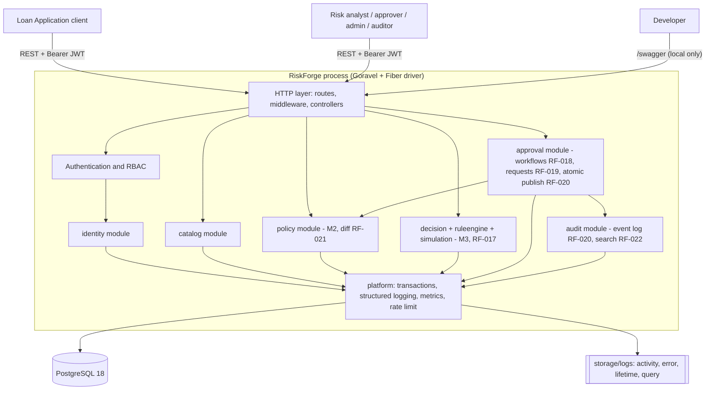
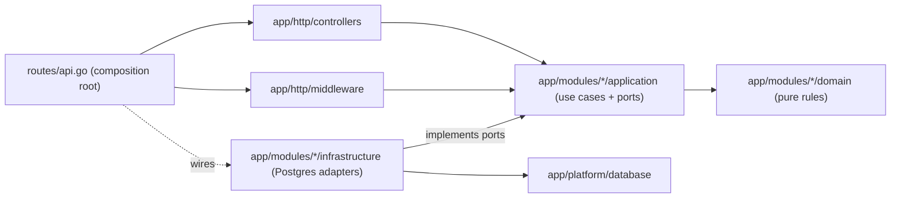
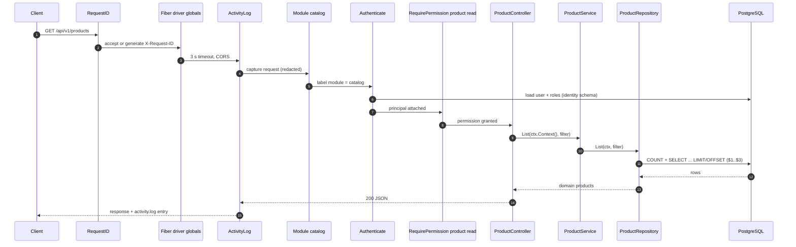
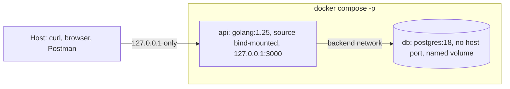
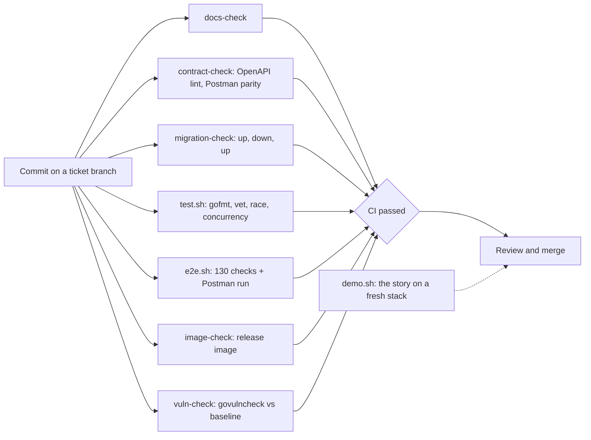

# Architecture

RiskForge is a **modular monolith**: one Go process (Goravel v1.18 with the official Fiber HTTP driver) and one PostgreSQL 18 database. Business capabilities live in separate modules with explicit boundaries, so they can be reasoned about and tested independently without the operational cost of microservices. The full target design is in `SYSTEM_DESIGN.md` sections 5 to 12; this page describes what runs today.

## High-level view

All modules in the diagram exist. `GET /metrics` and the rate limits (RF-023) belong to the HTTP layer and the platform box.

## Modules

| Module | Owns | Status | Code |
|---|---|---|---|
| `identity` | Users, roles, permission matrix, login | Implemented (RF-003) | `app/modules/identity` |
| `catalog` | Credit products (`KTA_DEMO`, ...) | Implemented (RF-004) | `app/modules/catalog` |
| `dictionary` | Input variables and derived features: typed definitions, append-only versions, one schema version | Implemented (RF-005), with the feature builder `BuildFeatures` for derived values (RF-011) | `app/modules/dictionary` |
| `policy` | Policy packages and versioned drafts with frozen, checksummed snapshots | Implemented (RF-006), with RAC rules (RF-007), scorecard (RF-008), decision matrix (RF-009), and test cases with full validation (RF-010); the test cases are executed through the decision pipeline, with the evaluator `CompilePolicy` (RF-013) | `app/modules/policy` |
| `ruleengine` | Pure compile/validate/evaluate. Today: `Analyze` checks RAC expressions (syntax, allowed subset of the `expr` language, known variables, boolean result) | Checking (RF-007), RAC evaluation (RF-012), and scorecard and matrix evaluation (RF-013) implemented | `app/modules/ruleengine` |
| `decision` | Decision API: resolves the active policy, evaluates an application, returns the decision with its trace | `POST /decisions/evaluate` (RF-014) with durable runs, traces, and idempotency, and `GET /decisions/{id}` (RF-015) implemented, with the compiled policy cache (RF-016) | `app/modules/decision` |
| `simulation` | Policy simulator: evaluates one applicant against any version with the Decision API's evaluation core (`decision/infrastructure.NewEvaluablePolicy`) and stores nothing. No tables. | `POST /policy-versions/{version_id}/simulate` implemented (RF-017) | `app/modules/simulation` |
| `approval` | Approval workflow configuration (one workflow per product and policy scope, append-only versions of sequential steps with role, scope, quorum) and approval requests: submit opens a request pinned to the policy checksum and workflow version; the state machine records approver actions on the active step. Calls the policy module through a port. | Workflow configuration (RF-018) and state machine (RF-019) implemented, schema `approval`: `workflow_definitions`, `workflow_versions`, `workflow_steps`, `requests`, `actions`; the last approval publishes the version in the same transaction (RF-020); the review endpoint returns the policy diff (RF-021) | `app/modules/approval` |
| `audit` | Append-only domain event log (`audit.events`): who, when, action, entity, identifiers only | Event log written in the same transaction as the change: publication (RF-020, `POLICY_VERSION_PUBLISHED`) and workflow configuration (`APPROVAL_WORKFLOW_CREATED`, `APPROVAL_WORKFLOW_VERSION_CREATED`, M4 review), and the approval history (`APPROVAL_REQUEST_OPENED`, `APPROVAL_ACTION_RECORDED`, `APPROVAL_REQUEST_CLOSED`, RF-022); `GET /audit/events` searches it, and `GET /audit/decisions` lists stored decisions through the decision module (RF-022) | `app/modules/audit` |
| `platform` | Transaction manager, query logging, structured logs, metrics registry (`GET /metrics`), token bucket rate limiter | Implemented (metrics and rate limit in RF-023) | `app/platform` |

Each PostgreSQL schema belongs to one module (`identity`, `catalog`, `dictionary`, `policy`, `approval`, `decision`, `audit`). A module never queries another module's tables; cross-module calls go through application interfaces.

## Layers and dependency direction

Rules that keep the boundaries honest:

- `domain/` and `application/` import no Goravel, Fiber, HTTP, or SQL packages, so their unit tests run without booting the framework. Each review checks the imports.
- Controllers only translate HTTP into a use-case call and back. They pass `ctx.Context()`, never the Fiber-backed `http.Context`, because the driver returns that object to a pool when the handler ends.
- Repositories get their query handle from `database.Manager.Querier(ctx)`, which returns the transaction carried by `ctx` when there is one. A repository can therefore never write outside the current business transaction by accident.
- `routes/api.go` is the only place that constructs concrete adapters and wires them into services.

## Request lifecycle

What happens on `GET /api/v1/products` with a valid token:

Failures short-circuit with the standard error envelope and the same `request_id`:

| Where | Result |
|---|---|
| No or invalid token | `401 UNAUTHENTICATED` from `Authenticate` (roles are re-read from the database on every request, so a disabled user is rejected immediately). |
| Missing permission | `403 FORBIDDEN` from `RequirePermission`. Without `Authenticate` in front it fails closed with `401`. |
| Invalid input | `422 INPUT_VALIDATION_ERROR` with per-field `details`. |
| Unknown route (any method) | `404 ROUTE_NOT_FOUND` from the fallback handler. |
| Panic | `500 INTERNAL_ERROR`; `middleware.Recover` writes the stack trace to `error.log` without headers or body. |
| Login while bcrypt slots are full | `503 SERVICE_BUSY` with `Retry-After` (ADR 0003). |
| Body over 64 KiB / request over 3 s | `413` / `408` plain text from the Fiber driver. |

## Transactions and concurrency

- `tx.Manager.WithinTransaction(ctx, fn)` (port in `app/platform/tx`, Goravel adapter in `app/platform/database`) commits when `fn` returns nil and rolls back on an error or panic. Nested calls join the outer transaction.
- Read-modify-write uses row locks: product updates run `SELECT ... FOR UPDATE` inside the transaction, so concurrent updates to different fields do not overwrite each other.
- Uniqueness is enforced by the database (`UNIQUE` plus `ON CONFLICT DO NOTHING`), so concurrent creates of the same product code produce exactly one row and a `409` for the rest.
- Both behaviours are covered by concurrency tests under `-race` ([TESTING.md](TESTING.md)).

## Cross-cutting concerns

| Concern | Implementation | Reference |
|---|---|---|
| Authentication | Goravel JWT guard (HS256), 60-minute tokens, user ID only in the token | ADR 0002 |
| Authorization | Permission matrix per role; separation of duties tested | ADR 0002, `permission.go` |
| Password hashing | bcrypt cost 12 behind a semaphore | ADR 0003 |
| Correlation | `X-Request-ID` echoed or generated, carried into every log type | `middleware/request_id.go` |
| Structured logs | `activity.log`, `error.log`, `lifetime.log`, `query.log` per module, redacted | ADR 0004, `SYSTEM_DESIGN.md` 15.4 |
| Configuration | Environment variables; startup refuses weak or unsafe values | `app/support/config_validator.go` |
| API contract | OpenAPI 3.1, Swagger UI (local only), generated Postman collection, parity test | ADR 0005 |

## Runtime topology

Every developer, agent, or test run uses its own Compose project name (`rf-dev`, `rf-test-<ticket>`), so networks and database volumes never collide. The release image (`Dockerfile`) is a static binary on Alpine running as a non-root user, without `.env`, docs assets, or the API spec.
## From a change to a verified release
Every check is a script, and the CI workflow and your machine run the same ones (`./scripts/ci.sh`, [CI.md](CI.md)). Each gate that needs a database creates its own Compose project and removes only that project.

