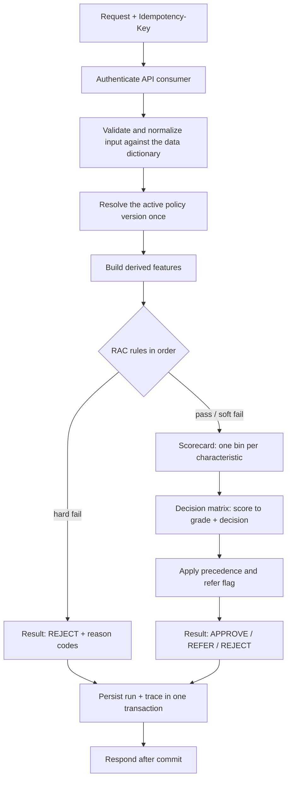

# Decision engine

> **Status: Implemented (milestone 3).** The evaluation core is implemented as pure functions (feature builder RF-011, RAC RF-012, scorecard, matrix, precedence, and golden test execution RF-013); the Decision API is implemented (RF-014: `POST /decisions/evaluate`), with durable decisions and idempotency (RF-015: `Idempotency-Key`, `GET /decisions/{decision_id}`) and the compiled policy cache (RF-016). The policy simulator (RF-017, `POST /policy-versions/{version_id}/simulate`) runs this same core on a draft or any version and stores nothing; publishing (RF-018 to RF-020) is still to come in milestone 4. This page is the engineering specification for milestone M3 (RF-011 to RF-016), distilled from `SYSTEM_DESIGN.md` sections 8, 10, 12, and 20. The configuration side is implemented and marked where it applies: RAC expressions are checked by `app/modules/ruleengine` (RF-007), scorecard bins and matrix rows are validated (RF-008, RF-009), and golden test cases are stored and checked statically (RF-010).

The engine turns one loan application plus one immutable policy version into one decision and a complete trace. It is the part of RiskForge that is not CRUD: correctness, determinism, and explainability matter more than speed.

## Design constraints

| Constraint | Consequence |
|---|---|
| **Pure** | `ruleengine` takes typed facts and a compiled policy and returns a result. No HTTP, SQL, clock, randomness, or network. The simulator and the live API call the same code. |
| **Deterministic** | Same input + same policy version = same output, byte for byte. Rules run in a declared order; decimal maths with explicit scale; no floating point for money. |
| **Compiled before activation** | Expressions (`expr-lang/expr`) are parsed and type-checked when a policy is validated. A policy that fails to compile can never become active. Runtime executes only precompiled programs. |
| **Sandboxed** | Expressions see an allowlist of variables and functions. No I/O, no database access, no arbitrary code. |
| **Explainable** | Every evaluated rule, selected bin, score contribution, and the policy version and checksum are part of the result and stored with the run. |
| **Errors are not decisions** | A technical failure never becomes `REJECT`. |

## Pipeline



The active version is resolved once at the start; a publish during evaluation does not change the version a run uses.

## Stage by stage

### 1. Input validation

Inputs are checked against the data dictionary before any rule runs.

| Input problem | Outcome |
|---|---|
| Required field missing, `null`, or wrong type | `INPUT_VALIDATION_ERROR` (422) |
| `monthly_income <= 0` | `INPUT_VALIDATION_ERROR`; never a division by zero |
| Negative age, tenure, or amount | `INPUT_VALIDATION_ERROR` |
| Money sent as a JSON number | Rejected or normalized explicitly; amounts are decimal strings (`"12000000.00"`) to avoid float precision loss |

### 2. Derived features

Computed by a feature builder, not by free-form expressions:

- `dsr_ratio = existing_installment / monthly_income` as a ratio in `[0, ∞)`, not a percentage. Full precision is kept; rounding happens only for display.
- `net_disposable_income = monthly_income - existing_installment`.

Derived values and their formula version are written to the trace so a run can be replayed. These formulas are synthetic examples, not a banking standard.

**Implemented (RF-011).** `domain.BuildFeatures(dictionary, input)` in `app/modules/dictionary/domain/feature.go` validates the input and computes every `DERIVED` variable of the dictionary. It is pure Go and uses exact fractions (`math/big.Rat`), so `2500000 / 12000000` is `5/24` and displays as `0.208333`; only `Display()` rounds, and rules compare the exact value. Each `FeatureValue` carries its formula version, expression, unit, exact value, and display value.

| Situation | Result |
|---|---|
| `monthly_income <= 0` | `InputError` `must_be_positive`; no division happens |
| `existing_installment < 0` | `InputError` `must_not_be_negative` |
| Missing, `null`, wrong type, out of range, too many decimals | `InputError` with the `ValidateInput` issue |
| The applicant sends `dsr_ratio` or `net_disposable_income` | `InputError` `derived_not_allowed` |
| A derived variable has no formula, or a formula input is missing, optional, derived, or not numeric | `ErrFeatureConfiguration` (a policy configuration fault, not the caller's) |

The formulas are code with a version, not database rows (ADR 0012). `domain.BuildFacts` wraps the builder and turns the result into the facts the RAC evaluator reads (RF-012). The scorecard and matrix (RF-013) and the Decision API (RF-014) are the other callers still to come. Limits are listed in [M3_NOTES.md](M3_NOTES.md).

### 3. RAC (Risk Acceptance Criteria)

Each rule has a `rule_code`, a boolean expression that must hold to pass, an action on failure (`REJECT` or `REFER`), a stable `reason_code`, and an order.

| Code | Pass when | On fail | Reason |
|---|---|---|---|
| `RAC_MIN_AGE` | `age_years >= 21` | `REJECT` | `AGE_BELOW_MINIMUM` |
| `RAC_BLACKLIST` | `is_blacklisted == false` | `REJECT` | `BLACKLISTED` |
| `RAC_SLIK` | `slik_max_kol <= 2` | `REFER` | `SLIK_REVIEW_REQUIRED` |

- Rules run in their declared order.
- A **hard fail** (`REJECT`) stops evaluation after recording the traces already produced. Scoring does not run.
- A **soft fail** (`REFER`) sets `refer_flag = true`, records the reason, and continues to scoring.
- An expression that errors at runtime is an `EVALUATION_ERROR`, not a failed rule.

**Managing rules (implemented, RF-007).** An analyst edits the rules of a draft with `GET` and `PUT /api/v1/policy-versions/{version_id}/rac-rules`. The array order is the order above, and every list is checked before it is stored. The expression language is a small allowlist of the `expr` language: comparisons, `and` / `or` / `not`, arithmetic, `in` with a list of numbers or booleans, number and boolean literals, `nil`, parentheses, and dictionary variable names. Function calls, strings, member access, conditionals, and everything else are refused, so an expression cannot do anything except compute a yes or no from the applicant's values. Each expression must be a boolean over variables that exist in the dictionary version the draft is pinned to. Submitting a draft checks the rules again and freezes them in the snapshot.

**Evaluation (implemented, RF-012).** `ruleengine.CompileRules` compiles an ordered rule list once and `CompiledRules.Evaluate(facts)` runs it. It is pure Go with exact fractions (`math/big.Rat`), so `0.1 + 0.2 == 0.3` is true and `dsr_ratio <= 0.3` has no rounding error; a decimal literal such as `0.3` is read from the text, not from a float. The result (`RACResult`) holds the outcome, the refer flag, the reason codes, and one trace entry per evaluated rule with the values it used.

| Situation | Result |
|---|---|
| All rules pass | `PASS`, no reason codes |
| A `REFER` rule fails | `REFER`, `ReferFlag` set, evaluation continues |
| A `REJECT` rule fails | `REJECT`, evaluation stops; later rules are listed as not evaluated; an earlier soft fail keeps the flag and its reason code |
| `nil` | Equal only to `nil`; any other use (`<`, `+`, `and`) is an evaluation error. `x == nil or x > 3` is safe because `and`/`or` short-circuit |
| Missing or mistyped fact, division by zero, non-boolean result | `EvaluationError` (`EVALUATION_ERROR`), no outcome, the finished rules kept in `Partial`. Never a `REJECT` |
| A rule that does not compile | `CompileError` (`POLICY_CONFIGURATION_ERROR`) |

`dictionary/domain.BuildFacts` produces the facts (validated input, features, optional variables as `nil`). The decision pipeline that calls all this is RF-014; scoring and precedence are RF-013. Details: ADR 0013 and [M3_NOTES.md](M3_NOTES.md).

### 4. Scorecard

`total_score = base_score + Σ points of the selected bin of each characteristic`

| Characteristic | Example bin | Points |
|---|---|---|
| (base) | | 350.00 |
| `age_group` | 25 to 45 years | +85.00 |
| `dsr_ratio` | up to 0.30 | +150.00 |
| `employment_tenure` | 24 months or more | +100.00 |

- Exactly **one** bin matches per characteristic. Bins use half-open intervals `[min, max)`, with the last upper bound documented.
- Zero or several matching bins is a `POLICY_CONFIGURATION_ERROR`. Pre-publish validation rejects overlapping bins and gaps, so this should never happen in production.
- Points are `NUMERIC(12,2)` with deterministic rounding.

**Managing the scorecard (implemented, RF-008).** An analyst edits the scorecard of a draft with `GET`, `PUT`, and `DELETE /api/v1/policy-versions/{version_id}/scorecard`. Saving checks that the bins of every characteristic are listed in ascending order, meet edge to edge, and cover the whole valid range of the dictionary variable, so every application that passes input validation selects exactly one bin; zero or several matches cannot happen in a version that saved and submitted successfully. Points have two decimals and are added with exact decimal arithmetic, so no rounding happens at all: the total of two-decimal points is itself exact to two decimals. A characteristic may give explicit `missing_points` for an optional variable that is absent. The response shows `score_range`, the lowest and highest total the scorecard can produce. Nothing is scored yet: bin selection at decision time arrives with RF-013.

### 5. Decision matrix

Maps the total score to a grade and a decision. Supported domain `0` to `900` inclusive:

| Total score | Grade | Decision |
|---|---|---|
| `[0, 500)` | D | `REJECT` |
| `[500, 650)` | B | `REFER` |
| `[650, 901)` | A | `APPROVE` |

`901` is an exclusive bound so a score of 900 is included. The grades follow the design's illustrative dataset (`SYSTEM_DESIGN.md` 20.3), which uses three bands and skips C; a real policy defines its own bands. Ranges must be complete and non-overlapping; no matching row is a configuration error, **never a default APPROVE**.

**Managing the matrix (implemented, RF-009).** An analyst edits the matrix of a draft with `GET`, `PUT`, and `DELETE /api/v1/policy-versions/{version_id}/decision-matrix`. Rows follow the same `[min, max)` rule as scorecard bins and must be ascending and edge to edge. The supported score domain is the scorecard's own `score_range` (lowest to highest total it can produce), and when the draft has a scorecard the rows must cover it; submit checks this again, because the scorecard can change after the matrix. A version that saved and submitted therefore cannot produce a score without a row. Lookup and precedence at decision time arrive with RF-013.

### 6. Precedence

```
hard RAC REJECT  >  matrix REJECT  >  soft RAC REFER  >  matrix APPROVE / REFER
```

| RAC outcome | Matrix outcome | Final |
|---|---|---|
| Hard fail | (not evaluated) | `REJECT` |
| Pass | `REJECT` | `REJECT` |
| Soft fail (`refer_flag`) | `REJECT` | `REJECT` |
| Soft fail (`refer_flag`) | `APPROVE` | `REFER` |
| Pass | `REFER` | `REFER` |
| Pass | `APPROVE` | `APPROVE` |

## Evaluation and golden tests (implemented, RF-013)
`policy/domain.CompilePolicy(content, dictionary)` turns the content of one version into an immutable `CompiledPolicy`, and `Evaluate(facts)` runs stages 3 to 6 above on facts from `dictionary/domain.BuildFacts`. It is pure Go, exact (`big.Rat`), and safe for concurrent use.

| Step | What happens |
|---|---|
| RAC | `ruleengine` runs the rules (RF-012). A hard fail ends the run: `REJECT`, no score, no grade. |
| Scorecard | For each characteristic in order, the bin that contains the fact (`[min, max)`) adds its points; a null fact uses `missing_points`. The total is `base_score` plus the points, exact, shown with two decimals. The trace lists each characteristic, the value read, the bin, and its points. |
| Matrix | The row that contains the total gives the grade and a decision. |
| Precedence | `domain.Precedence`: hard RAC `REJECT` > matrix `REJECT` > soft RAC `REFER` > matrix `APPROVE`/`REFER`. |

Failures are errors, never `REJECT`. A fact the scorecard needs that is missing or not a number is a `ScoringError` (`EVALUATION_ERROR`). A value that no bin or matrix row contains, a null with no `missing_points`, or a policy that does not compile wraps `ErrPolicyConfiguration` (`POLICY_CONFIGURATION_ERROR`). Matrix rows carry no reason code, so a matrix `REJECT` or `REFER` has an empty `ReasonCodes`; the grade, score, and matrix row in the result explain it.

**Golden tests.** `POST .../validate` and submit run every stored test case through this pipeline (`domain.RunTestCases`), using the same input validation and feature builder as a real request:

| Expected | Passes when |
|---|---|
| `DECISION` | The input is accepted, the final decision is equal, the reason codes are the same set (a case that lists none expects none), and the grade is equal when the case names one |
| `INPUT_VALIDATION_ERROR` | The input is refused (dictionary rules or feature preconditions such as `monthly_income > 0`) |

A required case that fails is an issue (`decision_mismatch`, `grade_mismatch`, `reason_codes_mismatch`, `input_rejected`, `validation_error_not_raised`, `evaluation_failed`) and blocks submit; an optional case that fails is reported in `golden_tests` only. A technical failure is never a pass. When another validation check already failed, the cases are not executed and `pending_checks` says so. Limits: [M3_NOTES.md](M3_NOTES.md).

## Decision API (implemented, RF-014)
`POST /api/v1/decisions/evaluate` (permission `decision:evaluate`, the API consumer) runs the pipeline above for one application. Steps in order:

1. Check the request: `application_id`, `product_code`, and an `applicant` object (unknown top-level keys are refused).
2. Resolve the active policy **once**: product (404 if unknown, 409 `POLICY_NOT_ACTIVE` if retired), then the version its active binding points to (one small query, on every decision). The compiled policy for that version comes from the in-memory cache; only a miss reads the frozen snapshot, verifies its checksum, and compiles it (see "Compiled policy cache"). The content tables are not read.
3. Validate the applicant against the dictionary of that snapshot and build the derived features. Invalid data, unknown keys, and a derived value sent by the caller are 422 `INPUT_VALIDATION_ERROR` with every problem listed (`applicant.<variable>`).
4. Evaluate RAC, scorecard, matrix, and precedence (`CompiledPolicy.Evaluate`).
5. Return `200` with the decision and its trace: the policy version (`id`, `number`, `checksum`), `final_decision`, `risk_grade`, `total_score`, `reason_codes`, `derived_features` (exact value and formula version), `rac_results` with the values each rule used, `rac_not_evaluated`, `score_breakdown`, and the `matrix` row.

| Situation | Response |
|---|---|
| Decision made (`APPROVE`, `REFER`, `REJECT`) | `200` |
| Invalid request or applicant data | `422 INPUT_VALIDATION_ERROR` (never a `REJECT`) |
| Unknown product | `404 PRODUCT_NOT_FOUND` |
| Retired product, or no active version (a draft or pending version is never evaluated) | `409 POLICY_NOT_ACTIVE` |
| Active policy cannot be evaluated | `500 POLICY_CONFIGURATION_ERROR` |
| Technical failure while evaluating | `500 EVALUATION_ERROR` |

Error responses never carry a decision. The cause of a `500` is in `error.log`, not in the response.

**Stored once per key (RF-015).** The decision is stored with a `decision_id` and replayed for a repeated `Idempotency-Key`; see "Idempotency and persistence" below.

**How a policy becomes active.** Publishing needs the approval workflow (M4). Until then, `./artisan db:seed` runs `DemoActivePolicySeeder` in local and testing environments: it submits the complete demo draft through the normal policy service and binds it as active in one transaction. See ADR 0015. A database whose first demo draft is not complete (an old `rf-dev`) is left alone, and `evaluate` answers `409` there.

## Worked runs

| Scenario | Input change from baseline | RAC | Score | Final |
|---|---|---|---|---|
| Baseline | age 29, income 12M, installment 2.5M, tenure 36, kol 1, not blacklisted | all pass | 350+85+150+100 = 685 → A | `APPROVE` |
| Under age | `age_years = 19` | `RAC_MIN_AGE` hard fail | not computed | `REJECT` (`AGE_BELOW_MINIMUM`) |
| Blacklisted | `is_blacklisted = true` | `RAC_BLACKLIST` hard fail | not computed | `REJECT` (`BLACKLISTED`) |
| Needs review | `slik_max_kol = 3` | `RAC_SLIK` soft fail | 685 → A | `REFER` (`SLIK_REVIEW_REQUIRED`) |
| Zero income | `monthly_income = "0"` | not run | not run | `422 INPUT_VALIDATION_ERROR` |

Scores for other bins depend on the full scorecard defined in RF-008; only the bins above are fixed by the design.

## Result shape (target contract)

```json
{
  "decision_id": "dec_demo_0001",
  "application_id": "LOAN-APP-DEMO-0001",
  "product_code": "KTA_DEMO",
  "policy_version": "1.0",
  "status": "COMPLETED",
  "final_decision": "APPROVE",
  "risk_grade": "A",
  "total_score": "685.00",
  "reason_codes": [],
  "rac_results": [{"rule_code": "RAC_MIN_AGE", "passed": true}, {"rule_code": "RAC_BLACKLIST", "passed": true}],
  "score_breakdown": [
    {"characteristic": "age_group", "bin": "25_to_45", "points": "85.00"},
    {"characteristic": "dsr_ratio", "bin": "up_to_30_pct", "points": "150.00"},
    {"characteristic": "employment_tenure", "bin": "24_months_or_more", "points": "100.00"}
  ]
}
```

Scores and points are decimal strings. `status` is the processing state (`COMPLETED`, `FAILED`); `final_decision` is the business result.

## Business results versus errors

| Category | Values | Meaning |
|---|---|---|
| Business result | `APPROVE`, `REFER`, `REJECT` | The policy was evaluated successfully. |
| Processing state | `RECEIVED`, `COMPLETED`, `FAILED` | Internal lifecycle of a run. |
| Errors | `INPUT_VALIDATION_ERROR`, `POLICY_NOT_ACTIVE`, `POLICY_CONFIGURATION_ERROR`, `EVALUATION_ERROR`, `IDEMPOTENCY_CONFLICT`, `FORBIDDEN`, `RATE_LIMITED` (`429`), `SERVICE_BUSY` (`503`, retriable) | No valid business decision was produced. |

A PostgreSQL failure, parser error, timeout, or bug is an error response, never `REJECT`: otherwise an outage becomes a wrong credit decision about a person.

## Idempotency and persistence

- The key is scoped to `(api_client_id, idempotency_key)`, and the request payload hash is stored with it.
- Same key + same payload: the stored decision is returned without re-evaluating.
- Same key + different payload: `409 IDEMPOTENCY_CONFLICT`.
- A duplicate arriving while the first is in flight waits briefly or gets a retriable conflict. There are never two runs for one key.
- The run, result, and trace commit in one transaction, and the response is sent only after the commit.

**Implemented (RF-015).** `POST /decisions/evaluate` requires the `Idempotency-Key` header. In one transaction it claims the key (an `INSERT ... ON CONFLICT DO NOTHING` on the unique `(client_id, idempotency_key)`), resolves the active policy, evaluates, and stores the run and one trace row per evaluated rule in `decision.requests`, `decision.runs`, and `decision.rule_traces`. The tables are append-only, and a run carries the policy version and checksum that made it, plus the normalized input.

| Request | Result |
|---|---|
| New key | Evaluated and stored; `200` with `decision_id` and `created_at` |
| Same key, same request (key order and white space do not matter) | The stored decision, byte for byte, with the header `Idempotent-Replayed: true`. Nothing is evaluated and the active policy is not consulted, so it still works after the policy changed |
| Same key, different request | `409 IDEMPOTENCY_CONFLICT` |
| Duplicate while the first is still running | Waits for the first for at most 2 seconds (`lock_timeout` on the claim) and returns its decision; after that the answer is `503 SERVICE_BUSY` with `Retry-After: 1`, nothing is stored, and a retry with the same key returns the stored decision. Never a second run |
| Any request that gives no decision (422, 404, 409, 500) | Rolled back with its key. The key stays free, so a corrected retry is evaluated |

The key belongs to the calling user (there are no API clients yet). `GET /decisions/{decision_id}` returns a stored decision as it was returned: the consumer reads its own, an auditor reads all, anyone else gets `404 DECISION_NOT_FOUND`. Details: ADR 0016 and [M3_NOTES.md](M3_NOTES.md).

## Compiled policy cache

- Keyed by `policy_version_id` + checksum, which are immutable, so entries never need invalidation.
- Each decision reads the small, indexed active-version pointer from PostgreSQL, then uses the in-memory compiled policy. No Redis.
- A missing entry is loaded and compiled once, concurrency-safely.

**Implemented (RF-016).** `decision/infrastructure.PolicyResolver` keeps compiled policies in a small LRU (64 entries) keyed by `(version id, checksum)`. Every decision first reads which version the binding points to; a hit returns the shared immutable policy, and a miss loads and compiles the snapshot once even if many requests miss together (single-flight).

| Situation | Behaviour |
|---|---|
| Publish (binding moves to a new version) | The next decision uses the new version; no invalidation is needed because the key is another version. A run that already resolved the old version finishes with it. |
| Product retired, or binding removed | Seen on the next decision, because the pointer is read every time |
| Replay of an earlier request | Returns the stored decision; the cache and the policy are not consulted |
| Snapshot that cannot be read or compiled | One load, then the same configuration error from memory (500 `POLICY_CONFIGURATION_ERROR`); fixed only by a new version |
| Database failure while loading | Returned to the waiting requests and not remembered; the next request tries again |
| The request that was loading is cancelled | A waiting request takes over the load instead of failing |
| More than 64 versions | The least recently used entry is dropped and loaded again if asked for |

An informal benchmark on one machine (no database latency, not a baseline): about 133 µs per decision on a warm cache against about 571 µs when the snapshot is compiled each time. On a live stack the query log shows the first decision reading the snapshot and the next ones not. ADR 0017.

## Edge cases the tests must cover

From `SYSTEM_DESIGN.md` 12 (golden cases for `KTA_DEMO`):

1. Happy path → `APPROVE`.
2. Age under the RAC threshold → hard `REJECT`.
3. `is_blacklisted = true` → hard `REJECT`.
4. Soft RAC fail with a high score → `REFER`.
5. Total score exactly on each matrix boundary (499.99/500.00, 649.99/650.00, 900.00).
6. Missing, `null`, or wrong-type input → validation error.
7. `monthly_income = 0` → validation error, no division by zero.
8. Overlapping bins or a matrix gap → policy fails validation and cannot be published. (Implemented: RF-008 to RF-010.)

**Storing the golden cases (implemented, RF-010).** Cases 1 to 4, 6, and 7 are stored with the demo policy as test cases (`GET`/`PUT /api/v1/policy-versions/{version_id}/test-cases`) with their expected outcome. Each case is checked when it is saved: its references must exist and its input is run against the data dictionary and the feature builder, so a validation-error case must really be refused and a decision case accepted. Since RF-013, `POST .../validate` and submit also **execute** every case through this engine (see "Evaluation and golden tests" below) and failing required cases block submit.
9. Simulating a draft does not affect decisions made with the active version. (Implemented: RF-017, `TestSimulatingADraftWritesNothingAndLeavesTheActivePolicyAlone`.)
10. Re-evaluating the same input and policy snapshot gives the same output.

Plus: concurrent duplicate requests with one idempotency key produce one run; a publish during evaluation does not change the version a run uses.
