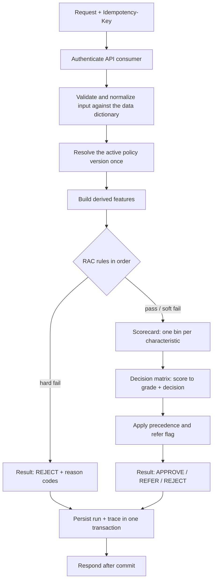

# Decision engine

> **Status: Planned behavior.** Nothing on this page is implemented yet. It is the engineering specification for milestone M3 (RF-011 to RF-016), distilled from `SYSTEM_DESIGN.md` sections 8, 10, 12, and 20. Implemented pieces will be marked here as tickets land. `app/modules/ruleengine` is currently an empty placeholder.

The engine turns one loan application plus one immutable policy version into one decision and a complete trace. It is the part of RiskForge that is not CRUD: correctness, determinism, and explainability matter more than speed.

## Design constraints

| Constraint | Consequence |
|---|---|
| **Pure** | `ruleengine` takes typed facts and a compiled policy and returns a result. No HTTP, SQL, clock, randomness, or network. The simulator and the live API call the same code. |
| **Deterministic** | Same input + same policy version = same output, byte for byte. Rules run in a declared order; decimal maths with explicit scale; no floating point for money. |
| **Compiled before activation** | Expressions (`expr-lang/expr`) are parsed and type-checked when a policy is validated. A policy that fails to compile can never become active. Runtime executes only precompiled programs. |
| **Sandboxed** | Expressions see an allowlist of variables and functions. No I/O, no database access, no arbitrary code. |
| **Explainable** | Every evaluated rule, selected bin, score contribution, and the policy version and checksum are part of the result and stored with the run. |
| **Errors are not decisions** | A technical failure never becomes `REJECT`. |

## Pipeline



The active version is resolved once at the start; a publish during evaluation does not change the version a run uses.

## Stage by stage

### 1. Input validation

Inputs are checked against the data dictionary before any rule runs.

| Input problem | Outcome |
|---|---|
| Required field missing, `null`, or wrong type | `INPUT_VALIDATION_ERROR` (422) |
| `monthly_income <= 0` | `INPUT_VALIDATION_ERROR`; never a division by zero |
| Negative age, tenure, or amount | `INPUT_VALIDATION_ERROR` |
| Money sent as a JSON number | Rejected or normalized explicitly; amounts are decimal strings (`"12000000.00"`) to avoid float precision loss |

### 2. Derived features

Computed by a feature builder, not by free-form expressions:

- `dsr_ratio = existing_installment / monthly_income` as a ratio in `[0, ∞)`, not a percentage. Full precision is kept; rounding happens only for display.
- `net_disposable_income = monthly_income - existing_installment`.

Derived values and their formula version are written to the trace so a run can be replayed. These formulas are synthetic examples, not a banking standard.

### 3. RAC (Risk Acceptance Criteria)

Each rule has a `rule_code`, a boolean expression that must hold to pass, an action on failure (`REJECT` or `REFER`), a stable `reason_code`, and an order.

| Code | Pass when | On fail | Reason |
|---|---|---|---|
| `RAC_MIN_AGE` | `age_years >= 21` | `REJECT` | `AGE_BELOW_MINIMUM` |
| `RAC_BLACKLIST` | `is_blacklisted == false` | `REJECT` | `BLACKLISTED` |
| `RAC_SLIK` | `slik_max_kol <= 2` | `REFER` | `SLIK_REVIEW_REQUIRED` |

- Rules run in their declared order.
- A **hard fail** (`REJECT`) stops evaluation after recording the traces already produced. Scoring does not run.
- A **soft fail** (`REFER`) sets `refer_flag = true`, records the reason, and continues to scoring.
- An expression that errors at runtime is an `EVALUATION_ERROR`, not a failed rule.

**Managing rules (implemented, RF-007).** An analyst edits the rules of a draft with `GET` and `PUT /api/v1/policy-versions/{version_id}/rac-rules`. The array order is the order above, and every list is checked before it is stored. The expression language is a small allowlist of the `expr` language: comparisons, `and` / `or` / `not`, arithmetic, `in` with a list of numbers or booleans, number and boolean literals, `nil`, parentheses, and dictionary variable names. Function calls, strings, member access, conditionals, and everything else are refused, so an expression cannot do anything except compute a yes or no from the applicant's values. Each expression must be a boolean over variables that exist in the dictionary version the draft is pinned to. Rules are checked, not run: nothing evaluates them until RF-012. Submitting a draft checks the rules again and freezes them in the snapshot.

### 4. Scorecard

`total_score = base_score + Σ points of the selected bin of each characteristic`

| Characteristic | Example bin | Points |
|---|---|---|
| (base) | | 350.00 |
| `age_group` | 25 to 45 years | +85.00 |
| `dsr_ratio` | up to 0.30 | +150.00 |
| `employment_tenure` | 24 months or more | +100.00 |

- Exactly **one** bin matches per characteristic. Bins use half-open intervals `[min, max)`, with the last upper bound documented.
- Zero or several matching bins is a `POLICY_CONFIGURATION_ERROR`. Pre-publish validation rejects overlapping bins and gaps, so this should never happen in production.
- Points are `NUMERIC(12,2)` with deterministic rounding.

### 5. Decision matrix

Maps the total score to a grade and a decision. Supported domain `0` to `900` inclusive:

| Total score | Grade | Decision |
|---|---|---|
| `[0, 500)` | D | `REJECT` |
| `[500, 650)` | B | `REFER` |
| `[650, 901)` | A | `APPROVE` |

`901` is an exclusive bound so a score of 900 is included. The grades follow the design's illustrative dataset (`SYSTEM_DESIGN.md` 20.3), which uses three bands and skips C; a real policy defines its own bands. Ranges must be complete and non-overlapping; no matching row is a configuration error, **never a default APPROVE**.

### 6. Precedence

```
hard RAC REJECT  >  matrix REJECT  >  soft RAC REFER  >  matrix APPROVE / REFER
```

| RAC outcome | Matrix outcome | Final |
|---|---|---|
| Hard fail | (not evaluated) | `REJECT` |
| Pass | `REJECT` | `REJECT` |
| Soft fail (`refer_flag`) | `REJECT` | `REJECT` |
| Soft fail (`refer_flag`) | `APPROVE` | `REFER` |
| Pass | `REFER` | `REFER` |
| Pass | `APPROVE` | `APPROVE` |

## Worked runs

| Scenario | Input change from baseline | RAC | Score | Final |
|---|---|---|---|---|
| Baseline | age 29, income 12M, installment 2.5M, tenure 36, kol 1, not blacklisted | all pass | 350+85+150+100 = 685 → A | `APPROVE` |
| Under age | `age_years = 19` | `RAC_MIN_AGE` hard fail | not computed | `REJECT` (`AGE_BELOW_MINIMUM`) |
| Blacklisted | `is_blacklisted = true` | `RAC_BLACKLIST` hard fail | not computed | `REJECT` (`BLACKLISTED`) |
| Needs review | `slik_max_kol = 3` | `RAC_SLIK` soft fail | 685 → A | `REFER` (`SLIK_REVIEW_REQUIRED`) |
| Zero income | `monthly_income = "0"` | not run | not run | `422 INPUT_VALIDATION_ERROR` |

Scores for other bins depend on the full scorecard defined in RF-008; only the bins above are fixed by the design.

## Result shape (target contract)

```json
{
  "decision_id": "dec_demo_0001",
  "application_id": "LOAN-APP-DEMO-0001",
  "product_code": "KTA_DEMO",
  "policy_version": "1.0",
  "status": "COMPLETED",
  "final_decision": "APPROVE",
  "risk_grade": "A",
  "total_score": "685.00",
  "reason_codes": [],
  "rac_results": [{"rule_code": "RAC_MIN_AGE", "passed": true}, {"rule_code": "RAC_BLACKLIST", "passed": true}],
  "score_breakdown": [
    {"characteristic": "age_group", "bin": "25_to_45", "points": "85.00"},
    {"characteristic": "dsr_ratio", "bin": "up_to_30_pct", "points": "150.00"},
    {"characteristic": "employment_tenure", "bin": "24_months_or_more", "points": "100.00"}
  ]
}
```

Scores and points are decimal strings. `status` is the processing state (`COMPLETED`, `FAILED`); `final_decision` is the business result.

## Business results versus errors

| Category | Values | Meaning |
|---|---|---|
| Business result | `APPROVE`, `REFER`, `REJECT` | The policy was evaluated successfully. |
| Processing state | `RECEIVED`, `COMPLETED`, `FAILED` | Internal lifecycle of a run. |
| Errors | `INPUT_VALIDATION_ERROR`, `POLICY_NOT_ACTIVE`, `POLICY_CONFIGURATION_ERROR`, `EVALUATION_ERROR`, `IDEMPOTENCY_CONFLICT`, `FORBIDDEN` | No valid business decision was produced. |

A PostgreSQL failure, parser error, timeout, or bug is an error response, never `REJECT`: otherwise an outage becomes a wrong credit decision about a person.

## Idempotency and persistence

- The key is scoped to `(api_client_id, idempotency_key)`, and the request payload hash is stored with it.
- Same key + same payload: the stored decision is returned without re-evaluating.
- Same key + different payload: `409 IDEMPOTENCY_CONFLICT`.
- A duplicate arriving while the first is in flight waits briefly or gets a retriable conflict. There are never two runs for one key.
- The run, result, and trace commit in one transaction, and the response is sent only after the commit.

## Compiled policy cache

- Keyed by `policy_version_id` + checksum, which are immutable, so entries never need invalidation.
- Each decision reads the small, indexed active-version pointer from PostgreSQL, then uses the in-memory compiled policy. No Redis.
- A missing entry is loaded and compiled once, concurrency-safely.

## Edge cases the tests must cover

From `SYSTEM_DESIGN.md` 12 (golden cases for `KTA_DEMO`):

1. Happy path → `APPROVE`.
2. Age under the RAC threshold → hard `REJECT`.
3. `is_blacklisted = true` → hard `REJECT`.
4. Soft RAC fail with a high score → `REFER`.
5. Total score exactly on each matrix boundary (499.99/500.00, 649.99/650.00, 900.00).
6. Missing, `null`, or wrong-type input → validation error.
7. `monthly_income = 0` → validation error, no division by zero.
8. Overlapping bins or a matrix gap → policy fails validation and cannot be published.
9. Simulating a draft does not affect decisions made with the active version.
10. Re-evaluating the same input and policy snapshot gives the same output.

Plus: concurrent duplicate requests with one idempotency key produce one run; a publish during evaluation does not change the version a run uses.
