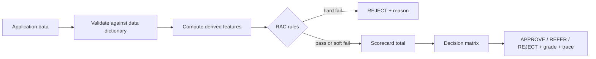
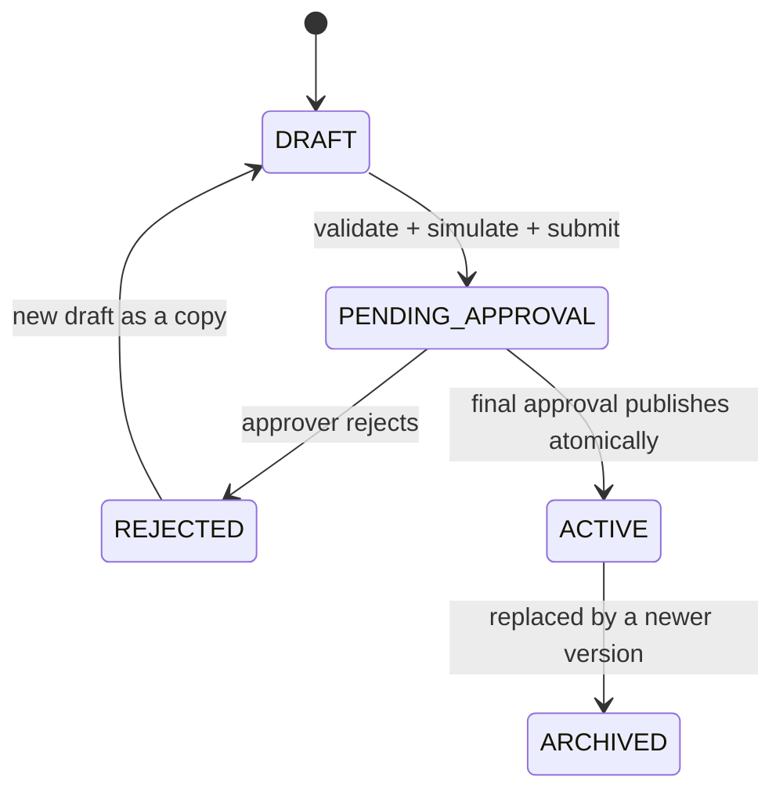

# Domain guide

The credit vocabulary RiskForge uses, explained for engineers who have never worked on a credit decision engine. All data is synthetic, and the numbers are illustrations, not a calibrated risk model.

## The problem

A lender's **Loan Application** system collects an applicant's data and must answer: approve, send to a human reviewer, or reject? The rules that answer this change often (new products, risk appetite, regulation). Hard-coding them means a code release for every rule change and no record of which rules decided a past application.

RiskForge separates the two:

- **Risk teams** maintain the rules as versioned **policies**, test them, and publish them through an approval workflow.
- **The Loan Application** sends applicant data to the decision API and receives a decision, together with the exact policy version and the reasoning (trace).

## Glossary

| Term | Meaning | Status |
|---|---|---|
| **Product** | A credit product the lender offers, identified by a stable code such as `KTA_DEMO` (unsecured personal loan). Policies are defined per product. | Implemented (RF-004) |
| **Role / permission** | Who may do what. Roles (`ADMIN`, `RISK_ANALYST`, `RISK_APPROVER`, `AUDITOR`, `API_CONSUMER`) grant permissions such as `product:write` or `approval:act`. | Implemented (RF-003) |
| **Data dictionary** | The typed contract of input variables (`age_years`, `monthly_income`, ...) and derived features (`dsr_ratio`). Each variable has a type (integer, decimal, boolean), a unit, a range, and flags for required and nullable. Changes are append-only versions, and one schema version numbers the whole dictionary so a past decision can be replayed against the definitions it used. Ranges are sanity limits; eligibility limits such as a minimum age are RAC rules. | Implemented (RF-005); derived formulas in code (RF-011) |
| **Derived feature** | A value computed from inputs, for example the debt service ratio (DSR) = `existing_installment / monthly_income`. | Implemented (RF-011); used by the decision and simulate endpoints |
| **RAC (Risk Acceptance Criteria)** | Knock-out rules checked first. Failing one gives a hard `REJECT` or a soft `REFER`, each with a reason code. | Rules can be written, ordered, and checked (RF-007); evaluated by the decision and simulate endpoints (RF-012, RF-014, RF-017) |
| **Scorecard** | Characteristics (age group, DSR, tenure) split into bins; each bin adds points to a base score. Bins are half-open intervals `[min, max)` that must cover every valid value exactly once, so each application lands in exactly one bin per characteristic. | Configured and checked (RF-008); scoring implemented (RF-013) |
| **Decision matrix** | Maps the total score to a risk grade and a decision (`APPROVE`, `REFER`, `REJECT`). Rows are score intervals `[min, max)` that must cover every total the scorecard can produce, so there is never a default decision. | Configured and checked (RF-009); lookup implemented (RF-013) |
| **Policy package / version** | One publishable unit: dictionary reference, RAC, scorecard, matrix, and test cases. A policy is the package for one product and scope; it has numbered versions. A version is a draft until it is submitted. Submitting freezes a canonical snapshot (including the dictionary definitions it was written against) with a SHA-256 checksum, and nothing about it changes afterwards. To revise it, clone it into a new draft. Submit refuses a version that is incomplete (no scorecard, no matrix, or no required test case) or whose content no longer validates. | Implemented (RF-006 to RF-010) |
| **Golden test case** | An example application stored with the policy and the result it must give: a decision (with optional grade and reason codes) or an input validation error. Required cases gate submit. | Stored and checked against the dictionary, RAC, and matrix (RF-010); executed through the whole policy at validate and submit (RF-013) |
| **Reason code** | A stable machine-readable code that explains an outcome, such as `AGE_BELOW_MINIMUM`. Messages can change; codes do not. | Implemented (RAC rules carry reason codes, returned by the decision API since RF-014) |
| **Maker-checker** | The person who submits a policy (maker) can never approve it (checker). | Enforced by the permission matrix and by the approval state machine (RF-019): the submitter cannot act on the request, and a database trigger refuses it as well |
| **Decision run** | One evaluation of one application against one policy version, stored with its input, result, and trace. | Implemented (RF-015) |
| **Idempotency key** | A client-supplied key that makes retries safe: the same key and payload return the same decision instead of evaluating twice. | Implemented (RF-015) |

## How a decision is made

The evaluation details, precedence rules, and edge cases are in [DECISION_ENGINE.md](DECISION_ENGINE.md).

## Worked example (synthetic `KTA_DEMO` policy)

From `SYSTEM_DESIGN.md` section 20:

| Input | Value |
|---|---|
| `age_years` | 29 |
| `monthly_income` | 12,000,000 IDR |
| `existing_installment` | 2,500,000 IDR |
| `employment_tenure_months` | 36 |
| `slik_max_kol` (simulated credit-bureau collectibility; no real SLIK connection) | 1 |
| `is_blacklisted` | false |

1. **Derived feature:** DSR = 2,500,000 / 12,000,000 = 0.2083 (ratio, not percent).
2. **RAC:** age ≥ 21 passes, not blacklisted passes, `slik_max_kol` ≤ 2 passes. No reject, no refer flag.
3. **Scorecard:** base 350 + age 25-45 (85) + DSR ≤ 0.30 (150) + tenure ≥ 24 months (100) = **685**.
4. **Matrix:** `[650, 901)` gives grade **A**, **APPROVE**.

If the same applicant had `slik_max_kol = 3`, the soft RAC rule `RAC_SLIK` would set the refer flag and the final decision would be **REFER** even with a score of 685. If `age_years = 19`, the hard rule `RAC_MIN_AGE` would end evaluation with **REJECT** and reason `AGE_BELOW_MINIMUM`.

## Policy lifecycle

- Only drafts can be edited. A submitted version is frozen by a checksum, and every approval refers to that exact content.
- Approval is multi-level (for example Risk Lead, then Head of Risk). The maker can never approve their own submission, and an approver cannot edit the draft under review.
- The last approval switches the active version, archives the previous one, and records the audit event in one database transaction.
- Every step of the approval (submit, each approval or rejection, the closing) is an audit event written in the transaction of that step. An auditor reads the history of a request with `GET /audit/events?aggregate_type=APPROVAL_REQUEST&aggregate_id=<request id>&order=asc`, and the results of past decisions with `GET /audit/decisions` (RF-022). The audit log holds identifiers and codes, not applicant data and not the approver's comment.
- Rolling back means publishing a new version copied from a known-good one, through the same approval process. History is never edited.

## What is a business result and what is an error

This distinction matters for customers and for incident response:

| Situation | Outcome |
|---|---|
| Rules evaluated successfully | Business result: `APPROVE`, `REFER`, or `REJECT`. |
| Input missing or of the wrong type, `monthly_income = 0` | `INPUT_VALIDATION_ERROR` (422), **not** `REJECT`. |
| No active policy, broken policy, database down, timeout | Technical error (409/500/503), **never** disguised as `REJECT`. |

Rejecting an applicant because a database timed out would turn an outage into a wrong credit decision about a real person.

## Who does what

| Role | Today | When policies exist |
|---|---|---|
| `ADMIN` | Creates and updates products; defines and versions dictionary variables; configures approval workflows (RF-018: versioned tiers with role, scope, and quorum); reads `GET /metrics` (RF-023, `metrics:read`). Cannot read policies. | Manages users and approval workflow configuration. Cannot approve policies or edit them. |
| `RISK_ANALYST` | Reads products; defines and versions dictionary variables; opens, edits, clones, validates, simulates (RF-017), and submits policy drafts, with their RAC rules, scorecard, decision matrix, and test cases. | Creates, edits, simulates, and submits drafts. Cannot approve. |
| `RISK_APPROVER` | Reads products, the dictionary, and the approval workflows (RF-018); approves or rejects the active tier of an approval request when they hold its scope (`RISK_LEAD`, `HEAD_OF_RISK`), never their own submission (RF-019). | Reviews diffs and approves or rejects. Cannot edit drafts. |
| `AUDITOR` | Reads products, the dictionary, policies and their versions, the approval workflows and requests, every stored decision with its trace, and the audit log and decision history (`GET /audit/events`, `GET /audit/decisions`, RF-022). Cannot read `GET /metrics`. | Reads decision traces and histories. Read-only everywhere. |
| `API_CONSUMER` (the Loan Application) | Evaluates applications (`POST /decisions/evaluate`) and reads its own decisions. No product or dictionary access. | Calls the decision API and reads its own decisions. |
